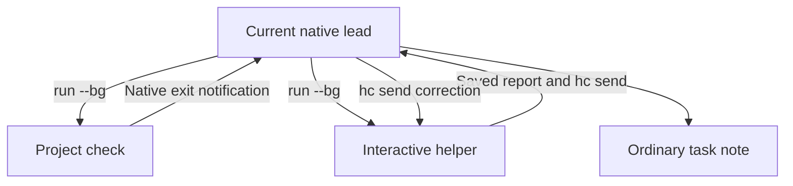

# Architecture

Sum owns working instructions; HC owns live terminals and native communication, Git owns source isolation, and the target project owns verification.
There is no Sum executable, registry, task database, receipt protocol, lifecycle engine, release staging, collector, or background service.

The approved task selects the role: an explicit bounded helper stays bounded, maintenance of Sum itself uses [Develop](../skills/sum-develop/SKILL.md), and operational coordination uses the native HC lead workflow.
Role selection precedes HC prerequisites and survives verification, review, finish, and resume.
Maintainers can work directly and use supported helpers in their current environment; actual HC operations retain native identity and lifecycle requirements.
In the operational workflow, the lead session stays free for messages.
It launches a native HC worker for implementation, investigation, builds, and CI, and steers that worker when a report arrives.
See [Work](../skills/sum-work/SKILL.md), [Review](../skills/sum-review/SKILL.md), [Finish](../skills/sum-finish/SKILL.md), and [Resume](../skills/sum-resume/SKILL.md).

The note and per-helper reports live outside disposable worktrees.
Native addresses are current observations, not durable conversation identity.
One lead per workspace and one writer per checkout are instructions, not hard locking.
Keep source stable for checks/review and use separate worktrees for concurrent writers.
[Native prerequisites](native-hc.md), [independent adoption](update.md), and [legacy boundaries](legacy.md) define operational limits.

## Delivery artifacts

The operational lead receives the builder report, launches a separate reviewer against the frozen candidate, and routes blocking findings back to the builder.
Maintainer delivery uses the same independent review and stable-candidate standards through the current environment's supported tools and reporting route, without mandatory HC dispatch or `hc send`.
Corrected inputs receive affected verification and review again.
The [PR template](../templates/pull-request.md) standardizes review summaries, prescribed-check status tables, and before/after evidence across harnesses.
Screenshots show visual changes; validated transcripts or HTTP responses show CLI/API changes.
The authorized delivery role publishes and reads back the PR artifacts against its current head.
These are delivery requirements implemented by the existing procedures, not a Sum runtime or a second task ledger.
