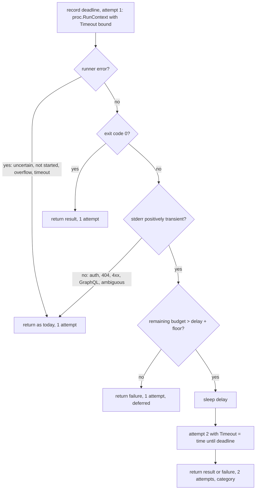

# Retry Read-Only GitHub Observations Once - Plan

## Goal Capsule

- **Objective:** A coordinator's `pr reconcile` or `sweep` stops failing on a single transient GitHub hiccup, while every failure that is not positively transient still surfaces as an uncertain observation and never as fabricated success.
- **Means:** One narrowly classified retry inside the two read-only `gh` observations owned by `go/internal/prcmd`, both attempts under the one existing bound (KTD1, KTD2).
- **Authority:** GitHub issue douglasjarquin/sum#297 defines scope and acceptance; the worker brief for t-aaf763d38ce4 fixes the lane (`go/internal/prcmd` plus docs) and the no-comments rule.
- **Stop conditions:** Any change that would retry a write, retry inside `go/internal/proc`, reset the deadline for attempt two, or touch another lane's package stops the work.
- **Execution profile:** Lightweight; one package, one new helper, tests the issue explicitly requests, feature-map and help-catalog rows.
- **Finish and ship:** The task worker commits on `sum/t-aaf763d38ce4`, runs the verify contract, opens a draft PR, and reports with a handoff; the coordinator reviews and the user merges.

---

## Product Contract

### Summary

Add a small read-only wrapper in `go/internal/prcmd` that runs one `gh` read, classifies a conclusively failed nonzero exit, and runs it exactly once more only for positively identified transient transport, server, or rate-limit conditions, with both attempts and any delay inside the caller's existing bound. Route `viewPR` and `observedVisibility` through it. Everything else, including the generic process runner and every write, stays single-attempt.

### Problem Frame

At the audit commit, `viewPR` in `go/internal/prcmd/pr.go` runs `gh pr view` once and returns an uncertain observation on any nonzero exit. A momentary 502 or a secondary rate limit therefore fails `pr reconcile`, marks the task `observe_failed_at`, and in `sweep` the next pass orders that task behind untried ones. The reconcile command also records observations, promotes drafts, and publishes blocks, so a retry around the whole command would repeat side effects.

### Requirements

**Retry boundary**

- R1. Exactly the read-only observations `viewPR` (`gh pr view --json`) and `observedVisibility` (`gh repo view --json visibility`) in `go/internal/prcmd` may make a second attempt; no other `gh` call in sum gains a retry.
- R2. A second attempt happens only after the first attempt completed conclusively with a nonzero exit whose stderr positively identifies a transient condition: an HTTP 5xx status line, HTTP 429, an explicitly worded secondary rate limit, or a verified connection, DNS, or TLS transport error.
- R3. Authentication and authorization failures, HTTP 404, every other 4xx, GraphQL application errors, malformed or oversized output, cancellation, timeouts, uncertain process or descendant outcomes, and ambiguous stderr are never retried.
- R4. The generic runner in `go/internal/proc` keeps its no-retry contract untouched.

**Deadline**

- R5. Both attempts and any delay between them run under the single existing bound `GHBound`; attempt two receives only the remaining budget and the bound is never reset.
- R6. A rate-limit delay that would not leave budget for a second attempt defers instead of overrunning: the observation fails after one attempt and says the retry was deferred for budget.

**Outcome truthfulness**

- R7. A persistent failure after two attempts returns an uncertain observation, never an empty result, green CI, merge confirmation, or fresh verification; the task's prior `pr` record and `observed_at` stay as recorded.
- R8. The error carries a sanitized category and the attempt count; it never carries tokens, credentials, or a response body, and the stderr excerpt is bounded.
- R9. Error classification by callers such as `sweep` keeps working: the wrapped error still unwraps to `proc.ErrUncertain`, `proc.ErrNotStarted`, or `proc.ErrOutputLimit` when the runner produced one.

**Proof and documentation**

- R10. Deterministic failure-injection tests prove each acceptance checkbox in the issue, including that writes and the generic runner are never repeated by this mechanism.
- R11. The feature maps and the `sumctl help pr` catalog text describe the exact retry boundary.

### Acceptance Examples

- AE1. **Covers R2, R5.** Given a fake `gh` whose first call exits 1 with `HTTP 502: Bad Gateway` and whose second call prints valid PR JSON, when `viewPR` runs, then it returns the parsed JSON and the fake was invoked exactly twice.
- AE2. **Covers R7, R8.** Given a fake `gh` that always exits 1 with `HTTP 503: Service Unavailable`, when `viewPR` runs, then it returns an error naming two attempts and the server-error category, no data, and the fake was invoked exactly twice.
- AE3. **Covers R3.** Given fakes that exit 1 with `HTTP 401: Bad credentials`, `HTTP 404: Not Found`, `GraphQL: Could not resolve to a PullRequest`, or `HTTP 403: Resource not accessible`, print truncated JSON, print oversized stdout, or sleep past the bound, when `viewPR` runs, then each fake was invoked exactly once and the error is the one the existing tests already pin where they pin it.
- AE4. **Covers R2, R6.** Given a fake that exits 1 with `HTTP 429: Too Many Requests` and a `GHBound` shorter than the rate-limit delay, when `viewPR` runs, then it fails after one attempt with a message that says the retry was deferred for budget; with a bound longer than the delay it attempts twice.
- AE5. **Covers R5.** Given a fake whose first call sleeps longer than `GHBound`, when `viewPR` runs, then it fails once with the runner's unchanged `timed out after` wording, the fake was invoked once, and the wall-clock time stays near one bound.
- AE6. **Covers R1, R4.** Given the fake from AE2, when `proc.RunContext` runs it directly, then it is invoked once; and a source-level check of `go/internal/prcmd` shows the retrying helper is called only from `viewPR` and `observedVisibility`.

### Scope Boundaries

- No retry around all of `pr reconcile`, around `pipeline.ObserveCI`, `pipeline.RemoteRepository`, `pipeline.MarkReady`, PR creation or editing, publication, push, merge, agent launches, or prompts.
- No backoff loop, polling, watcher, or daemon: at most one delay and one second attempt.
- Considered and not built: parsing a `Retry-After` header. `gh` does not surface it on stderr, so a fixed short delay is the smallest closing form; evidence of `gh` printing the header would reopen this.
- Considered and not built: retrying `EOF` or `connection reset` style errors. They can follow a partially applied request on other endpoints and are ambiguous as text; a verified list of `gh` transport error strings would reopen this.

### Deferred to Follow-Up Work

- Sharing the classifier with `go/internal/pipeline` reads (`gh pr checks`, `gh repo view`, `gh pr list`) once that lane's contracts are inspected; #292 owns that package during this factory pass.

---

## Planning Contract

### Key Technical Decisions

- KTD1. **One helper, two call sites, inside `prcmd`.** A new unexported function in `go/internal/prcmd` takes the `gh` argv, the working directory, and the bound, and returns the runner result plus the attempt count and category. It is the only place a second attempt can originate, which makes R1 mechanically checkable from the package source.
- KTD2. **One deadline recorded before attempt one.** The helper records `deadline := time.Now().Add(bound)`, runs attempt one exactly as today (`proc.RunContext` with `context.Background()` and `Timeout: bound`, `Check: false`), and runs attempt two with `Timeout: time.Until(deadline)` after any delay. `Cmd.Timeout` is never left zero, because the runner then substitutes its own 20 second default instead of the bound. Keeping attempt one on the runner's own timer preserves today's `gh: timed out after <bound>; its effect is unknown` wording on the single-attempt path (R5, KTD5).
- KTD3. **Classify stderr text only after a conclusive nonzero exit.** Any runner error returns immediately (R3). Classification scans every captured stderr line against the `gh` wording for `HTTP 5xx`, `HTTP 429`, and the secondary-rate-limit sentence, plus a short allowlist of transport forms as `gh` 2.100 prints them: its DNS rewrite `error connecting to `, and the pass-through Go fragments `connection refused`, `tls:` and `x509:` handshake failures. Go's `i/o timeout` is excluded because R3 never retries a timeout-shaped failure. A `403` only counts when the secondary-rate-limit sentence is present; a bare 403 stays non-retryable.
- KTD4. **Fixed short delays, deferral on budget.** A rate-limit category waits a package-level `rateLimitDelay` (default a few seconds) and a server or transport category waits a shorter `transientDelay`; both are variables so tests can shrink them. If the remaining budget does not exceed the delay plus a minimum attempt floor (`transientDelay`), the helper returns the first failure with a `deferred` note instead of sleeping (R6), so attempt two never starts with a budget that can only time out.
- KTD5. **Error text stays byte-identical on the single-attempt path.** Existing tests pin `PR observation for #7 is uncertain: <detail>`; the helper only changes the message when a second attempt ran or was deferred, appending the attempt count and category. The runner error is wrapped with `%w` so R9 holds.
- KTD6. **Bounded, redacted detail.** The stderr detail the error carries is the trimmed first line capped to a few hundred bytes with token-shaped substrings (`ghp_`, `github_pat_`, `gho_`, `Bearer`) replaced, satisfying R8 without a new dependency.
- KTD7. **Boundary proof by source inspection.** One test parses the non-test files of the `prcmd` package with `go/parser` and asserts the helper's callers are exactly `viewPR` and `observedVisibility`; one test runs `proc.RunContext` against a transient-looking fake and asserts a single invocation. Together they prove AE6 without touching other lanes' packages.

### High-Level Technical Design

### Assumptions

- `gh` prints HTTP-level failures as `HTTP <status>: <reason>` and GraphQL application errors prefixed `GraphQL:`; the classifier keys on those shapes and the secondary-rate-limit sentence `You have exceeded a secondary rate limit`. The installed `gh` 2.100.0 rewrites DNS failures to `error connecting to <host>` and passes `connection refused` through verbatim (verified locally against an unresolvable host and a closed port).
- Existing tests in `go/internal/prcmd/pr_test.go` must keep passing unchanged; they pin the single-attempt messages.
- The issue's explicit request for failure-injection tests and boundary tests is the user's authorization to add tests in this task; no other tests are added.

---

## Implementation Units

### U1. Read-only retry helper and classifier

- **Goal:** Add the single helper that runs one read-only `gh` observation with at most one retry under one deadline.
- **Requirements:** R2, R3, R4, R5, R6, R8, R9; KTD1, KTD2, KTD3, KTD4, KTD6.
- **Dependencies:** none.
- **Files:** create `go/internal/prcmd/readonly.go`; tests in `go/internal/prcmd/readonly_test.go`.
- **Approach:**
  1. Define a small result type carrying the `proc.Result`, the attempt count, the category string, and whether a retry was deferred.
  2. Implement the helper per the design flow; delays are package variables.
  3. Implement the classifier as a pure function over the stderr text returning a category (`server-error`, `rate-limit`, `transport`) or empty.
  4. Implement the bounded redacting detail function.
- **Patterns to follow:** `viewPR` and `observedVisibility` in `go/internal/prcmd`; `proc.RunContext` error classification in `go/internal/proc/proc.go`.
- **Test scenarios:**
  - Classifier table: `HTTP 502`, `HTTP 503`, `HTTP 429`, the secondary-rate-limit sentence with 403, `error connecting to api.github.com`, `connection refused`, `tls: handshake failure` classify, including when a notice line precedes the status line; `HTTP 401`, `HTTP 403` alone, `HTTP 404`, `HTTP 422`, `GraphQL:` lines, `i/o timeout`, empty stderr, and plain `EOF` do not.
  - Transient first call then success: two invocations, success result.
  - Persistent transient: two invocations, failure carrying attempts 2 and category.
  - Runner-level failures (timeout via slow fake, oversized stdout, truncated JSON handled by the caller) never reach attempt two.
  - Rate limit with short bound: one invocation, deferred flag set; with long bound and shrunk delay: two invocations.
  - Slow first attempt: one invocation, the unchanged `gh: timed out after <bound>; its effect is unknown` wording, elapsed close to the bound.
  - Direct `proc.RunContext` against the transient fake: one invocation.
  - Redaction: a stderr line containing a `ghp_` token yields detail without it.
- **Verification:** `cd go && go test ./internal/prcmd/` passes with the new tests and the existing ones unchanged.

### U2. Route the two prcmd reads through the helper

- **Goal:** `viewPR` and `observedVisibility` use the helper; messages on the single-attempt path stay byte-identical, and multi-attempt or deferred paths add the attempt count and category.
- **Requirements:** R1, R7, R8, R9; KTD5, KTD7.
- **Dependencies:** U1.
- **Files:** modify `go/internal/prcmd/pr.go`, `go/internal/prcmd/publish.go`; boundary test in `go/internal/prcmd/readonly_test.go`.
- **Approach:**
  1. Replace the direct `proc.RunContext` call in `viewPR` and the `proc.Run` call in `observedVisibility` with the helper, keeping JSON parsing and stdout-only handling as they are. The helper always runs with `Check: false`; `observedVisibility` therefore maps both a runner error and a nonzero exit to its existing `could not report the visibility of` message so its current test stays unchanged.
  2. Keep the error text identical when only one attempt ran and no deferral happened.
  3. Add the `go/parser` boundary test that lists the helper's callers in the package.
- **Patterns to follow:** existing `TestViewPR*` tests use `fakeGh`; reuse it with a counter file for invocation counts.
- **Test scenarios:**
  - `viewPR` with transient-then-valid fake returns parsed data after two invocations (AE1).
  - `viewPR` with persistent 503 returns an error mentioning two attempts and no data (AE2).
  - `observedVisibility` with transient-then-valid fake returns `public` after two invocations.
  - Existing `TestViewPRNonzeroExitIsUncertain` message unchanged (AE3).
  - Boundary test: callers of the helper are exactly `viewPR` and `observedVisibility` (AE6).
- **Verification:** `cd go && go test ./internal/prcmd/ ./internal/lifecycle/ ./internal/cli/` pass; `mise run lint` clean.

### U3. Feature map and help catalog

- **Goal:** Describe the exact retry boundary where operators and the verify runner read it.
- **Requirements:** R11.
- **Dependencies:** U2.
- **Files:** modify `docs/features/pipeline.md`, `go/internal/helpview/catalog.json`.
- **Approach:**
  1. Add one row `pipeline.pr-read-retry` to the pipeline map naming the two reads, the transient set, the single shared bound, the non-retry list, and the test file.
  2. Extend the `pr` topic help and the `reconcile` subcommand text in the catalog with one clause about the single bounded retry of the read.
- **Test expectation:** none, documentation only; the existing catalog and feature-map tests under `cd go && go test ./...` still pass.
- **Verification:** `python3 .agents/skills/verify/scripts/verify_run.py --check` accepts the map; the full verify run records `policy_changed` for the map edit as expected.

---

## Verification Contract

| Check | Command | Proves |
| --- | --- | --- |
| Package tests | `cd go && go test ./internal/prcmd/` | U1, U2 scenarios and the unchanged existing tests |
| Callers | `cd go && go test ./internal/lifecycle/ ./internal/cli/` | `sweep` and the CLI still classify observation failures |
| Lint | `mise run lint` | gofmt and vet clean |
| Aggregate | `mise run verify` via `python3 .agents/skills/verify/scripts/verify_run.py --base d48e088fec30c0d3ceb727ca4797b1cffb4849e0 --json` | the project's contract on the clean candidate |
| Evidence | `.agents/skills/evidence` nonvisual CLI transcript of the new package tests at base and candidate | the factory's before/after record |

## Definition of Done

- All three units landed on `sum/t-aaf763d38ce4` with no code comments added or edited.
- Every acceptance checkbox in #297 maps to a passing test or a documented row.
- No file outside `go/internal/prcmd`, `docs/features/pipeline.md`, `go/internal/helpview/catalog.json`, and this plan changed.
- The verify runner's `run.json` is attached to the handoff with its outcome reported as observed.
- No experimental or abandoned code remains in the diff.
