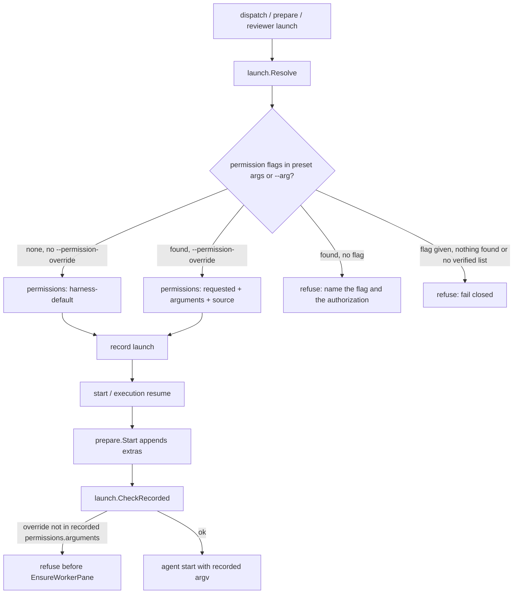

# Explicit authorization for worker permission overrides - Plan

## Goal Capsule

- **Objective:** Choosing a harness for a sum worker or reviewer never changes that harness's permission or trust behavior by itself. A permission or trust override reaches a launch only when the person authorized it for that launch, and every record and confirmation says which override was requested, where it came from, and that it is not runtime-verified.
- **Means:** Delete the adapter-fixed Devin worker argv, recognize permission/trust flags per harness from verified CLI help, and gate them behind an explicit `--permission-override` launch option recorded with the launch (KTD1, KTD2, KTD3).
- **Authority:** Issue douglasjarquin/sum#294 defines scope and acceptance. `README.md`, `COORDINATOR.md`, and `AGENTS.md` state the operating contract this plan restores. `VERIFY.md` governs verification. The factory brief for task t-3d8e1da01f35 governs process constraints (no code comments, no test changes, lane ownership).
- **Execution profile:** Standard depth, implemented inline in the task worktree on branch `sum/t-3d8e1da01f35`.
- **Stop conditions:** A change would require editing a running worker's process or record; the resume-time check cannot be carried by the two small edits to lane #292's package that KTD3 and U4 name; a harness the registry must name turns out to have no verified permission flag list at all.
- **Finishes and ships:** The worker session implements, verifies, commits, pushes, and opens the PR. The user merges.

---

## Product Contract

### Summary

Remove the implicit `--permission-mode dangerous --respect-workspace-trust false` that every Devin worker launch receives today, and replace it with an explicit, recorded, fail-closed authorization path that works the same for fresh dispatches, starts and resumes of prepared records, and reviewer launches.

### Problem Frame

`go/internal/settings/settings.go` carries a fixed worker argv for the `devin` adapter, and `go/internal/launch/launch.go` appends it to every resolved launch. Selecting Devin therefore silently escalates permissions and disables workspace trust, while `README.md`, `COORDINATOR.md`, and `skills/sum-dispatch/SKILL.md` all promise that sum adds no permission-bypass flags. The flags were added in commit b5f9781 so a Devin worker lands at its input box and receives the injected kickoff prompt; a per-task Git worktree was cited as isolation, but a worktree is not a process or credential sandbox. The launch record discloses model and reasoning sources but says nothing about permission behavior, so a reader cannot tell that the escalation happened or where it came from.

### Requirements

**Launch resolution**

- R1. Selecting a harness, including `devin`, never adds a permission or trust flag to the resolved argv.
- R2. A permission or trust flag supplied through `--arg` or a preset's `args` is accepted only when the same launch carries `--permission-override`; otherwise the launch is refused before any record, slot, worktree, or Herdr call.
- R3. `--permission-override` without a permission or trust flag to authorize is refused, and `--permission-override` on a harness with no verified permission flag list is refused.
- R4. The resolved launch record carries a `permissions` object naming each override argument, its source (`explicit` or `preset`), the authorization that admitted it, and a status that reads `requested`, never verified; the one-line `confirmation` repeats it.

**Recorded and resumed launches**

- R5. Starting or resuming a task whose executed argv carries a permission or trust flag that the record's `permissions.arguments` does not list, whether from a legacy record or from `start --arg`, is refused before a pane is allocated, with the fix named.
- R6. A running worker is never reconfigured, interrupted, or edited by this change.

**Reviewer launches**

- R7. `reviewer launch` applies R2 through R4 to the reviewer's resolved launch, the recorded reviewer endpoint carries the same `permissions` object, and `--permission-override` against a live recorded reviewer is refused like the other explicit launch flags.

**Surfaces and documentation**

- R8. `prepare`, `dispatch`, and `reviewer launch` document `--permission-override` in the help catalog, and `preset show` lists the permission override arguments a preset's args would carry, only when there are any.
- R9. `docs/configuration.md`, `skills/sum-dispatch/SKILL.md`, and the `dispatch.harness-argv` row in `docs/features/coordination.md` describe the final contract, including the rule for legacy prepared records.

### Key Decisions

- **Devin selection alone injects nothing** (session-settled: user-directed — chosen over keeping adapter-fixed worker argv: it contradicts the operating contract). Governs R1.
- **Overrides are admitted only through an explicitly authorized launch option layered on the existing `--arg` and preset model** (session-settled: user-directed — chosen over a sandbox or tool-exclusion framework: that is a stated non-goal). Governs R2, R3.
- **Effective permission behavior is disclosed with its source and requested-versus-verified status and never claims a sandbox** (session-settled: user-directed — chosen over silent recording: the issue's acceptance requires disclosure). Governs R4, R7.
- **An unsupported restriction fails closed** (session-settled: user-directed — chosen over ignoring it or representing prompt-only enforcement: the issue's acceptance requires it). Governs R3.
- **Legacy prepared records are not silently authorized on a new start, and running processes are untouched** (session-settled: user-directed — chosen over stripping or auto-authorizing the recorded flags: the issue's acceptance requires it). Governs R5, R6.

### Acceptance Examples

- AE1. **Covers R1.** Given no settings file, when the coordinator runs `dispatch --harness devin --approved`, then the task's `launch.argv` and `started_argv` are empty and Herdr's `agent start` receives no `--` separator.
- AE2. **Covers R2.** Given `dispatch --harness devin --arg=--permission-mode --arg=dangerous --approved` without `--permission-override`, then dispatch is refused naming `--permission-mode` as a permission/trust override, and no task directory or worktree exists afterwards.
- AE3. **Covers R2, R4.** Given the same command with `--permission-override`, then the task is created, `launch.permissions` lists `--permission-mode dangerous` with source `explicit`, authorization `--permission-override`, and status `requested`, and the confirmation line names it.
- AE4. **Covers R3.** Given `dispatch --harness grok --permission-override --approved`, then dispatch is refused because grok has no verified permission flag list.
- AE5. **Covers R3.** Given `dispatch --harness claude --permission-override --approved` with no permission argument, then dispatch is refused because nothing is being authorized.
- AE6. **Covers R5.** Given a task record prepared before this change whose `launch.argv` holds the legacy Devin flags, when `start TASK` runs, then start is refused before `EnsureWorkerPane`, the task stays prepared, and the message says to dispatch again with `--permission-override` after the user authorizes it.
- AE8. **Covers R5.** Given a task dispatched with `--permission-override` for `--permission-mode plan`, when `start TASK --arg=--dangerously-skip-permissions` runs, then start is refused naming the unrecorded argument, because `start --arg` cannot authorize a new override.
- AE7. **Covers R7.** Given a reviewer preset whose args include `--dangerously-skip-permissions`, when `reviewer launch TASK` runs without `--permission-override`, then launch is refused before a tab is created; with `--permission-override`, the reviewer endpoint records the override.

### Scope Boundaries

- No general-purpose sandbox, credential manager, global harness configuration edit, automatic trust acceptance, or universal tool-exclusion framework.
- No change to running workers, and no rewrite of existing task records; validation runs only on new launches and on new starts or resumes of recorded ones.
- Harness permission behavior set outside argv is outside this gate: on-disk harness settings and profiles (`codex -p/--profile`, `claude --settings`, user config files) and environment variables such as copilot's `COPILOT_ALLOW_ALL`. The record's `harness-default` status attests only that sum passed no override argument, and `docs/configuration.md` says so.
- Mesh `herdr_agent_start` argv is caller-owned and outside this rule; the rule covers sum worker and reviewer launches only, and the documentation says so.
- `--add-dir` is excluded from every registry: sum injects it for Claude task access, and it grants directory reach rather than changing approval behavior. The documentation names it as the one argument sum adds.
- The Devin kickoff-prompt problem that motivated commit b5f9781 is not re-solved here. A Devin worker started without the override may stop at its trust gate; the operator authorizes the override explicitly or answers the gate by hand.
- A harness whose CLI is not installed on this machine (grok, cursor, pi, omp) gets no verified permission flag list; `--permission-override` fails closed for it.
- Considered and not built: refusing `preset set` when the preset's args carry a permission flag. A saved preset is inert until a launch names it, and the launch-time gate already refuses it without authorization; adding a second gate would duplicate the rule. Evidence that would change this: a preset path that reaches `agent start` without `launch.Resolve`.
- Considered and not built: a `--permission-override` flag on `start` and `execution resume`. Legacy records are rare and re-dispatch is the documented recovery; adding the flag would widen lane #292's `prepare.Start` signature and `execution/park.go`. A parked legacy Devin task that already ran cannot be resumed after this change and its worktree keeps its work until the user carries it over; whether such a task deserves an authorized resume is the user's call and is recorded as an open question.

#### Deferred to Follow-Up Work

- Per-adapter tool exclusions after each adapter's behavior is verified live (named in the issue as a later change).
- Writing or updating tests for the new behavior, including the now-contradicted `TestDispatchDevinWorkerCarriesTrustGateArgv` and the `help reviewer-launch` golden in `go/internal/cli/testdata/help-reviewer-launch.stdout`; the user's rule reserves test changes for a manual step.

### Open Questions

- Deferred to the user: should a parked legacy Devin task that already ran get an explicitly authorized `execution resume` path instead of re-dispatch? The plan refuses the resume (R5) and documents re-dispatch; an authorized resume would need a flag on `execution resume` and a wider edit in lane #292's package.

### Dependencies

- Verified permission/trust flags, each marked whether it takes a value. From `claude --help` on this machine: `--permission-mode <mode>`, `--permission-prompts <target>`, `--allowedTools`/`--allowed-tools <tools...>`, `--disallowedTools`/`--disallowed-tools <tools...>`, `--tools <tools...>`, and the bare `--dangerously-skip-permissions` and `--allow-dangerously-skip-permissions`. From `codex --help`: `-a`/`--ask-for-approval <policy>`, `-s`/`--sandbox <mode>`, the bare `--dangerously-bypass-approvals-and-sandbox`, `--dangerously-bypass-hook-trust`, `--approve-for-me`, and the config keys `approval_policy=`, `sandbox_mode=`, and `sandbox_permissions=` passed through `-c`/`--config`. From `copilot --help`: `--allow-tool`, `--allow-url`, `--deny-tool`, `--deny-url` (value-taking), and the bare `--allow-all`, `--allow-all-tools`, `--allow-all-paths`, `--allow-all-urls`, `--yolo`, `--autopilot`, `--disallow-temp-dir`. From the `devin --help` output recorded in commit b5f9781: `--permission-mode <mode>` and `--respect-workspace-trust <bool>`; `devin` is not installed here, so those two are carried forward unverified and a live Devin launch cannot be checked in this change.

---

## Planning Contract

### Key Technical Decisions

- KTD1. **Replace the adapter `Worker` argv with a per-harness `Permission` flag list in `go/internal/settings/settings.go`, and delete `WorkerArgv`.** The adapter table already owns verified-from-help flag knowledge for model and reasoning; permission flags belong beside them so a harness without a verified list reads as absent and fails closed the way an unverified `--model` does. Governs R1, R3.
- KTD2. **Gate overrides in `launch.Resolve` with a new `ResolveArgs.PermissionOverride` and record a `permissions` object on the launch.** `Resolve` is the single assembly point for fresh dispatch and reviewer launch argv, so one check covers both and runs before any record, slot, or Herdr call. The object shape is `{override: bool, arguments: [{argument, source}], authorization: "--permission-override" | null, status: "harness-default" | "requested"}`; `status` deliberately has no verified value because no harness exposes its permission mode through Herdr. (session-settled: user-directed — chosen over a sandbox or tool-exclusion framework: a stated non-goal.) Governs R2, R3, R4, R7.
- KTD3. **Validate recorded launches with a new `launch.CheckRecorded(spec) error`, called once in `prepare.Start` after start-time extras are appended and before pane allocation.** It computes the overrides in the executed argv and refuses when any is absent from the record's `permissions.arguments`, so neither a legacy record nor a `start --arg` can add an override the dispatch did not authorize. `TaskLaunch` returns the recorded spec without error for display paths, so a separate check keeps those callers unchanged; `prepare.Start` is the one path that executes a recorded argv for both `start` and `execution resume`, and `go/internal/prepare` belongs to lane #292, so the edits there are the one call plus the `Args` field U4 threads. (session-settled: user-directed — chosen over stripping or auto-authorizing legacy flags: the issue's acceptance requires refusal.) Governs R5, R6.
- KTD4. **Registry entries carry arity in the adapter-prefix style: a value-taking flag is written with a trailing `=` (`--permission-mode=`), a bare switch without one, and a codex config key as the two tokens `-c approval_policy=`.** A value-taking flag matches `--flag value` and `--flag=value` and records both tokens as one argument; a bare switch records only itself; a config key matches `-c key=...`, `--config key=...`, and the joined forms the way `argvConflicts` already matches `-c model_reasoning_effort=`. This keeps `--dangerously-skip-permissions --permission-mode bypassPermissions` disclosed as two arguments. Governs R2, R4.
- KTD5. **Carry `--permission-override` on `prepare`, `dispatch`, and `reviewer launch` only.** These are the three commands that assemble a launch; `start` replays a record and `execution resume` calls `prepare.Start` with no extras, so neither needs a new flag under the documented re-dispatch rule. Governs R5, R8.

### Assumptions

- Every flag that changes what the harness asks about or allows counts as a permission override, widening or narrowing alike (copilot `--allow-tool` and `--deny-tool`, codex `-s`/`--sandbox`, claude `--allowedTools`), because the record's job is to disclose every explicit permission choice; the user may prefer to gate only widening flags.
- `preset show` is the right place to disclose a preset's permission arguments; `preset list` stays unchanged.
- The `dispatch.harness-argv` scenario id is kept and its description rewritten rather than renaming the row, so existing references stay valid.

### High-Level Technical Design

### Implementation Constraints

- Never add or edit a code comment, including the comment above the `devin` adapter entry: delete the entry and its comment together as one removal.
- Never add, expand, delete, or rewrite a test file, golden, or fixture.
- Touch `go/internal/prepare/prepare.go` only for two edits: the single `CheckRecorded` call in `Start` and the `PermissionOverride` field on `Args` threaded into `Resolve`; do not touch `go/internal/pipeline`, `go/internal/prcmd`, or any other lane's package.
- `docs/features/coordination.md` and `skills/sum-dispatch/SKILL.md` are verification policy files; edits there are expected and will flag `requires_root_review`.

---

## Implementation Units

### U1. Permission flag registry in settings

- **Goal:** The adapter table carries verified permission/trust flags per harness, the fixed Devin worker argv is gone, and preset views disclose permission arguments.
- **Requirements:** R1, R3, R8 (KTD1, KTD4)
- **Dependencies:** none
- **Files:** `go/internal/settings/settings.go`
- **Approach:**
  1. Replace the `Worker` field with `Permission []string` on `adapter`, written in the KTD4 arity style; populate claude, codex, copilot, and devin from the Dependencies list; leave grok, cursor, pi, omp without one.
  2. Delete `WorkerArgv`.
  3. Add `PermissionFlags(harness) ([]string, bool)` and `PermissionOverrides(harness string, argv []string) []string` that returns each matched argument as one string per KTD4.
  4. Set `permission_overrides` on the `presetLaunch` result only when the matched list is non-empty, so the existing `preset-show-fast` and `preset-show-slow` goldens stay byte-identical.
- **Patterns to follow:** `adapterPrefix`, `knownHarnessesForField`, `argvConflicts`, `presetLaunch`.
- **Test scenarios:** Test expectation: none added -- the user's rule reserves tests; the implementer verifies through the existing suite, `preset show` output, and the evidence capture in U6.
- **Verification:** `go build ./...` succeeds; `preset show` on a preset with `--arg=--permission-mode --arg=dangerous` on claude lists the override; the settings package has no remaining reference to `Worker` argv.

### U2. Override gate and disclosure in launch resolution

- **Goal:** `launch.Resolve` never injects flags, refuses unauthorized or unauthorizable overrides, records `permissions`, and the confirmation line discloses it.
- **Requirements:** R1, R2, R3, R4 (KTD2, KTD4)
- **Dependencies:** U1
- **Files:** `go/internal/launch/launch.go`
- **Approach:**
  1. Add `PermissionOverride bool` to `ResolveArgs`.
  2. Remove the `settings.WorkerArgv` append.
  3. After `allExtra` is assembled, compute overrides from preset args and explicit args separately so each argument carries its source.
  4. Refuse per R2 and R3 with messages that name the harness, the argument, and the fix, and end with "Nothing was created."
  5. Set `permissions` on the result. For a legacy record lacking the object, `TaskLaunch` derives one from the recorded argv: each matched argument with source `legacy-record`, authorization `null`, override `false`, status `requested`; `harness-default` only when the argv carries none.
  6. Extend `Confirmation` with "permissions harness default" or "permission override ARG (SOURCE, requested, not runtime-verified)".
- **Patterns to follow:** the existing `--same-as-you` and preset-conflict refusals in `Resolve`; the `source` object per field.
- **Test scenarios:** Test expectation: none added -- covered by AE1 through AE5 through the U6 evidence capture and the existing offline suite.
- **Verification:** AE1 through AE5 hold when driven through the built `sumctl` against the fake Herdr fixtures.

### U3. Recorded-launch check for start and resume

- **Goal:** A recorded launch argv carrying an override without recorded authorization is refused before pane allocation.
- **Requirements:** R5, R6 (KTD3)
- **Dependencies:** U1, U2
- **Files:** `go/internal/launch/launch.go`, `go/internal/prepare/prepare.go`
- **Approach:**
  1. Add `CheckRecorded(spec *ordjson.Object) error` to `launch`: read `harness` and the post-extras `argv`, compute overrides, and refuse when any computed argument is absent from the recorded `permissions.arguments` (a record without the object or with `override` false has an empty list); the message names the unrecorded argument, says `start --arg` cannot authorize a new override and a legacy record carries no authorization, and names re-dispatch with `--permission-override` as the fix.
  2. In `prepare.Start`, call it once after `launchSpec.Set("argv", ...)` and before `started_argv` is set, unlocking and returning the error so the task stays prepared.
- **Patterns to follow:** the `state != held && state != running` refusal immediately above in `Start`.
- **Test scenarios:** Test expectation: none added -- AE6 and AE8 are exercised by hand through the built CLI against the fake Herdr.
- **Verification:** A hand-written task record with the legacy Devin argv is refused by `start` with no `agent start` call in the fake Herdr log, `execution resume` of such a record is refused the same way, and `start --arg` with a new override on an authorized record is refused (AE8).

### U4. Command flags and reviewer launch

- **Goal:** `prepare`, `dispatch`, and `reviewer launch` accept `--permission-override`; reviewer endpoints record `permissions`.
- **Requirements:** R7, R8 (KTD2, KTD5)
- **Dependencies:** U2
- **Files:** `go/internal/cli/prepare.go`, `go/internal/cli/reviewer.go`, `go/internal/prepare/prepare.go` (the `Args` field only, in the same edit as U3), `go/internal/review/review.go`, `go/internal/helpview/catalog.json`
- **Approach:**
  1. Add the bool flag to both CLI commands and thread it through `prepare.Args` and `review.LaunchArgs` into `ResolveArgs`; `LaunchArgs.explicit()` counts it so a live recorded reviewer refuses it with the other explicit flags.
  2. In `reviewerLaunch`, return the resolved `permissions` object alongside argv; when the fallback root harness path runs, record `harness-default`.
  3. Set `permissions` on the reviewer endpoint record.
  4. Add the `--permission-override` argument entry to the `prepare`, `dispatch`, and `reviewer-launch` topics in the help catalog; the `help reviewer-launch` golden then fails and is reported, not repaired.
- **Patterns to follow:** `PresetSet: cmd.Flags().Changed("preset")` plumbing; the `endpoint` object assembly in `review.Launch`.
- **Test scenarios:** Test expectation: none added -- AE7 is verified by hand through the built CLI against the fake Herdr.
- **Verification:** `sumctl help dispatch` and `sumctl help reviewer` list the flag; AE7 holds.

### U5. Documentation and feature map

- **Goal:** User docs, the dispatch skill, and the feature map describe the final contract.
- **Requirements:** R9
- **Dependencies:** U1 through U4
- **Files:** `docs/configuration.md`, `skills/sum-dispatch/SKILL.md`, `docs/features/coordination.md`
- **Approach:**
  1. Add a "Permission and trust overrides" subsection to `docs/configuration.md`: sum adds none except the Claude `--add-dir` task grant, the verified flag lists per harness, `--permission-override`, the recorded `permissions` object, the requested-not-verified status, the no-sandbox statement, the fail-closed rule, the legacy-record and `start --arg` rule, and the boundary: `harness-default` means sum passed no override argument, while on-disk settings, profiles, environment variables, and mesh `agent start` argv are outside the gate.
  2. Update the "No permission-bypass flags are added by sum" line in the dispatch skill to name the override flag and the refusal.
  3. Rewrite the `dispatch.harness-argv` row: no harness carries fixed argv, overrides need the flag and are recorded, legacy records are refused at start; keep the `agent_pane_busy` retry clause; note the live Devin acceptance remains manual and that the existing Devin test now contradicts the contract and awaits the user's manual test cleanup.
- **Patterns to follow:** the existing "Named launch presets" subsection shape; the row style of neighbouring `dispatch.*` rows.
- **Test scenarios:** Test expectation: none -- documentation.
- **Verification:** `python3 .agents/skills/verify/scripts/verify_run.py --check` accepts the feature map; the three documents agree with the code's messages and record keys.

### U6. Before/after evidence and verification run

- **Goal:** The changed CLI path has captured before/after transcripts and a verify run on the committed candidate.
- **Requirements:** all (verification)
- **Dependencies:** U1 through U5 committed
- **Files:** `.artifacts/evidence/` (ignored), `.artifacts/verification/` (ignored)
- **Approach:**
  1. Build `sumctl` from a base worktree at `d48e088` and from the candidate; drive `dispatch --harness devin --approved` against the fake Herdr fixtures (`tests/fixtures/herdr.py` and companions, environment per `demoEnv` in `go/internal/cli/demo_test.go`) in a temporary home for each.
  2. Capture with `evidence_capture.py capture ... cli --` as `--kind bugfix`, scenario `dispatch.harness-argv`, with the identical assertion on both sides: `--expect-exit 0` and `--expect-text 'started_argv: []'` against a wrapper that prints the dispatch's `started_argv`, so the base fails on the injected flags and the candidate passes.
  3. Compare and record the `comparison.json` path.
  4. Run the verify runner with `--base d48e088fec30c0d3ceb727ca4797b1cffb4849e0 --json` on the clean committed tree and attach the run to the handoff as is, including the expected failures of `TestDispatchDevinWorkerCarriesTrustGateArgv` and the `help reviewer-launch` golden.
- **Test scenarios:** Test expectation: none -- verification unit.
- **Verification:** A `comparison.json` with verdict `red-green` for the scenario; a `run.json` whose outcome is reported truthfully.

---

## Verification Contract

| Check | Command | Proves |
| --- | --- | --- |
| Build and vet | `mise run lint` | gofmt and go vet over `go/` |
| Offline suite | `MISE_ENABLE_TOOLS=go,python,node,aube python3 .agents/skills/verify/scripts/verify_run.py --base d48e088fec30c0d3ceb727ca4797b1cffb4849e0 --json` | `mise run verify` plus mapped checks; expected to report the contradicted Devin test and the `help reviewer-launch` golden as failures |
| Evidence | `python3 .agents/skills/evidence/scripts/evidence_capture.py compare --scenario dispatch.harness-argv ...` | base injects the flags, candidate does not |
| Help catalog | `sumctl help dispatch`, `sumctl help reviewer` | the flag is documented |

A green suite is not expected; the two known failing tests are reported, not repaired.

---

## Definition of Done

- U1 through U5 committed on `sum/t-3d8e1da01f35` with no code comments added and no test files touched.
- `settings.WorkerArgv` and the Devin worker argv no longer exist in the tree.
- `dispatch --harness devin --approved` records empty argv (AE1); AE2 through AE8 behave as stated.
- `permissions` appears on every new launch and reviewer endpoint record with `status: requested` or `harness-default`.
- Documentation, dispatch skill, and feature map agree with the code.
- Evidence comparison and verify run recorded and listed in the handoff; the failing Devin test, the failing reviewer-launch help golden, and the unavailable live Devin check are reported plainly.
- No abandoned experimental code remains in the diff.
