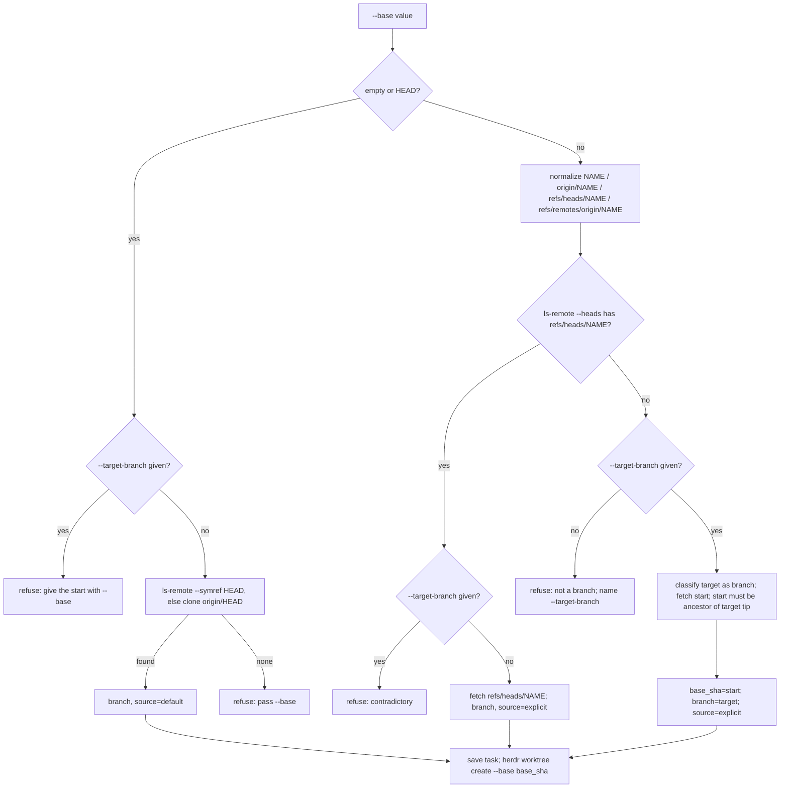
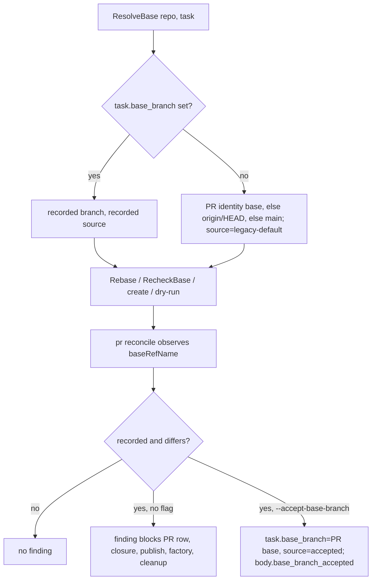

# Preserve the Selected Base Branch - Plan

## Goal Capsule

- **Objective:** A task prepared from a release or integration branch is checked against, proposed for, and merged into that branch, and a coordinator can read which branch a task targets and why without re-deriving it.
- **Means:** record the delivery branch and its selection source on the task at prepare, and make every later branch-sensitive step read that record (KTD1, KTD2).
- **Authority:** issue douglasjarquin/sum#292 and its acceptance checkboxes; the pinned worker procedure (no code comments; tests only because the issue asks for them); the factory lane constraint that `go/internal/launch` and `go/internal/settings` belong to #294.
- **Stop conditions:** a change needs `go/internal/launch` or `go/internal/settings`; a verification-policy file must change in a way that weakens a gate; an existing test fails for a reason that is not this change's intended behavior.
- **Execution profile:** one worker in the task checkout on branch `sum/t-203043a3600a`; the coordinator verifies and the user merges.

---

## Product Contract

### Summary

Persist `base_branch` and `base_branch_source` on the task record beside the immutable `base_sha`, resolve the default branch once at prepare, read the record in rebase checks, PR creation, reconcile, brief, context, status, and factory merge-check, refuse a `--base` that names no branch before any Herdr resource exists, raise a blocking reconcile finding when the PR targets another branch, add one explicit coordinator action that re-records the target, and disclose `legacy-default` for records written before this change.

### Problem Frame

`prepare` resolves the requested `--base` to a commit and keeps only the SHA. Every later gate asks `pipeline.BaseBranch`, which answers with the reconciled PR's base, then `origin/HEAD`, then `main`. A task started from `release/1.2` therefore begins at the right commit and is later rebased against, proposed to, and merge-checked against the repository default without anyone choosing that. A commit or tag passed to `--base` is accepted silently today and has no branch at all.

### Requirements

**Recording the target at prepare**

- R1. `prepare` and `dispatch` record `base_branch` (the bare remote branch name) and `base_branch_source` on the task beside `base_sha`, before the Herdr worktree is created.
- R2. `--base NAME`, `--base origin/NAME`, `--base refs/heads/NAME`, and `--base refs/remotes/origin/NAME` all record `NAME` with source `explicit`; the branch is classified through `refs/heads/` only, so a tag sharing the name never shadows it.
- R3. An omitted `--base` or `--base HEAD` records the repository default resolved once at prepare with source `default`; the default is the remote's symbolic HEAD, then `origin/HEAD` in the primary clone when the remote does not answer the symref, and when neither answers prepare refuses and asks for `--base`.
- R4. A `--base` the remote does not answer, or that names no branch under `refs/heads/`, is refused before any task record, lock, or Herdr call; the message names the normalized ref and the `--target-branch` route.
- R5. A commit or tag starting ref is accepted only with `--target-branch NAME`; the start must be an ancestor of `origin/NAME`'s tip, `base_sha` stays the start commit, and the record carries `NAME` with source `explicit`. `--target-branch` without an explicit non-branch `--base`, or with a `--base` that is itself a branch, is refused.

**Reading the record during delivery**

- R6. `pipeline rebase`, the fresh observations before push and PR, PR creation, and `pipeline pr --dry-run` use the recorded branch and fetch it as `refs/heads/NAME` so a same-named tag never shadows it; the rebase record and the PR gate record carry `base_branch_source`.
- R7. A recorded branch that no longer exists on origin at delivery time refuses as it does today (uncertain, never a pass); no fallback to the default branch happens for any source.
- R8. A legacy record without `base_branch` resolves as today (reconciled PR base, then `origin/HEAD`, then `main`), is never written back, and is disclosed as `legacy-default` in the rebase record, as a note on the rebase row, and in the brief; the rendered row text and the published pipeline block stay unchanged.

**Disagreement between the PR and the record**

- R9. `pr reconcile` adds a finding when the PR's base differs from the recorded branch; a legacy record raises no such finding. The finding blocks the PR row, closure, evidence auto-publish, factory merge-check, and cleanup through the existing `findings` channel.
- R10. `pr reconcile TASK --number N --accept-base-branch` is the only reconciliation: it records the PR's base as the task's `base_branch` with source `accepted`, leaves `base_sha` and the approved fingerprint unchanged, writes the change into the publication record, and raises no finding for that observation. Without the flag the finding stands; the PR itself is never edited.
- R11. A Rebase row observed against a branch other than the task's recorded branch (or, for a legacy record, the reconciled PR's base) reads as unobserved rather than as a standing pass; a legacy record with no PR keeps today's row.

**Surfaces and documentation**

- R12. The brief's execution contract and `status` open-PR rows name the branch and its source; factory merge-check inherits the blocking finding from R9; the help catalog documents `--base`, `--target-branch`, and `--accept-base-branch`.
- R13. The feature maps and the dispatch and deliver skills describe the recorded target, the refusal, the finding, the accept action, and the legacy fallback.

### Key Decisions

- **The disagreement is a blocking finding, not a note** (session-settled: user-directed — chosen over adopting the PR's base silently: the issue requires publication and merge admission to block until an authorized path resolves it). Governs R9, R10.
- **Legacy records are disclosed, never backfilled** (session-settled: user-directed — chosen over writing the resolved branch into old records: inventing historical intent is the behavior the issue forbids). Governs R8.
- **No automatic rebase, force-push, PR edit, or direct push to the base** (session-settled: user-directed — chosen over `gh pr edit --base`: the issue's non-goals exclude new remote writes and merge authority). Governs R7, R10.
- **Tests are in scope** (session-settled: user-directed — chosen over the worker procedure's default of no agent-written tests: the issue's acceptance criteria ask for a divergent-branch fixture and regression tests that fail on the audited commit). Governs the Verification Contract.

### Acceptance Examples

- AE1. **Covers R1, R6.** Given origin has `main` and a divergent `release/1.2`, when a task is prepared with `--base release/1.2`, then its worktree starts at the `release/1.2` tip, `pipeline rebase` passes against `origin/release/1.2` while `main` has moved on, and `pipeline pr` runs `gh pr create --base release/1.2`.
- AE2. **Covers R3.** Given `origin/HEAD` points at `main`, when a task is prepared without `--base` and `origin/HEAD` is later moved to another branch, then the task still records `main` with source `default` and its rebase observation still fetches `main`.
- AE3. **Covers R4.** Given origin has a tag `v1.0` and no branch of that name, when `dispatch --base v1.0` runs, then it refuses naming `--target-branch`, no task directory exists, and the fake Herdr log has no `worktree create` call.
- AE4. **Covers R9, R10.** Given a task records `release/1.2`, when `pr reconcile --number 7` observes a PR whose base is `main`, then the PR row is blocked with a finding naming both branches; when the same observation runs with `--accept-base-branch`, then the task records `main` with source `accepted` and no finding.
- AE5. **Covers R8.** Given a task record with `base_sha` and no `base_branch`, when `pipeline rebase` runs, then it fetches the branch resolved as today, the record carries `legacy-default`, the row's note discloses it, and the row's result text is unchanged.

### Scope Boundaries

- `dev prepare --base` (`go/internal/devcmd`) creates a development checkout, not a task, and is unchanged.
- `go/internal/launch` and `go/internal/settings` are untouched; nothing in the flows needs them.
- `validateFactoryPR` and `MergeCheck` are unchanged; the recorded branch enters factory authority through the R9 finding, which already fails closure.
- Considered and not built: a separate `MergeCheck` row naming the recorded branch. The finding from R9 already blocks merge admission and factory lanes are dispatched without `--base`; a factory lane that targets a non-default branch would change this.
- Considered and not built: a second `ls-remote` after a failed delivery fetch to say the branch is gone and name the retarget route. The refusal already fails loudly and never passes; evidence that coordinators retry it indefinitely would change this.
- Considered and not built: refusing to adopt an open PR whose base differs at the PR gate. Adoption prevents duplicate PRs, and the reconcile that follows in the same run raises the finding; evidence that a wrongly targeted PR reached merge admission without reconcile would change this.
- Considered and not built: adding the branch to `context --section execution`. Its stdout is pinned by golden files under `go/internal/cli/testdata`, and rewriting golden files is the user's manual step under the worker procedure; the brief, the rebase record, and the PR gate record already carry the branch and source.
- Considered and not built: printing the source in the PR body. GitHub shows the base itself; the dry-run summary and gate record carry the source for the coordinator.

#### Deferred to Follow-Up Work

- A one-time explicit adopt that gives a long-running legacy task a recorded target.
- Retiring the parsed-but-unread `--replace` flag on `pr reconcile`.
- Forcing a brief revision after `--accept-base-branch` so a running worker learns the new target.
- A `status` summary when a sweep raises the new finding on many tasks at once.

---

## Planning Contract

### Key Technical Decisions

- KTD1. **Two top-level task keys, no schema bump.** `base_branch` and `base_branch_source` sit beside `base_sha`; a missing key is the legacy signal. They stay out of `verification_policy`, which is sealed and hash-checked (`verifycontract.SealPolicy`, `validVerificationSnapshot` in `go/internal/prepare/prepare.go`), and out of `versions.ApprovedFingerprint`, which `brief regenerate` compares across revisions and would otherwise refuse every legacy task. Follows `docs/solutions/architecture-patterns/retiring-persisted-compatibility-fields.md`: derive the public shape at the read boundary.
- KTD2. **One resolver in `go/internal/pipeline`.** A `RecordedBase(task) (branch, source)` reader and a `ResolveBase(repo, task) (branch, source)` that returns the record when present and otherwise today's order with source `legacy-default`. `BaseBranch` becomes a thin wrapper so `Rebase`, `RecheckBase`, and `create` keep their call shape; those three are the only callers of `ResolveBase`, and `Derive` stays free of git calls. `contextview`, `lifecycle`, and `factory` already import `pipeline`; `brief` may import it (pipeline imports none of them). Source values: `explicit`, `default`, `accepted`, `legacy-default`.
- KTD3. **Prepare classifies through `refs/heads/` and returns the triple.** `fetchBase` grows into a resolver that normalizes the spelling (R2), checks `git ls-remote --heads origin refs/heads/NAME` for exactly one line, fetches `refs/heads/NAME`, and returns SHA, branch, and source; it runs where `fetchBase` runs today, before the store lock and before `herdrclient.Call worktree create`, which is what makes R4 hold. The default case asks `git ls-remote --symref origin HEAD` first, because the clone's `origin/HEAD` is written once at clone time and never refreshed by fetch, then reads the clone's `origin/HEAD` when the remote does not answer the symref, then refuses (R3).
- KTD4. **`--target-branch` reuses the same resolver.** The start ref is fetched and resolved to a commit as today; the target goes through the branch classification; `git merge-base --is-ancestor <start> FETCH_HEAD-of-target` must hold; `base_sha` is the start. `--target-branch` is refused when `--base` is omitted or `HEAD` (the message says the start commit or tag must be given with `--base`) and when `--base` is itself a branch (contradictory flags); the flag means only the delivery branch for a non-branch start.
- KTD5. **Accept re-records the task, never the PR** (session-settled: user-directed — chosen over `gh pr edit --base`: the non-goals exclude new remote writes). `recordObservation` compares `baseRefName` with `RecordedBase`; a difference appends the finding unless `AcceptBaseBranch` is set, in which case it sets the two task keys under the same store lock and adds `base_branch_accepted: {from, to}` to the publication record body. `task.pr` is rebuilt every reconcile, so the decision must live on the task, which it does.
- KTD6. **Disclosure beside the row, never in its text.** `deriveRebase` leaves `Row.Result` byte-identical to today, because `rebaseResultIs` compares the whole string and the same text is what the published pipeline block renders. The disclosure is a new `Note` field on `pipeline.Row`, set to `recorded target not in the task record (legacy-default)` when the latest rebase record's `base_branch_source` is `legacy-default`, emitted by `Record.Object()` as `note` and never by `Table()`, so legacy PR bodies are not rewritten. R11 is implemented from record data alone: `deriveRebase` compares the latest row's `base_branch` with `RecordedBase(task)` when a branch is recorded, otherwise with the reconciled PR identity's `base_branch` when one exists, and skips the comparison otherwise.
- KTD7. **Every new cobra flag goes into `go/internal/helpview/catalog.json`.** `presentation_test.go` fails otherwise; usage strings stay empty by convention.

### High-Level Technical Design

Base resolution at prepare:

Base resolution during delivery:

### Assumptions

- The record holds the bare branch name; `origin/NAME` stays accepted as input because the existing test `TestDispatchHonorsAnExplicitBaseRef` already passes it.
- When a tag and a branch share a name, the branch is taken; only `refs/heads/` is consulted at prepare and in every delivery fetch (rebase, push, PR).
- The published pipeline block and the rendered rebase row text are unchanged for legacy tasks; the disclosure lives in the row's note.
- A commit or tag start that is not an ancestor of the target tip is refused rather than disclosed, because the Rebase gate's behind count and the PR diff would not describe the worker's change.
- The default case costs one extra remote call (`ls-remote --symref`) per default dispatch; a clone whose `origin/HEAD` is stale after a default-branch rename would otherwise be frozen into the record as intent.
- A recorded branch missing from origin stays a refusal for every source, with today's message.
- Legacy records never raise the base finding, because under their resolution the PR's base is the authority.
- The PR body does not print the source.
- Factory lanes are dispatched without `--base` today; factory merge-check needs no change because the R9 finding already fails its closure check.
- A recorded branch deleted from origin before any PR exists has no in-tool retarget; the coordinator opens a PR against the new branch and reconciles with `--accept-base-branch`, or prepares a new task.
- The commit-SHA start of R5 is exercised only through a tag in the labs, because a local bare origin refuses to fetch an unadvertised SHA; the SHA path is covered by the same code and validated against GitHub in use.

### Sequencing

U1 first (the record), then U2 before U3 because U3 depends on the resolver U2 introduces, then U4 (surfaces), then U5 (docs and feature maps), with U6 (evidence and verification) last on the committed candidate.

---

## Implementation Units

### U1. Record the delivery branch at prepare

- **Goal:** `prepare` and `dispatch` write `base_branch` and `base_branch_source`, classify the requested base, and refuse non-branches before any side effect.
- **Requirements:** R1, R2, R3, R4, R5 (KTD3, KTD4, KTD7).
- **Dependencies:** none.
- **Files:** `go/internal/prepare/prepare.go`, `go/internal/cli/prepare.go`, `go/internal/helpview/catalog.json`, `go/internal/cli/dispatch_launch_test.go`.
- **Approach:**
  1. Replace `fetchBase` with a resolver returning SHA, branch, and source; keep its position in `Prepare` (after `launch.Resolve`, before `s.Lock()`), so refusals leave no record and no Herdr call.
  2. Normalize the four accepted spellings to a bare name; classify with `git ls-remote --heads origin refs/heads/NAME` using the same scrubbed environment and bound as the fetch; fetch `refs/heads/NAME` and read `FETCH_HEAD^{commit}`.
  3. Default case: `origin/HEAD` symbolic ref in the primary clone, else `git ls-remote --symref origin HEAD`, else an error asking for `--base`.
  4. Add `TargetBranch` to `prepare.Args` and a `--target-branch` flag on both `prepare` and `dispatch`; with it, the start ref is fetched as any ref, the target is classified as a branch, and `git merge-base --is-ancestor` must hold in the primary clone.
  5. Set the two keys on the task object next to `base_sha`; the prepare result already echoes the task, so `base_branch` appears in the command output.
  6. Catalog: update the `--base` description for `prepare` and `dispatch` and add `--target-branch`.
  7. Refuse `--target-branch` when `--base` is omitted or `HEAD`, naming `--base` as where the start goes.
- **Patterns to follow:** `TestDispatchRefusesABaseTheRemoteDoesNotAnswer` for refusal assertions (no `tasks/` entries, no `worktree create` in `herdrCalls`); `gateLab.remoteSHA` in `go/internal/cli/pipeline_gates_test.go` for the `ls-remote --heads` idiom.
- **Test scenarios:**
  - Covers AE1. `dispatch --base release/1.2` on a `policyProject` with a pushed, divergent `release/1.2`: `base_sha` is that tip, `base_branch` is `release/1.2`, `base_branch_source` is `explicit`, the worktree HEAD matches.
  - Extend `TestDispatchHonorsAnExplicitBaseRef`: `--base feature` and `--base origin/feature` both record `feature` with source `explicit`.
  - Covers AE2. `dispatch` without `--base` records `main` with source `default`; after `git remote set-head origin release/1.2` in the primary clone a second `prepare` records `release/1.2`, and the first task's record is unchanged.
  - Covers AE3. `dispatch --base v1.0` where `v1.0` is a pushed tag: refused with a message naming `--target-branch`; no task directory; no `worktree create` call.
  - `dispatch --base v1.0 --target-branch release/1.2` where the tag is an ancestor of the branch tip: `base_sha` is the tag's commit, `base_branch` is `release/1.2`, source `explicit`, worktree HEAD is the tag's commit.
  - `dispatch --base v1.0 --target-branch release/1.2` where the tag is not an ancestor: refused, no records.
  - `dispatch --base main --target-branch release/1.2`: refused as contradictory.
  - `dispatch --target-branch release/1.2` with no `--base`: refused, naming `--base`; no records.
- **Verification:** the existing `TestDispatchBranchesFromTheFetchedBase` and `TestDispatchRefusesABaseTheRemoteDoesNotAnswer` still pass. Run against `d48e088`, the `--base release/1.2` and `--base v1.0` scenarios fail for the behavioral reason (no `base_branch` recorded; the tag accepted); the `--target-branch` scenarios fail there with an unknown flag, which proves the flag is new rather than the behavior.

### U2. Delivery reads the recorded branch

- **Goal:** every rebase observation, fresh pre-push and pre-PR check, PR creation, and dry run uses the record, and a legacy record is disclosed.
- **Requirements:** R6, R7, R8, R11 (KTD2, KTD6).
- **Dependencies:** U1.
- **Files:** `go/internal/pipeline/rebase.go`, `go/internal/pipeline/prcreate.go`, `go/internal/pipeline/derive.go` (only if `deriveRebase` moves), `go/internal/cli/pipeline_gates_test.go`, `go/internal/cli/pipeline_pr_test.go`, `go/internal/pipeline/derive_test.go` (only a new legacy-disclosure case).
- **Approach:**
  1. Add `RecordedBase` and `ResolveBase` beside `BaseBranch`; `BaseBranch` returns `ResolveBase`'s branch; `fetchBase`'s nil-task call disappears with U1.
  2. `observeRebase` takes the source, writes `base_branch_source` into the record body, and fetches `+refs/heads/NAME:refs/remotes/origin/NAME` instead of the bare name (R6). A failed fetch keeps today's `unavailable` outcome and message (R7).
  3. `deriveRebase`: set the new `Row.Note` per KTD6 when the latest record's source is `legacy-default`, leaving `Result` unchanged; return the unobserved row when the latest record's `base_branch` differs from the recorded branch, or from the reconciled PR's base for a legacy record (R11).
  4. `create` and the dry-run planned object carry `base_branch_source`; the adopt summary says `targets X; the task records Y (source)` when they differ.
- **Patterns to follow:** `rebaseResultIs` pins `(main at sha, observed t)`; `gateLab.writeTask` is a raw JSON fixture and stays legacy; add a sibling writer that takes a branch and base SHA.
- **Test scenarios:**
  - Covers AE1. Gate lab with `release/1.2` pushed from `lab.source` diverging from `main`, candidate on top of `release/1.2`, task fixture recording `release/1.2` explicit: `pipeline rebase` passes with the row naming `release/1.2`, the record's `base_branch_source` is `explicit`, and the result stays passing after `advanceOrigin` moves `main`.
  - Covers AE1. PR lab variant with the same fixture: `pipeline run` creates the PR once and the fake gh `calls.jsonl` created entry has `base` `release/1.2`; the dry run says `against release/1.2`.
  - Covers AE5. The unchanged legacy `gateLab.writeTask` fixture: the rebase record carries `base_branch_source` `legacy-default`, `pipeline show` carries the row note, and the row result still satisfies `rebaseResultIs`; all existing gate tests keep passing.
  - R6: with a tag `release/1.2` pushed beside the branch, the rebase observation reads the branch tip, not the tag's commit.
  - R11: a task whose record says `release/1.2` with a latest rebase row observed against `main` shows the Rebase row as unobserved in `pipeline show`; a legacy record with no PR keeps its row (in-package `derive_test.go`).
- **Verification:** `go test ./internal/pipeline/... ./internal/cli/ -run 'Pipeline|Rebase'` green. Run against `d48e088`, the CLI lab scenarios with the recorded fixture fail because `BaseBranch` answers `main`; the in-package `derive_test.go` scenarios reference `Row.Note` and do not compile there, so their red state is not claimed.

### U3. Reconcile finding and the accept action

- **Goal:** a PR whose base disagrees with the record is a blocking finding, and one explicit flag re-records the target.
- **Requirements:** R9, R10 (KTD5, KTD7).
- **Dependencies:** U2 (uses `RecordedBase`).
- **Files:** `go/internal/prcmd/pr.go`, `go/internal/cli/pr.go`, `go/internal/helpview/catalog.json`, `go/internal/cleanup/inspect.go`, `go/internal/lifecycle/lifecycle.go`, `go/internal/prcmd/pr_test.go`, `go/internal/cli/pr_test.go` (flag table row).
- **Approach:**
  1. `ReconcileArgs.AcceptBaseBranch`; the CLI flag `--accept-base-branch`; the parse-contract table in `go/internal/cli/pr_test.go` gains a valid row.
  2. In `recordObservation`, after the head comparison: when `RecordedBase` returns a branch and `baseRefName` differs, either append the finding `PR #N targets X; the task records Y (source)` or, with the flag, set the two task keys to the PR's base and `accepted`, and set `base_branch_accepted` on the publication body. Head findings stay first in the list so `derivePR` keeps reading the head mismatch when both exist.
  3. `lifecycle` open-PR rows: when `pr.findings` is non-empty, set `blocked` to the first finding and `fix` to the reconcile command with `--accept-base-branch` when the finding is the base one.
  4. `cleanup/inspect.go` merged-with-findings block: print the first finding and the generic `reconcile again` advice instead of only the head-attribution remedy.
- **Patterns to follow:** `coordinatorVerification` for an evidence-aware downgrade; `observeInto`, `ghView`, and `observationTask` in `go/internal/prcmd/pr_test.go` for in-package observations.
- **Test scenarios:**
  - Covers AE4. Task records `release/1.2` explicit; `ghView` with `baseRefName` `main`: one finding naming both branches, `complete` false, PR row blocked.
  - Covers AE4. Same with `AcceptBaseBranch`: no finding, task `base_branch` is `main`, source `accepted`, publication record body has `base_branch_accepted` from `release/1.2` to `main`, `base_sha` unchanged.
  - Legacy `observationTask` without `base_branch` and `baseRefName` `main`: no finding, task keys still absent.
  - Record and PR both `release/1.2`: no finding; with the flag nothing changes.
  - Head mismatch and base mismatch together: the head finding is first.
- **Verification:** `go test ./internal/prcmd/ ./internal/cli/ -run 'Reconcile|PR'` green. Run against `d48e088`, the finding scenario (which uses only existing identifiers) fails because no finding exists; the accept scenario references the new argument field and does not compile there.

### U4. Surfaces: brief, context, status, factory

- **Goal:** the branch and its source are visible in the worker brief.
- **Requirements:** R12 (KTD2).
- **Dependencies:** U2.
- **Files:** `go/internal/brief/render.go`, `go/internal/brief/brief_test.go` (one new test).
- **Approach:**
  1. Brief: a `- Base branch:` line after `Base commit` reading `NAME (source)`, or `not recorded (legacy task; delivery resolves the reconciled PR, then the repository default)` for a legacy record. The approved fingerprint is untouched, so `brief regenerate` keeps working.
- **Patterns to follow:** the `line(...)` helper in `brief/render.go`.
- **Test scenarios:**
  - Brief render for a task with `release/1.2` explicit contains the `Base branch` line; for a legacy task it contains the legacy wording.
- **Verification:** the brief suite green; run against `d48e088`, the brief assertion fails because the line does not exist.

### U5. Documentation and feature maps

- **Goal:** operators and the verifier read the new behavior where they already look.
- **Requirements:** R13.
- **Dependencies:** U1–U4 (so the text matches what shipped).
- **Files:** `docs/features/pipeline.md`, `docs/features/coordination.md`, `skills/sum-dispatch/SKILL.md`, `skills/sum-deliver/SKILL.md`.
- **Approach:**
  1. `coordination.md`: a `dispatch.base-branch` row (record, spellings, default resolution, refusal, `--target-branch`), automated by `go/internal/cli/dispatch_launch_test.go`.
  2. `pipeline.md`: update `pipeline.rebase` to say the recorded branch; add `pipeline.recorded-base` (rebase, push, PR against the record; legacy disclosure; branch-gone message) and `pipeline.pr-base-finding` (finding, accept flag, factory and cleanup effects), automated by the labs above and `go/internal/prcmd/pr_test.go`.
  3. `sum-dispatch`: one paragraph on when to pass `--base` and `--target-branch` and what the record means.
  4. `sum-deliver`: the reconcile findings list names the base finding, and the rebase paragraph says the branch comes from the task record; one paragraph on `--accept-base-branch`.
- **Test expectation:** none -- documentation; the verify runner flags these as policy files requiring root review, which is expected.
- **Verification:** `python3 .agents/skills/verify/scripts/verify_run.py --check` passes and the new scenario ids are unique.

### U6. Evidence and verification on the committed candidate

- **Goal:** the handoff carries the before/after proof and the project's verify run.
- **Requirements:** factory constraints in the task brief.
- **Dependencies:** U1–U5 committed.
- **Files:** none in the repository; `.artifacts/evidence/` and `.artifacts/verification/` are Git-ignored.
- **Approach:** capture `nonvisual` CLI transcripts for one scenario, `dispatch.base-branch`, from a separate base checkout and from the candidate (the base accepts a tag start and records no branch; the candidate refuses it), compare them, then run `verify_run.py --base d48e088fec30c0d3ceb727ca4797b1cffb4849e0 --json` on a clean tree.
- **Test expectation:** none -- this unit runs existing tooling.
- **Verification:** `comparison.json` verdict is `red-green`; `run.json` outcome recorded as observed.

---

## Verification Contract

| Check | Command | Proves |
| --- | --- | --- |
| Go suites | `cd go && go test ./...` | all units; the new scenarios in `dispatch_launch_test.go`, `pipeline_gates_test.go`, `pipeline_pr_test.go`, `prcmd/pr_test.go`, `derive_test.go`, `brief_test.go` |
| Lint | `mise run lint` | gofmt and vet over `go/` |
| Aggregate | `MISE_ENABLE_TOOLS=go,python,node,aube mise run verify` | the project's declared verification |
| Contract runner | `python3 .agents/skills/verify/scripts/verify_run.py --base d48e088fec30c0d3ceb727ca4797b1cffb4849e0 --json` | the recorded run for the handoff; `requires_root_review` true because feature maps and skills change |
| Red/green | the new scenarios that use only pre-existing identifiers and flags (the CLI labs with `--base`, the recorded-branch gate and PR labs, the reconcile finding, the brief line) fail when their test files are run against `d48e088`; scenarios that reference new identifiers or flags cannot compile or parse there and are listed as such rather than claimed red; the U6 transcript comparison is the behavioral red for the refusal | acceptance criterion 6, stated honestly |

## Definition of Done

- Every unit's test scenarios exist and pass; the new scenarios fail when run against the base commit.
- No code comment was added or edited; no existing test body was modified, deleted, or weakened. Additions to existing test files are limited to the extension of `TestDispatchHonorsAnExplicitBaseRef`, the flag table row in `pr_test.go`, new scenarios in the gate, PR, derive, and reconcile test files, and one new assertion in the brief test.
- `go/internal/launch` and `go/internal/settings` are unchanged in the diff.
- The help catalog lists every new flag and `presentation_test.go` passes.
- Feature maps and skills describe the shipped behavior; the verify runner flags the policy change rather than failing.
- No abandoned code from earlier attempts remains in the diff.
- The handoff lists the `comparison.json` path and the verify `run.json` fields.
