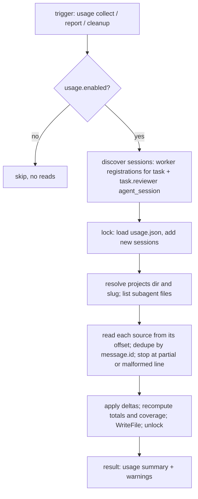
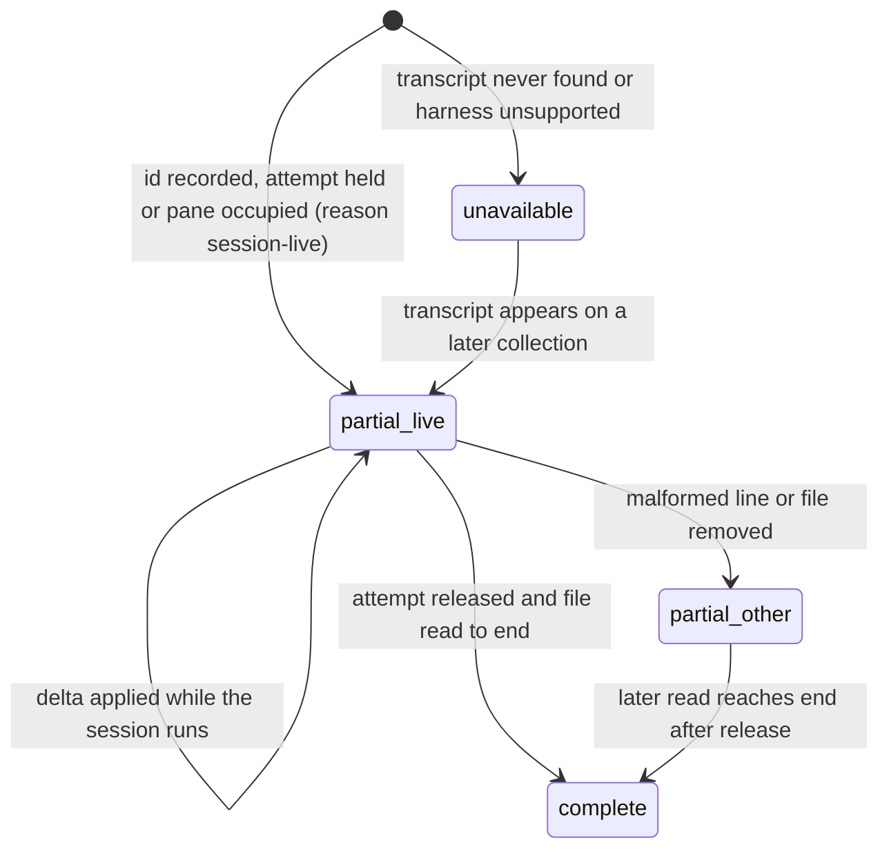

# Opt-in per-task agent usage accounting - Plan

## Goal Capsule

- **Objective:** An operator who turns usage accounting on can read, for one task, how many model invocations and tokens its implementation, review, and repair work consumed on Claude Code, with every gap in that picture labeled instead of counted as zero, and with no change to how tasks complete, deliver, release capacity, or get cleaned up.
- **Means:** A `usage` settings block, a private `usage.json` sidecar per task filled by delta-aware reads of the Claude Code transcripts that sum's own pane registrations name, and a `usage` command that reads it (KTD1, KTD2, KTD4).
- **Authority:** Issue #299, then this plan, then `VERIFY.md` and the feature maps.
- **Stop:** No dollar estimates, spending enforcement, daemon, scheduler, billing integration, account or model switching, no-mistakes dependency, or second harness adapter. No change to the harness argv sum sends to Herdr. No edits to `VERIFY.md`, `mise.toml`, `mise-tasks/`, `docs/features/README.md`, `.agents/skills/verify/`, `.agents/skills/evidence/`, `COORDINATOR.md`, or `skills/`. No new tests and no code comments (Key Decisions).
- **Execution profile:** One new Go package `go/internal/usage`, bounded edits in `go/internal/settings`, `go/internal/cli`, `go/internal/report`, `go/internal/cleanup`, `go/internal/review`, `go/internal/backup`, `go/internal/helpview/catalog.json`, plus docs, the web configuration page, and the coordination feature map. Proven by the existing suite, hand exercise against a lab state home with a real Claude transcript, and before/after CLI evidence.
- **Who finishes:** The worker implements, verifies, and opens the pull request. The user merges.

---

## Product Contract

### Summary

Add `usage: {"enabled": true}` to `.sum/settings.json`. When it is on, `report`, `cleanup`, and an explicit `sumctl usage collect TASK` read the Claude Code transcripts of the sessions sum already bound to the task, fold per-message usage into `.sum/tasks/<id>/usage.json` without double counting, and label what they could not see. `sumctl usage show TASK` prints per-category and task totals with a coverage label. When it is off, sum reads no transcript and writes no ledger.

### Problem Frame

Sum records which worker, reviewer, and repair attempts a task went through, and it can ask a provider for its remaining quota, but nothing says what one task consumed across those attempts. An operator comparing a cheap implementation with an expensive review loop, or deciding whether repair iterations are worth their cost, has only wall-clock impressions. The audit behind #299 found no per-task usage ledger in the reviewed paths. Claude Code writes a structured per-message usage record for every API call it makes, and Herdr already reports each pane's Claude conversation id to sum, so the data exists on the machine; sum just never joins it to the task.

### Requirements

**Opt-in**

- R1. `.sum/settings.json` accepts an optional `usage` object with one required boolean key `enabled`; any other key, a non-object, or a non-boolean refuses the whole file with the exact defect, the way `hook` and `evidence` defects do today.
- R2. With the block absent or `enabled: false`, no command reads a Claude transcript, resolves a Claude projects directory, or creates `usage.json`; `usage show` still reads a ledger that already exists and label the configuration `disabled`; `usage collect` refuses with the key to set.
- R3. `settings set` gains `--usage-accounting true|false` and `--clear-usage`, coordinator only, written atomically with the other blocks, and every existing settings writer preserves the block.

**Source and association**

- R4. The only supported source is a Claude Code session transcript: `<projects>/<slug>/<session-id>.jsonl` plus `<projects>/<slug>/<session-id>/subagents/*.jsonl`, where `<projects>` is `$CLAUDE_CONFIG_DIR/projects` from sum's own environment, else `$HOME/.claude/projects`, and `<slug>` is the registration's working directory, symlinks resolved, with every character outside `[A-Za-z0-9]` replaced by `-`. Sum opens no other path; the ledger records the resolved path for every session so an operator can see where sum looked.
- R5. A session belongs to the task only when sum recorded its id: the worker registration's `incarnation.agent_session` (agent `claude`, kind `id`) for a registration whose `task` is this task, and the `agent_session` that `reviewer launch` records on `task.reviewer` at launch (R6). Sum never scans other sessions, other slugs, or transcripts of panes it did not bind.
- R6. `reviewer launch` observes the bound reviewer pane the way `start` observes the worker pane and stores the observed incarnation on the reviewer endpoint, so a review session can be attributed.
- R7. Each session is attributed to the worker attempt whose checkout equals the registration's `cwd` and that was current when the session was first seen, or to the reviewer endpoint. Category is `implementation` for a worker attempt, `repair` when that attempt's repair-ledger operation has `kind: send`, `review` for a reviewer session, and `unknown` when the attempt cannot be established; a plain `execution resume` stays `implementation`.
- R8. A task on another harness, a task dispatched before the block was enabled, or a session whose transcript cannot be found reports `unavailable` for that session with the reason, never a zero.

**Measurement**

- R9. One invocation is one distinct `message.id` among `type: "assistant"` lines; its outcome is the last `stop_reason` seen for that id (`end_turn`, `tool_use`, `max_tokens`, `stop_sequence`, or `incomplete` when none was recorded); a line with `isApiErrorMessage: true` counts as an `api_error` invocation; a line with `isSidechain: true` or any line from a `subagents/` file also increments `subagent`.
- R10. Tokens are summed per session from `message.usage`: `input_tokens`, `output_tokens`, `cache_creation_input_tokens`, `cache_read_input_tokens`, once per `message.id`. A field absent from every message of a session is `null` for that session, and a total that includes such a session says how many sessions were unknown. Nothing is inferred from elapsed time or transcript length.
- R11. Per-session timing is `first_at` and `last_at` from line timestamps and the derived `wall_ms`; per-invocation durations are not in the source and are reported as unavailable, not estimated. The observed `message.model` values are listed per session.

**Deltas and durability**

- R12. The ledger keeps, per source file, the byte offset consumed and the last `message.id` folded; a later collection resumes from the offset, skips a leading repeat of that id, stops before a trailing partial line without advancing past it, and stops at the first unparsable complete line with status `partial` and the offset kept before it. A file shorter than its offset resets that file's counters and re-reads from zero. A file that is missing keeps the recorded counters and marks the session `partial` with reason `transcript removed`.
- R13. One collection holds the state lock from loading the ledger through writing it with `ordjson.WriteFile`, so two collections never fold the same delta and an interrupted write never leaves a partial `usage.json`.
- R14. `usage.json` lives beside `task.json`, refuses symlinks and a foreign schema like `pipeline.json`, survives `archive` and `cleanup`, and is added to the `backup` allowlist. Collection runs only on the task's recorded machine; elsewhere it skips with a warning.

**Collection points and best effort**

- R15. Collection runs at exactly three points: `sumctl usage collect TASK` (coordinator only), `report` after the task record is saved and the lock released, and `cleanup` (including `--reviewer-only`) after reservations are released and before the completion record is saved. Read-only views never collect.
- R16. Any source or ledger failure is a warning in the command result (`usage.warnings`) and never changes report acceptance, delivery gates, reservation release, cleanup, or the command's exit status.

**Reporting**

- R17. `sumctl usage show TASK` prints the configuration state, per-session rows, totals by category and task-wide, and a task coverage of `complete` (every known worker attempt and reviewer endpoint has at least one recorded session, every recorded session is `complete`, and no registration names a session id the ledger has not folded), `partial` (otherwise, with reasons), or `unavailable` (no readable session, unsupported harness, or no ledger); each row carries `source`, `status`, `reason`, and `collected_at`.
- R18. A session's status is `complete`, `partial`, or `unavailable`. While its attempt is held or its registration still occupies the pane it is `partial` with reason `session-live`; it becomes `complete` only after release when the file was read to its end without a malformed line. A Claude restart inside one attempt between two collections replaces the registration's session id before sum sees the old one; that gap is not detectable and the documentation names it as the one known undercount.
- R19. The help catalog, `docs/configuration.md`, the web configuration page, `docs/architecture.md`, and `docs/features/coordination.md` describe the setting, the Claude source format and its version assumption, the association and category rules, the coverage labels and the restart gap of R18, the rollback note (an older `sumctl` refuses a settings file carrying `usage`), and the standing non-goals.

### Key Decisions

- **Association uses the Claude conversation id Herdr already reports, not a sum-chosen `--session-id`.** The harness argv sum sends to Herdr is pinned by `go/internal/cli/dispatch_launch_test.go` and `execution_resume_test.go`, and a persisted flag would be re-sent on resume. Governs R5, R6, R7.
- **A plain resume is implementation, not repair.** `repair.RecordResume` writes a `kind: resume` operation for every successor, so the category keys on `kind: send`. Governs R7.
- **Collection is explicit maintenance, never a read-only view or the fast delivery path.** `docs/architecture.md` fixes that `status`, `inbox`, `show`, `context`, `doctor`, `init`, `bind`, `pump`, and hook events write nothing. Governs R15.
- **No tests are added or expanded in this change, and no code comments are written.** (session-settled: user-directed — chosen over the issue's "regression tests" checkbox: the user's standing #287 rule carried in the worker brief overrides it; the PR body and report disclose it. The one standing exception is regenerating help goldens whose only change is rendered help text from the catalog edit.) Governs R19.
- **Existing tests are left as they are.** (session-settled: user-directed — chosen over updating a golden that a code change moves: `settings show` therefore does not gain a `usage` row and `context` is not touched, because five context goldens pin its section list; the effective setting is read through `usage show`.) Governs R2, R17.
- **The change builds on `main` at `41ba86f` and stops at an open pull request.** (session-settled: user-directed — chosen over branching older or auto-merging: coordinator instruction and the factory constraint.) Governs nothing in the Requirements; it bounds delivery.
- **Verification policy files are not edited.** (session-settled: user-directed — chosen over touching the verify runner or the feature-map index: a candidate must not weaken the gate that certifies it; only `docs/features/coordination.md` gains rows.) Governs R19.

### Scope Boundaries

- Out: dollar or quota estimates, enforcement, model or account switching, a daemon or sweep-time collection, Codex or any other harness adapter, and publishing usage into the PR.
- Out: relaxing the unknown-key refusal in `settings.go` for older runtimes; the rollback note (R19) carries the trade-off.
- Considered and not built: recording the worker's session id at `init`, or observing every bound pane through Herdr at each collection, so a Claude restart inside one attempt is never missed. `init` is on the write-nothing fast path, a Herdr observation at collection still misses two restarts between collections, and R18 labels the gap in the documentation; evidence that operators hit it often would change the call.
- Considered and not built: a fallback that globs `<projects>/*/<session-id>.jsonl` when the slug derived from the registration has no transcript. R5 forbids reading outside the bound slug, and a wrong slug is already visible as `unavailable` with the tried path (R8); evidence that Herdr starts the Claude process outside the checkout would change the call.
- Considered and not built: a `context TASK --section usage` view beside `usage show`. The issue asks for one surface, and adding the section would move the five context goldens that pin `outline.read.sections`; `usage show --format json` carries the same object.
- Considered and not built: reading transcripts outside the state lock with a per-file compare-and-set. Collection runs at three explicit points and reads an append-only file once from its cursor, so a long lock hold would be noticed at once and fixed without touching stored data.
- Considered and not built: refusing a preset or `--arg` that carries `--resume`, `--continue`, or `--session-id`. Sum sets no session id, so these flags only change which transcript Herdr reports, and the ledger records whatever id was observed.
- Considered and not built: a `--since` or per-attempt filter on `usage show`; the ledger is small and `--format json` exposes every row.

#### Deferred to Follow-Up Work

- A `doctor` check that the resolved Claude projects directory exists and names its transcript version.
- Surfacing the task coverage label in `status` rows, which moves the status and inbox goldens.

---

## Planning Contract

### Key Technical Decisions

- KTD1. **One package owns the ledger and the Claude reader: `go/internal/usage`.** It holds the sidecar file contract, the session discovery over `store.Registrations()` and `task.reviewer`, the transcript resolver and line reader, the delta merge, and the view. Callers (`cli`, `report`, `cleanup`) get one `Collect` and one `View` entry point. Rationale: the issue's rules about deltas, unknown-not-zero, and coverage interact, and splitting them across callers would duplicate them.
- KTD2. **Ledger shape.** `usage.json` is `{schema: 1, task, enabled_at_collection, collected_at, sessions: [...], totals: {...}, coverage: {...}}`. Each session carries `id`, `role`, `category`, `attempt`, `repair`, `registration_key`, `cwd`, `projects_dir`, `sources: [{path, offset, last_message_id, lines}]`, `first_at`, `last_at`, `wall_ms`, `models`, `invocations: {total, by_outcome, api_errors, subagent}`, `tokens: {input, output, cache_creation, cache_read}` with `null` for never-seen fields, `status: complete|partial|unavailable`, `reason`, `collected_at`. Totals are by category and task-wide, each with `sessions`, `unknown_token_sessions`, the same `invocations` and `tokens` objects. Coverage is `{status, reasons}`. Rationale: additive sidecar beside `task.json` per `docs/solutions/architecture-patterns/retiring-persisted-compatibility-fields.md`; nested counters keep TOON readable and `--format json` carries everything.
- KTD3. **Delta merge keyed by `(path, offset, last_message_id)`.** The reader starts at the recorded offset, deduplicates within the delta by `message.id` (Claude writes one line per content block with identical usage), and updates `by_outcome` for an id that reappears with a new `stop_reason` by moving the count, not adding one. Rationale: the format verified on this machine (Claude Code 2.1.302) repeats `message.id` and `message.usage` across lines; this is the only stable identity.
- KTD4. **One lock acquisition per collection.** `Collect` takes `s.Lock()`, loads the ledger, reads every source from its cursor, writes the ledger, and releases. Rationale: the simplest arrangement that makes R13 true; the cursor keeps each read bounded to new bytes, so the hold is short.
- KTD5. **Transcript lines are parsed only when they can carry usage.** A line is skipped unless it contains `"type":"assistant"`; lines longer than 32 MiB count as malformed. Rationale: bounded, read-only collection on files that also hold tool results.
- KTD6. **The settings block mirrors `hook`.** `validateUsage` accepts exactly `{"enabled": bool}`, `Settings.Usage` is threaded through `save` and every caller, and `UsageEnabled(s)` returns false when the block is absent. Rationale: the one existing boolean-block precedent, with the default inverted because the issue requires opt-in.
- KTD7. **Help goldens are regenerated, settings and context goldens are not touched.** `help.stdout` and `help-unknown.err` change only because the catalog gains a `usage` topic; `cd go && UPDATE_GOLDEN=1 go test ./internal/cli/...` regenerates them and the handoff names them. `contextview.ContextSections` stays as it is because `outline.read.sections` renders that slice into five pinned context goldens. (session-settled: user-directed — chosen over editing `settings show`: the standing exception covers rendered help text from a catalog edit and nothing else.)

### High-Level Technical Design

Collection, from trigger to durable write:

Session status over its life:

### Assumptions

- The Claude Code transcript format observed on this machine (version 2.1.302: `type`, `uuid`, `timestamp`, `sessionId`, `cwd`, `isSidechain`, `requestId`, `message.id`, `message.model`, `message.stop_reason`, `message.usage`, `isApiErrorMessage`) is the format sum documents; a future field rename degrades to `partial` with a malformed-line reason, never to zeros.
- The worker pane's Claude process runs with the task checkout as its working directory, so the registration `cwd` after symlink resolution yields the slug; a slug without a transcript is reported `unavailable` with the tried path.
- `CLAUDE_CONFIG_DIR` in sum's environment matches the Claude process Herdr launched; a mismatch is reported as `unavailable` with the resolved directory in the row.
- The reviewer endpoint may carry a new `incarnation` key without moving any existing test, because `reviewer_launch_test.go` asserts `cwd`, `argv`, and skill fields only.
- `backup` restore on another machine keeps the ledger readable and `collect` there skips with a warning instead of resetting counters.

---

## Implementation Units

### U1. Settings block and settings writer

- **Goal:** `usage.enabled` is validated, preserved by every settings writer, and settable from the CLI.
- **Requirements:** R1, R2, R3; Key Decisions on tests and goldens.
- **Dependencies:** none.
- **Files:** `go/internal/settings/settings.go`, `go/internal/settings/write.go`, `go/internal/cli/settings.go`, `go/internal/helpview/catalog.json` (the `settings-set` topic arguments).
- **Approach:**
  1. Add `usage` to `settingsKeys` and to the literal `allowed` slice in `loadSettingsFile`; add `Usage *ordjson.Object` to `Settings`; add `validateUsage` beside `validateHook` and `UsageEnabled(s *store.Store) (bool, error)` that reads the file once (KTD6).
  2. Thread the block through `save` and its callers in `write.go`; extend `WriteArgs` with `UsageEnabled *bool` and `ClearUsage bool`, with the same conflict rule as evidence.
  3. Add `--usage-accounting` and `--clear-usage` to `settings set`; extend the all-empty refusal message; keep `settings show` unchanged.
- **Patterns to follow:** `validateHook` and `SetNativeEventsEnabled` in `go/internal/settings`; the `--auto-publish-evidence` flag in `go/internal/cli/settings.go`.
- **Test scenarios:** (recorded for the hand exercise; no tests are written, per Key Decisions)
  - A file with `"usage": {"enabled": true}` loads and `UsageEnabled` is true; with the block absent it is false.
  - `"usage": {"enabled": "yes"}` and `"usage": {"enabled": true, "x": 1}` refuse the whole file naming the defect.
  - `settings set --usage-accounting true` then `preset set NAME --harness claude --model m` leaves the block in place.
  - `settings set --clear-usage` removes the block; `--clear-usage` with `--usage-accounting` is refused.
- **Verification:** `settings show` output is byte-identical to today for every existing golden; the hand exercise above prints the expected refusals.

### U2. Usage package: ledger, Claude reader, delta merge

- **Goal:** `go/internal/usage` can discover the task's sessions, read their transcripts from the recorded cursors without double counting, and write the ledger atomically.
- **Requirements:** R4, R5, R7, R8, R9, R10, R11, R12, R13, R14, R17, R18.
- **Dependencies:** U1.
- **Files:** `go/internal/usage/record.go`, `go/internal/usage/claude.go`, `go/internal/usage/collect.go`, `go/internal/usage/view.go`.
- **Approach:**
  1. `record.go`: `File = "usage.json"`, `Load` (absent is empty, symlink and schema refusal), `save` through `ordjson.WriteFile`, totals and coverage recomputation (KTD2).
  2. `claude.go`: projects-dir resolution from the environment, slug derivation with symlink resolution, subagent file listing, and a line reader that honors offsets, partial trailing lines, malformed lines, and the size cap (KTD3, KTD5). It returns a per-file delta: counts by `message.id`, outcome per id, token sums, timestamps, models, api errors, subagent lines.
  3. `collect.go`: `Collect(s, taskID, host) (Result, error)` implementing the lock discipline of KTD4, session discovery from `store.Registrations()` filtered by `task` and from `task.reviewer.incarnation`, attempt and category resolution per R7 using `reservations.Worker` and `repair.Ledger`, machine check per R14, the `session-live` reason per R18, and the coverage rule of R17. Failures become `warnings`; the function never returns an error for a source problem, only for a ledger it cannot read or write, and callers treat that as a warning too.
  4. `view.go`: `View(s, taskID, enabled) *ordjson.Object` for `usage show`: configuration state, sessions, totals, coverage.
- **Patterns to follow:** `go/internal/pipeline/record.go` for the sidecar; `go/internal/environment/environment.go` `Redact` is not needed because no transcript text is stored; `go/internal/hookstatus/event.go` for environment-first home resolution.
- **Technical design (directional):** a session delta is folded as `invocations.by_outcome[old] -= 1; by_outcome[new] += 1` when an already-counted id reappears with a new terminal `stop_reason`, which keeps `total` stable across the in-flight to terminal transition.
- **Test scenarios:** (hand exercise against a copied real transcript and a lab home)
  - Collecting the same unchanged transcript twice leaves every counter and the offset identical.
  - Appending two more assistant lines for a new `message.id` raises `invocations.total` by one and the token sums by that message's usage once, although the two lines repeat the usage.
  - Truncating the file below the recorded offset resets that source's counters and re-reads from zero.
  - A trailing line without a newline is not consumed and the offset stops before it; after the newline arrives it is folded.
  - A corrupted middle line marks the session `partial` with its offset in `reason` and later lines are not read.
  - A session whose transcript path does not exist reports `unavailable: transcript not found` with the path sum tried.
  - A `message.id` first seen with no `stop_reason` and later seen with `end_turn` keeps `invocations.total` unchanged and moves one count from `incomplete` to `end_turn`; the real transcript on this machine never repeats an id with a different `stop_reason`, so this step needs a hand-edited line and the handoff says so.
  - A task recorded on another machine skips with a warning and writes nothing.
  - With the block disabled, `Collect` is never called and `View` reports `configuration: disabled` for an existing ledger.
- **Verification:** the ledger after each step above matches the expectation; `go vet` and `gofmt -l` are clean.

### U3. Command, help, backup

- **Goal:** operators can collect and read usage through `sumctl` and the ledger travels with backups.
- **Requirements:** R2, R14, R15, R17, R19; KTD7.
- **Dependencies:** U2.
- **Files:** `go/internal/cli/usage.go`, `go/internal/cli/root.go`, `go/internal/helpview/catalog.json`, `go/internal/backup/backup.go`, `go/internal/cli/testdata/help.stdout`, `go/internal/cli/testdata/help-unknown.err`.
- **Approach:**
  1. `usage show TASK` (any role, read only) and `usage collect TASK` (`app.RequireCoordinator`), both emitting through `emitOrdjson`; `collect` refuses when disabled with the key to set.
  2. Catalog: a `""`.commands line for `usage` and a `usage` topic with its two subcommands and `read_only_subcommands: ["show"]`.
  3. Add `usage.json` to the backup allowlist as a regular, non-symlink file like `notes.md`.
  4. Regenerate the two help goldens with the repository command (KTD7).
- **Patterns to follow:** `notes` in `go/internal/cli/native.go` for a small command.
- **Test scenarios:** (hand exercise)
  - `usage show` on a task without a ledger prints `coverage: unavailable` and the reason.
  - `usage collect` from a worker pane is refused as not the coordinator.
  - `usage show TASK --format json` carries the full nested ledger object.
  - `backup` into a temporary destination lists `usage.json` in the manifest for a task that has one.
- **Verification:** `go test ./internal/cli/...` passes after regenerating only `help.stdout` and `help-unknown.err`; every other golden is unchanged in `git status`.

### U4. Collection at report, cleanup, and reviewer launch observation

- **Goal:** usage is captured at the lifecycle points where evidence is about to go stale, and review sessions are attributable.
- **Requirements:** R6, R15, R16, R18.
- **Dependencies:** U2.
- **Files:** `go/internal/report/report.go`, `go/internal/cleanup/run.go`, `go/internal/review/review.go`.
- **Approach:**
  1. `report.Run`: after `unlock()` and before `returns.Notify`, when enabled, call `Collect` and attach its summary and warnings under `usage` in the result; an error is a warning.
  2. `cleanup.Run`: after `releaseCleanupReservations` and before the completion `saveCleanup`, and in `closeReviewerOnly` before its final save, the same call with the result under `usage`; the cleanup outcome is unchanged whatever it returns.
  3. `review.go`: after `agent start` succeeds, observe the pane outside the lock the way `prepare.observeBound` does; then, inside the existing post-start lock in `deliverKickoff` where the recorded reviewer pane is re-checked and `prompt` is saved, set `reviewer.incarnation` to the observed record, the same shape `bind --reviewer-pane` already writes, before `SaveTask`; a failed observation stores `agent_session: null` with a note.
- **Patterns to follow:** `prepare.observeBound`, `deliverKickoff` in `review.go`, and `bind --reviewer-pane` in `go/internal/bindcmd/bind.go` for the endpoint `incarnation` shape; the warning convention in `cleanup/run.go` (`detail.warning`).
- **Test scenarios:** (hand exercise against the fake Herdr and a lab home)
  - A worker `report` with usage enabled returns `status: reported-not-verified` and a `usage` object whose session is `partial: session-live`.
  - The same `report` with the projects directory unreadable still returns `reported-not-verified` and a warning naming the directory.
  - `cleanup --apply` on a merged task with an unreadable ledger directory completes with `step: archived` and a warning.
  - `reviewer launch` records `incarnation.agent_session` on `task.reviewer` when the fake Herdr reports one, and `null` when it does not.
- **Verification:** the existing report, cleanup, and reviewer launch tests pass unchanged; the hand exercise shows acceptance and cleanup decisions identical with and without the block.

### U5. Documentation, web page, and feature map

- **Goal:** the setting, the source assumptions, the rules, and the non-goals are documented where sum documents configuration and scenarios.
- **Requirements:** R19.
- **Dependencies:** U1–U4.
- **Files:** `docs/configuration.md`, `web/src/pages/configuration/index.astro`, `docs/architecture.md`, `docs/features/coordination.md`.
- **Approach:**
  1. `docs/configuration.md`: a `### Usage accounting` section stating the block, the three collection points, the Claude source path and version assumption, association and category rules, coverage labels, the rollback note, and the non-goals; extend the JSON-shape paragraph.
  2. Mirror the same prose on the web configuration page by hand.
  3. `docs/architecture.md`: add `usage.json` to the task-record sidecars and name `usage collect`, `report`, and `cleanup` as its only writers.
  4. `docs/features/coordination.md`: rows `usage.opt-in` (disabled reads nothing; invalid block refuses), `usage.collection` (association, deltas, dedupe, partial line, malformed line, one lock per collection), and `usage.coverage` (unknown never zero, unsupported harness, legacy task, live session, the restart gap, best-effort warnings), each `manual:` with the hand-exercise driver and an Evidence cell naming the implementation files by full path and the before/after CLI evidence.
- **Patterns to follow:** the `### Capacity` section and the `execution.project-capacity` row from PR #304.
- **Test scenarios:** `Test expectation: none -- documentation; the site build in mise run verify proves the page compiles.`
- **Verification:** `mise run verify` builds the web page; the feature-map audit in the verify runner accepts the new rows.

---

## Verification Contract

| Check | Command | Proves |
| --- | --- | --- |
| Aggregate | `python3 .agents/skills/verify/scripts/verify_run.py --base 41ba86fc24f5b08c7cfb3149c2b2bc9c9d8f735c --json` on the committed candidate with a clean tree | `mise run verify` (Go suite, site build) and the feature-map audit; the run id goes in the handoff |
| Lint | `mise run lint` | `gofmt -l` and `go vet` over `go/` |
| Hand exercise | a lab `--home`, a copied real Claude transcript under a temporary `CLAUDE_CONFIG_DIR`, the fake Herdr | the scenarios listed per unit, including opt-out, dedupe, deltas, missing measurements, and collection failures |
| Evidence | `.agents/skills/evidence/SKILL.md` CLI recipe for `usage show` and `usage collect` on the base (command absent) and the candidate | the `comparison.json` paths the coordinator's Test gate requires; `visual_proof: not-applicable` |

The settled no-new-tests rule means the issue's "regression tests" checkbox is satisfied by the hand exercise and the evidence captures, and the PR body says so.

---

## Definition of Done

- Every requirement R1–R19 is implemented or explicitly reported as not done in the handoff.
- `git status` shows no changed test, fixture, or golden other than `help.stdout` and `help-unknown.err`, and no code comment was added or edited.
- The verify run for the final SHA has its `run.json` attached to the handoff; a failing or provisional run is reported as it is.
- Before/after evidence for the usage commands exists and every `comparison.json` is listed under `artifacts`.
- Abandoned code paths and scratch files are removed from the diff.
- The pull request is open against `main`, not merged, and its body discloses the no-tests and no-comments rule.
