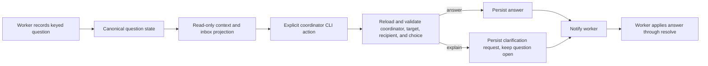

# Structured Inbox Decisions - Plan

## Goal Capsule

- **Objective:** People can understand a Sum question and submit an explicit decision through the existing coordinator path, while workers can distinguish answers from requests for explanation.
- **Means:** Extend existing question persistence, answer operations, and presentation routes (KTD1, KTD2).
- **Authority:** The coordinator remains the only writer of human answers. Inbox and context reads remain read-only.
- **Stop conditions:** Do not infer approval, weaken incarnation or role guards, replace the notification mechanism, add a frontend platform, or overlap source-specific sibling issue work.
- **Execution profile:** Implement the units in dependency order, use focused behavior coverage, and run the repository verification contract on the clean candidate.
- **Handoff:** Commit and prepare an open PR for coordinator review; do not merge.

---

## Product Contract

### Summary

Structured question details let a person compare choices, see the worker's recommendation and rationale, and answer or request an explanation without turning clarification into a decision. Existing text-only questions and current answer delivery behavior remain supported.

### Problem Frame

Workers already explain choices and evidence in question text, but the saved question shape does not identify those parts. As a result, inbox readers cannot scan a decision reliably, and an explanation request can be mistaken for an answer. Guarded, explicit actions are needed because answering changes durable task state and notifies a worker.

### Requirements

**Question records and compatibility**

- R1. A question may carry stable-ID choices, one recommended choice, a short rationale, and bounded evidence/source references while preserving its full text and remaining compatible with legacy text-only questions and repair-allowance decision data.
- R2. Recording structured questions requires valid choices and a recommendation that names one offered choice. Repeating the same keyed question is idempotent; changed content cannot silently replace the existing obligation.

**Presentation and action routes**

- R3. Context/inbox JSON, terminal detail, and coordinator guidance present the same structured decision information, including recommendation, rationale, and sources; full question text stays reachable when summaries are truncated.
- R4. The shared presentation layer describes an action's task/question target, kind, readable label, and applicable state or source identity. Action descriptions are hints rather than authority. Global Needs You counts and visibility remain independent of project focus.
- R5. Choosing a listed answer and explicitly submitting a custom answer use the durable answer path. Explain records a distinct clarification request, asks for context and tradeoffs through the coordinator, and leaves the question open with no answer. Reads, selection, and refresh do not mutate state.

**Guarded execution and delivery**

- R6. Before any external action, execution reloads canonical state and validates registered coordinator authority, task, current worker recipient/incarnation, question identity, current status, and selected choice. Stale, replaced, answered, wrong-task, wrong-role, and wrong-recipient actions are refused before a write or notification.
- R7. Answer state is persisted before notification. Duplicate submissions do not create another decision or overwrite an answer. Notification failure preserves the answer, and the worker applies it through the existing resolve operation.
- R8. Focused behavior coverage exercises legacy input, keyed duplicates and changed content, invalid choices, stale actions, Explain versus answer, repeated submissions, read-only refresh, notification failure, and durable application. Update affected help, procedures, and feature documentation.

### Acceptance Examples

- AE1. Given an open structured question with a recommendation and sources, when it is rendered in JSON or terminal detail, the choices, recommended option, rationale, and references are visible, and the full original text remains available.
- AE2. Given a structured question that was replaced or answered after a view was rendered, when a user submits its old action, the coordinator refuses it before notification or another durable write.
- AE3. Given an open question, when the coordinator submits an Explain request with clarification text, the worker is notified for context, the question remains open, and no answer is saved.
- AE4. Given an open question, when the coordinator submits a selected or custom answer, that answer is saved before notification; a notification failure leaves the saved answer available for the worker to apply.
- AE5. Given an inbox refresh or a project-focused view, global decision counts remain correct, selection remains stable where its item still exists, and stale rows expose no actionable route.

### Scope Boundaries

- In scope: structured choice data, shared action descriptions, explicit answer/custom-answer/Explain routes, canonical-state validation, consistent current CLI/context/inbox presentation, existing help and feature documentation, and focused behavior coverage.
- Deferred to sibling issues: GitHub review-thread sources (#306), incidental finding dispositions (#307), additional human-required source actions (#308), and precise feedback/recent outcomes (#309). Preserve the shared action foundation for these consumers without implementing their source adapters.
- Not built: generic dismissal or undo, expiry, inferred approval, second-model interpretation after replies, a replacement notification engine, daemon, live configuration, or a new frontend platform.

---

## Planning Contract

### Key Technical Decisions

- KTD1. Extend the existing question record and answer lifecycle. Optional structured fields preserve old records and retain one authority for durable question state.
- KTD2. Keep inbox and context projection read-only and represent available writes as explicit shared action descriptions. Execute them only through the existing coordinator CLI boundary after reloading canonical state.
- KTD3. Persist Explain as a separate idempotent clarification request on the question and notify the recorded worker through the existing delivery path. Keep the answer field and question status untouched so clarification remains distinct from a human decision.
- KTD4. Bind each action to task ID, immutable question ID, and the current worker recipient/incarnation; bind a choice action to its stable choice ID. The question key deduplicates recording and is not an incarnation token.
- KTD5. Reject a conflicting keyed duplicate instead of silently changing an open obligation. Use a content revision only if implementation finds the key does not make choice contents immutable.
- KTD6. Give each Explain request a stable identity derived from its task, question, captured worker recipient/incarnation, and clarification text. An exact retry is idempotent; different clarification text creates a separate request while the question remains open.

### High-Level Technical Design

### Assumptions

- The CLI can distinguish `answer --choice`, `answer --text`, and `explain --text` while using the existing durable answer and delivery paths.
- The current CLI and terminal inbox are sufficient action surfaces; no browser UI is required.
- A source reference can be represented within existing bounded detail conventions without introducing another storage owner.
- Explain requests can live with their question as separate records and be projected into worker context without changing decision status.

### System-Wide Impact

This change crosses task JSON, worker/coordinator authority, delivery, shared presentation, and read-only inbox/context consumers. Compatibility and stale-action validation must be checked across these boundaries. The shared action description is the extension point for sibling inbox sources.

### Risks & Dependencies

- Question records already contain repair-allowance-specific decision data; schema validation must preserve those fields and behavior.
- Answering and requesting explanation may trigger external notification. Require the registered coordinator and compare the captured worker recipient/incarnation with canonical state before writing or notifying; preserve saved state if notification outcome is uncertain.
- Current `presentation.Source` identity carries task, source kind, source ID, and optional revision/candidate data. Bind question actions to question ID and the captured recipient/incarnation; the question key is only a deduplication key.

### Sources / Research

- `go/internal/ask/ask.go` owns question creation, coordinator answer persistence, notification ordering, and worker application.
- `go/internal/presentation/presentation.go`, `go/internal/inboxview/snapshot.go`, `go/internal/inboxview/overview.go`, and `go/internal/inboxview/terminal.go` project saved state into read-only inbox and context routes.
- `skills/sum-work/SKILL.md` defines question recording and worker application; `skills/sum-status/SKILL.md` defines answer authority, context detail routes, and global inbox visibility.
- `docs/solutions/architecture-patterns/retiring-persisted-compatibility-fields.md` records the local compatibility-field lifecycle principle.
- External precedent: `https://github.com/petekp/inbox/blob/9bc2983367827bb6b49a7d14cfdff1f48a7f0626/hooks/view.ts` and `https://github.com/petekp/inbox/blob/9bc2983367827bb6b49a7d14cfdff1f48a7f0626/hooks/presses.ts` (shared action descriptions and distinct option/Explain handling).

---

## Implementation Units

### U1. Persist and validate structured question decisions

- **Goal:** Add optional structured choices, recommendation, rationale, and source references to keyed question records while retaining legacy and repair-allowance compatibility.
- **Requirements:** R1, R2
- **Dependencies:** None
- **Files:** `go/internal/ask/ask.go`, `go/internal/cli/native.go`, `go/internal/cli/structured_question_test.go`
- **Approach:** Keep original question text intact. Validate unique non-empty choice IDs and an offered recommendation at record time. Preserve keyed duplicate behavior, extending equality to structured contents so same content is idempotent and changed content is rejected.
- **Patterns to follow:** Existing keyed question handling and task JSON persistence in `go/internal/ask/ask.go`; command contract coverage in `go/internal/cli/native_test.go`.
- **Test scenarios:** Legacy text-only input remains recordable and readable; valid structured input persists all fields; missing/duplicate choice IDs and a recommendation outside the offered choices are rejected; same keyed structured input is idempotent; changed structured content for the same key is refused; repair-allowance decisions retain current behavior.
- **Verification:** Existing records load unchanged, malformed structured questions fail before persistence, and duplicate behavior does not replace an obligation.

### U2. Add guarded answer, custom answer, and Explain actions

- **Goal:** Route explicit decisions and clarification through registered-coordinator operations that revalidate current state before writing or notifying.
- **Requirements:** R5, R6, R7
- **Dependencies:** U1
- **Files:** `go/internal/ask/ask.go`, `go/internal/cli/native.go`, `go/internal/cli/structured_question_test.go`, `skills/sum-status/SKILL.md`
- **Approach:** Make the CLI distinguish `answer --choice`, `answer --text`, and `explain --text`. Each serialized route carries expected task ID, question ID, worker pane ID and incarnation, and (for a listed answer) choice ID. Require a registered and incarnation-verified coordinator. Reload the canonical task and compare every captured target field plus open status immediately before writing. Persist answers and separate clarification requests before using the existing worker notification path. Derive a stable Explain request identity from the task, question, captured recipient/incarnation, and exact clarification text so retries deduplicate while distinct requests remain recordable. Preserve worker `resolve` semantics.
- **Patterns to follow:** Existing durable write before pump/notification, duplicate answer handling, task endpoint identity, and `resolve` application path in `go/internal/ask/ask.go` and `go/internal/cli/native.go`.
- **Test scenarios:** Valid listed and custom answers use the durable path; Explain persists a distinct request and notifies while the question stays open and answer unset; an exact Explain retry deduplicates while different clarification text records a separate request; stale or replaced choice, changed worker incarnation, answered question, wrong task, and absent/reviewer/worker coordinator are refused before a write or notification; repeated identical action identity is idempotent; failed notification leaves saved answer or Explain request intact for later worker application/context.
- **Verification:** Only explicit answer submission changes decision state; every guarded failure precedes an external action; notification failure does not roll back persisted state.

### U3. Share action descriptions and structured decision presentation

- **Goal:** Expose a consistent structured decision and action contract from the current presentation, context, and inbox paths without making reads write state.
- **Requirements:** R3, R4, R5
- **Dependencies:** U1, U2
- **Files:** `go/internal/presentation/presentation.go`, `go/internal/presentation/presentation_test.go`, `go/internal/inboxview/snapshot.go`, `go/internal/inboxview/overview.go`, `go/internal/inboxview/overview_test.go`, `go/internal/inboxview/terminal.go`, `go/internal/inboxview/terminal_test.go`, `go/internal/statuscmd/compact.go`, `go/internal/cli/presentation_test.go`, `go/internal/contextview/contextview.go`
- **Approach:** Put semantic action metadata alongside `presentation.Source` and `Item`, then serialize it into bounded inbox/context rows and CLI routes. Carry structured details through `contextview`'s question projection and `inboxview` rows. Bind each route to task, question, and captured recipient/incarnation. Render recommendation, rationale, and sources consistently. Preserve global Needs You counts under project focus, full-text detail routes, stable selection, and action withholding for stale views.
- **Patterns to follow:** `presentation.Fact` and `Source` classification, `inboxview.Snapshot` read-only loading, `overview.Row` routes, and stale-view behavior in `inboxview.View`.
- **Test scenarios:** JSON, context detail, and terminal detail expose equivalent structured fields; legacy rows remain usable; truncated summaries retain a full-text detail route; focused project views retain global decision counts; refresh preserves a still-valid selection and performs no write; stale refresh exposes no action; action target/source identity distinguishes replaced questions and recipient incarnations; an agent can discover offered IDs in JSON and invoke the same allowed CLI actions without inferred consent.
- **Verification:** Read-only render and refresh do not acknowledge, answer, dispatch, or apply; global decision visibility and count stay stable.

### U4. Update worker/coordinator guidance and verify end to end

- **Goal:** Document structured question recording, Explain versus answer semantics, and the shared action contract; prove the full task behavior with existing verification.
- **Requirements:** R1-R8
- **Dependencies:** U1, U2, U3
- **Files:** `skills/sum-work/SKILL.md`, `skills/sum-status/SKILL.md`, `docs/features/coordination.md`, `go/internal/helpview/catalog.json`, `go/internal/cli/golden_test.go`
- **Approach:** Update the worker question procedure and coordinator guidance through the existing skill/document revision conventions. Keep guidance aligned with the persisted schema, explain path, read-only presentation, and authority guards. Regenerate affected golden help snapshots only when required by documentation or command help changes.
- **Patterns to follow:** Existing question procedure and status/answer guidance; `docs/features/README.md` map conventions and coordination journey.
- **Test scenarios:** Updated help and procedures describe legacy and structured questions; guidance distinguishes Explain from answer and preserves the coordinator-only decision boundary; existing golden output reflects any changed help text.
- **Verification:** `mise run verify` passes on the clean candidate, and every affected feature-map journey is accurate about automated versus manual coverage.

---

## Verification Contract

| Command | Purpose |
| --- | --- |
| `mise run verify` | Canonical repository verification, including Go behavior coverage and feature-map evidence requirements. |
| `python3 .agents/skills/verify/scripts/verify_run.py --base 41ba86fc24f5b08c7cfb3149c2b2bc9c9d8f735c --json` | Record the final clean candidate against the task base and capture the run record for handoff. |

## Definition of Done

- Structured and legacy questions remain readable and compatible, and invalid recommendations or changed keyed content are rejected.
- Explicit answers and Explain follow separate, guarded coordinator paths with correct persistence and notification ordering.
- JSON, terminal detail, and coordinator/worker guidance communicate the same choice, recommendation, rationale, and sources.
- Inbox/context reads remain read-only, global decision visibility is preserved, and stale actions are withheld and rejected at execution.
- Focused behavior coverage and `mise run verify` pass; verification evidence records the exact clean candidate.
- The diff contains no abandoned implementation attempts, and the task branch has a committed candidate and open PR for coordinator review.
