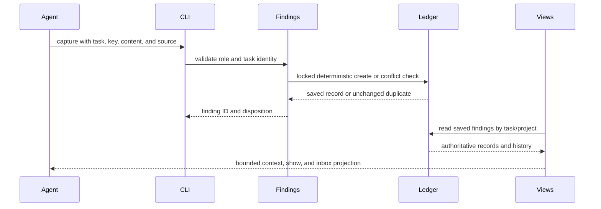
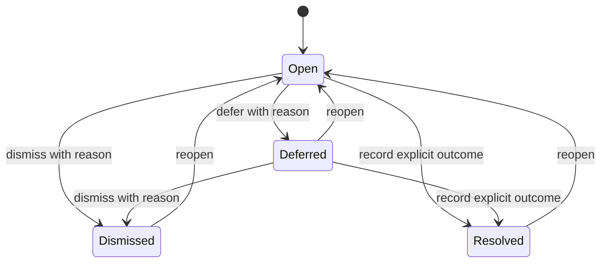

# Incidental Finding Follow-up - Plan

## Goal Capsule

- **Objective:** Agents and coordinators can retain useful out-of-scope discoveries, revisit them, and record an explicit outcome without changing the approval or delivery state of the originating task.
- **Means:** Add a durable finding ledger with role-checked capture and disposition actions and read-only task/project views.
- **Authority:** The approved task brief, existing task dispatch and repair authorization, and current review and verification gates remain authoritative.
- **Execution profile:** Implement against the task's current `main` baseline and sequence any shared inbox action integration after #305 provides its action descriptions.
- **Stop conditions:** Stop if a finding action would need to dispatch work without existing authorization or if a change would alter the meaning of review, PR identity, notes, or verification records.
- **Completion owner:** The coordinator performs independent verification and review and opens the PR. The user merges.

---

## Product Contract

### Summary

Add explicit, durable incidental findings associated with their originating task and project. Agents can capture a finding and continue approved work. The finding remains visible until an authorized person records a disposition or linked work settles.

### Problem Frame

Sum retains observations in notes, reports, handoffs, and reviewer records, but these records do not provide an explicit follow-up lifecycle for useful discoveries outside the approved brief. Treating those discoveries as blocking questions or review findings would change their authority and would interrupt the original task.

### Requirements

**Capture and identity**

- R1. A role-appropriate explicit capture action records a stable key, concise title and explanation, proposed next step, source/evidence references, originating task and project, author and time, and attempt/candidate identity when known.
- R2. Capture is idempotent for the same task and key with identical content. The same key with conflicting content is refused without changing the original record. Text similarity never merges findings.
- R3. Capture alone creates no task, blocking question, approval, scope expansion, review result, or verification evidence.

**Disposition and visibility**

- R4. A finding records append-only disposition and link events with actor, time, reason or outcome, and linked work. Dispositions include open, defer, dismiss, explicit resolution, and reopen. Link events distinguish attaching existing work from handing off to approved follow-up work.
- R5. Deferred and other unresolved findings remain discoverable. Dismissal preserves history; age, compaction, list limits, and source task archival do not erase or hide unresolved findings.
- R6. Saved inbox, task context, and show views expose source, age, proposed next step, and disposition. Views are read-only and keep optional findings separate from blocking Needs You decisions.
- R7. Where the shared inbox action descriptions are available, a finding exposes follow-up, attach, defer, dismiss, and explicit resolution actions with their source and state identity. Follow-up routes through the existing task creation and approval flow; after approval, the coordinator links the resulting task to the finding. Opening or applying a finding action does not itself create work.

**Authorization and compatibility**

- R8. Promotion or attachment links only to newly approved or suitable existing work, or to a scoped repair, and uses existing authorization. Repeated promotion is idempotent. A linked handoff remains outstanding until the linked work settles or the finding receives an explicit disposition.
- R9. Existing brief boundaries remain authoritative. Optional findings do not block completion of the originating task; defects or missing verification needed by that task stay in its report and delivery gates.
- R10. Existing reviewer findings, PR identity findings, limitations, and notes retain their current semantics. Dismissing an incidental finding cannot change a review verdict or waive evidence. Legacy notes remain readable without extraction or migration.

### Scope Boundaries

- **In scope:** explicit structured capture, deterministic identity, durable history, authorized linking, explicit dispositions, read-only saved visibility, and the documentation needed to use those paths.
- **Deferred to follow-up work:** automatic discovery or classification of findings from notes, reports, or model output. No automatic extraction is requested.
- **Out of scope:** fuzzy deduplication, automatic expiry, an independent issue tracker, a new approval system, implicit task creation, or a model call for each turn.

---

## Planning Contract

### Key Technical Decisions

- KTD1. Keep incidental findings in a dedicated authoritative ledger separate from task notes, review findings, PR identity observations, and blocking questions. Read views project the ledger rather than duplicating disposition state.
- KTD2. Scope the caller's exact non-empty stable key to its originating task and derive record identity as the full SHA-256 of a canonical JSON pair containing task ID and key. Compare canonical immutable capture fields, excluding capture actor/time and disposition history, for duplicate submissions. This follows Sum's task-local source/key conventions and avoids merging reports from separate tasks or by wording.
- KTD3. Keep each finding as one file under the state home `findings/` directory so source archival cannot remove it. Include every record in Sum's records-only backup because backup explicitly enumerates persisted state. Use Sum's state lock, atomic write, regular-file, credential handling, and bounded-read conventions.
- KTD4. Make disposition and promotion explicit role-authorized commands. Creating follow-up work passes through the existing task creation and approval flow; linking the approved result passes through the coordinator's finding authorization. Scoped repairs use existing repair authorization. Capture and inbox action reads never create or dispatch work.
- KTD5. Permit capture only to the registered worker assigned to the source task or its registered coordinator; reviewers and unrelated endpoints use existing review or report paths. Restrict changes to disposition and links to the registered coordinator, who owns human approval and repair authorization.
- KTD6. Record linked-work settlement as a coordinator-authored append-only resolution event after the linked task's result or repair outcome is reviewed. Do not infer resolution from a passive task status change.
- KTD7. Track disposition and linked-work status as separate fields. Allow one active linked-work target per finding. The first authorized link wins; a repeat to the same target is idempotent, while a different target requires an explicit reopen after the prior link is settled or explicitly dismissed. Defer, dismiss, and resolve may be recorded while work is linked and never erase its history. Reopening sets the disposition to open; an unsettled link remains outstanding, while a settled link is removed from the active target field and remains in history.
- KTD8. Add inbox action projection through #305's shared action description after that foundation is available. Give each action the finding ID and current disposition revision as source/state identity, and re-read the canonical record before applying it. Coordinate the additive adapter with #306, which consumes the same shared action surface.

### High-Level Technical Design

The interaction has two paths: a role-checked write path updates one authoritative ledger, and saved views read and project that ledger. Existing task approval, review, and verification systems remain independent.

Link status is tracked separately as absent, attached, handoff outstanding, or settled. Linking suitable existing work sets `attached`; linking an approved follow-up sets `handoff outstanding`. A coordinator records linked-work settlement after inspecting its result. Deferring preserves the link; dismissal or explicit resolution settles it without erasing its history. Reopening sets the disposition to open while an unsettled link remains outstanding; reopening after settlement clears the active target but preserves the prior target and its disposition event in history. A different target requires that explicit reopen. The stored history is authoritative. Read models may summarize it but cannot acknowledge or mutate findings. The command that links follow-up work records the existing approved task identity; it does not create a task as a side effect.

### Assumptions and Dependencies

- The base branch is Sum `main` at `41ba86f`, and its existing task and project identity rules remain the source for attribution.
- Issue #305 owns the shared action description in the presentation/inbox layer, which #306 also consumes. The finding ledger, capture, and disposition operations can be built without that change; action projection is sequenced after the shared type is available and coordinated across both lanes.
- The local Sum state directory is the durable home for the finding ledger. Existing backup behavior enumerates its records, so the finding ledger must be added explicitly to that list and its manifest.

### System-Wide Impact

The worker needs to record a finding without turning it into a question or changing task scope. The coordinator needs a saved view that distinguishes outstanding optional follow-up from work requiring attention. Reviewers and delivery gates must continue to see their existing verdict and evidence records unchanged. Project grouping must preserve host-qualified project identity and readable records whose source task is archived.

### Risks and Dependencies

- The schema, context, inbox, CLI, and skill documentation have neighboring work in #305 and #306. Keep those changes additive and record each shared file in the handoff for merge sequencing.
- A global ledger must report unreadable or malformed records as incomplete visibility rather than silently presenting an empty inbox.
- The task explicitly requires state-history behavior. Reopening is a new history entry, not deletion or rewriting of prior dismissals or resolutions.
- A linked task's status alone does not explain the outcome that resolves a finding. A coordinator records the settlement outcome explicitly after inspecting the linked work's report or repair result.

### Sources

- Issue #307, `Track incidental findings through explicit follow-up dispositions`.
- `go/internal/notes/notes.go` for task-local note attribution, safe writes, redaction, and bounded reads.
- `go/internal/ask/ask.go` for keyed durable state and coordinator authorization patterns.
- `go/internal/contextview/contextview.go` for role-aware read-only task context.
- `go/internal/inboxview/snapshot.go` and `go/internal/inboxview/overview.go` for saved source aggregation, project identity, gap reporting, and read-only routing.
- `go/internal/project/project.go` for canonical project identity.
- `docs/solutions/architecture-patterns/retiring-persisted-compatibility-fields.md` for single-authority persistence and read-boundary projection.
- Inbox's [record-and-continue guidance](https://github.com/petekp/inbox/blob/9bc2983367827bb6b49a7d14cfdff1f48a7f0626/hooks/model-text.ts#L65-L79) and [finding schema](https://github.com/petekp/inbox/blob/9bc2983367827bb6b49a7d14cfdff1f48a7f0626/hooks/tools.ts#L8-L22) as prior art. Sum's explicit key and no-expiry requirements govern this implementation.

---

## Implementation Units

### U1. Durable finding ledger and disposition history

- **Goal:** Store one deterministic finding record per originating task/key and preserve every disposition transition independently of source task retention.
- **Requirements:** R1, R2, R4, R5, R10.
- **Dependencies:** None.
- **Files:** `go/internal/notes/` finding ledger implementation and focused tests; `go/internal/store/store.go` only if the existing home lock/path API needs a narrow addition; `go/internal/backup/backup.go` and backup tests.
- **Approach:** Add a separate record type and one JSON file per finding under the state home `findings/` directory. Derive its filename from the task/key SHA-256 pair. Compare immutable capture content for duplicate submissions, excluding author/time and disposition history. Append disposition events with actor, time, reason/outcome, and linked task. Reject conflicting keys and second targets. Report malformed records as gaps. Refuse symlinks and credential-shaped content.
- **Patterns to follow:** `notes.Add` for locking, atomic mode-restricted writes, credential refusal, and attribution; `ask` for stable keyed idempotency and no-silent-replacement; compatibility learning for one authority with read-boundary projections.
- **Test scenarios:**
  - Capturing a new task/key produces a stable ID and stores next step, source references, optional attempt/candidate, and task/project attribution.
  - Repeating identical content under the same task/key returns the existing ID without adding a record.
  - Concurrent identical submissions produce one record, while conflicting title, explanation, or references are refused without replacing it.
  - Defer, dismiss, reopen, and resolve append actor/time/reason/outcome history and preserve earlier events.
  - A finding remains readable after its originating task is archived, and legacy notes remain byte-for-byte readable and unextracted.
  - A records-only backup includes the findings ledger and identifies it in the manifest.
  - Restoring that backup into a new state home retains each finding, its disposition history, and visibility for an archived source task.
  - Symlinked, malformed, and credential-shaped inputs fail without modifying existing records.
- **Verification:** The ledger has one authoritative record per task/key, preserves history through every disposition, and exposes errors instead of silently losing visibility.

### U2. Role-authorized capture, disposition, and promotion commands

- **Goal:** Give agents and coordinators explicit CLI paths to capture and dispose findings while preserving existing authorization boundaries.
- **Requirements:** R1, R3, R4, R8, R9.
- **Dependencies:** U1.
- **Files:** `go/internal/cli/native.go`, `go/internal/cli/root.go`, new finding command files and tests under `go/internal/cli/`, `go/internal/helpview/`, relevant help snapshots, `skills/sum-work/SKILL.md`, `skills/sum-status/SKILL.md`, and `docs/repairs.md` if repair linking requires clarification.
- **Approach:** Expose explicit record, defer, dismiss, reopen, resolve, attach, and promote operations. Permit capture from the registered worker of the source task or its coordinator; reserve disposition, settlement, and linking for the registered coordinator. Derive role from the endpoint rather than accepting a caller-declared role. Route follow-up creation through the existing task creation and approval flow, then link its approved task; attaching requires suitable existing work. Scoped repairs use existing repair authorization. The first linked target wins; repeat links to that target are idempotent and a different target is refused until the finding is reopened with the prior link disposition recorded.
- **Test scenarios:**
  - An authorized worker records a finding during an approved task without creating a task or question.
  - An unrelated endpoint or forged role string cannot record or change a finding.
  - An authorized coordinator links an existing approved task; repeating the same promotion returns the original link.
  - Concurrent links to the same target create one history entry; concurrent links to different targets preserve the first and refuse the second.
  - A different task, stale target, or unapproved target is rejected without a dispatch or repair side effect.
  - A linked handoff remains outstanding until the coordinator records its inspected task or repair outcome; a task status change alone does not settle it.
  - A defect or required verification gap remains in the original report and delivery result regardless of finding dismissal.
- **Verification:** CLI writes use existing identity and authorization checks; no finding command creates work without a separately approved task or repair.

### U3. Read-only context, show, and inbox visibility

- **Goal:** Make findings discoverable from task and project views while keeping optional follow-up distinct from blocking decisions.
- **Requirements:** R4, R5, R6, R7, R10.
- **Dependencies:** U1. Inbox action descriptions from #305 before action projection; coordinate the shared adapter with #306.
- **Files:** `go/internal/contextview/contextview.go` and tests; `go/internal/cli/context.go` and tests; `go/internal/inboxview/snapshot.go`, `overview.go`, `terminal.go`, and tests; `go/internal/presentation/presentation.go` and tests; metadata projection files if required.
- **Approach:** Add a read-only findings section and source routes. Project source, age, proposed next step, disposition, and linked work. Group by canonical project identity, include archived-source findings, and provide pagination and a detail route. Report malformed ledger records as visibility gaps. Add finding action descriptions for follow-up, attach, defer, dismiss, and resolve through #305's shared action type, with finding ID and disposition revision as source/state identity; validate identity and state against the canonical ledger on execution. The follow-up action routes to existing task creation and approval; the coordinator links the approved task afterward. Keep inbox changes additive with #306 and do not count findings as decisions or inspections.
- **Test scenarios:**
  - Task context and show expose the finding's source, age, next step, disposition, and history without mutating it.
  - Inbox groups active findings by project, includes archived origins, and keeps them out of Needs You decision counts.
  - Paging exposes a discoverable continuation and counts reflect all readable records; unreadable entries make the view incomplete.
  - Refreshing or opening any read view leaves the finding ledger unchanged.
  - An action created from an older disposition revision is refused after the finding has changed.
  - Existing review verdicts, PR identity items, limitations, and verification obligations remain unchanged when a finding is dismissed.
- **Verification:** Context, show, metadata, and inbox are read-only projections of one ledger and keep findings separate from blocking and review records.

### U4. Feature guidance and verification map

- **Goal:** Document when to capture incidental findings, how to choose a disposition, and which checks cover the behavior.
- **Requirements:** R1-R10.
- **Dependencies:** U2, U3.
- **Files:** `skills/sum-work/SKILL.md`, `skills/sum-status/SKILL.md`, `docs/repairs.md` if needed, and the relevant row in `docs/features/README.md` or its owning feature map.
- **Approach:** Explain that findings are optional records, do not authorize work, and do not replace task reports for in-scope defects or required verification. Describe each disposition and the existing authorization needed to promote it. Preserve all existing review, note, and evidence language.
- **Test scenarios:**
  - The documented worker path names the explicit capture command and states that recording does not create or block work.
  - The status path explains how to find deferred findings and how linked handoffs settle.
  - The feature map links the behavior to the focused CLI and package coverage and names any manual scenario as not-run until captured.
- **Verification:** Guidance, CLI help, and the feature map agree with the shipped command and disposition semantics.

---

## Verification Contract

- Use focused existing Go package and CLI coverage for the scenarios in U1-U4. The issue explicitly requests focused behavioral coverage.
- Run the repository's standardized verification runner from a clean committed candidate: `python3 .agents/skills/verify/scripts/verify_run.py --base 460cb52400706f8a42636b630d32b3f095cb256e --json`.
- Capture nonvisual CLI before/after evidence for the changed user path using the evidence skill. The transcript must say `visual_proof: not-applicable`; do not create a browser capture for this CLI feature.
- The coordinator runs an independent verification and review against the candidate SHA. The worker does not open or merge the PR.

---

## Definition of Done

- A stable task/key produces one authoritative finding record and conflicting content cannot replace it.
- A records-only backup contains the ledger and identifies it in its manifest.
- Restoring the records-only backup preserves findings, disposition history, and archived-source visibility.
- Disposition history includes actor, time, reason/outcome, and linked work; defer, dismiss, reopen, resolution, and outstanding handoff states are visible.
- Authorized promotion links approved work idempotently and never creates a task or repair from capture alone.
- Saved inbox, context, and show views display the required details, preserve archived-source findings, and leave decisions, reviews, notes, PR identity, and verification gates unchanged.
- Focused coverage and the required verification runner complete on the committed candidate, and the handoff lists the comparison artifact and all files shared with #305 or #306.
- Documentation describes the explicit workflow and confirms that optional findings do not block the originating task.
- The final diff contains no abandoned exploratory code or unrequested work.
