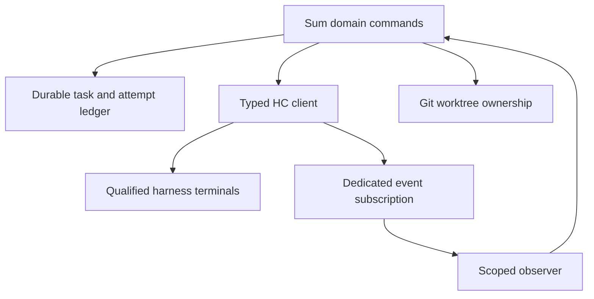
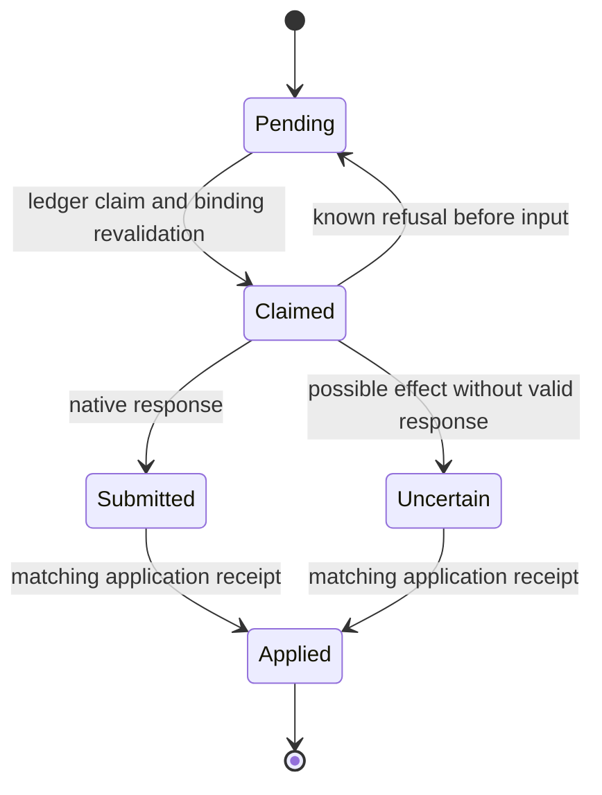
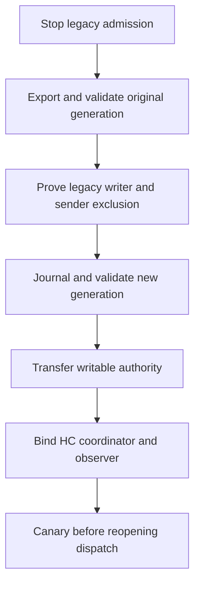

# HC terminal runtime - Plan

## Goal Capsule

Operators can complete Sum's approved local terminal workflow, recover interrupted work, and retain its decisions and evidence while using the supported upstream terminal runtime.
The means are the HC-only integration in KTD1 and the qualified native input path in KTD2.
The user-approved specification is [issue 330](https://github.com/douglasjarquin/sum/issues/330), with the conversation's explicit replacement of the upstream-patch proposal by the Sum-local approach.
This ships as one reviewable Sum PR from `sum-dev/issue-330`; only the user merges or activates it.
Stop on a demonstrated incompatible dependency or an unresolved authority transfer; never silently weaken a recorded approval, uncertainty, or cleanup rule.
No upstream changes or upstream PRs are authorized.

---
## Product Contract

### Summary

Replace the terminal runtime and its transport while preserving the useful application ledger and operational guarantees named in issue 330.
The complete ordered checklist and behavioral matrix in that issue are adopted as the acceptance authority; this plan binds their implementation areas below instead of replacing them with a smaller subset.

### Problem Frame

The custom Mesh MCP, scoped bridge, direct Herdr prompt calls, native workspaces and plugin callbacks couple task policy to a retired runtime.
A transport rename would preserve incompatible identity, delivery and cleanup assumptions.

### Requirements

**Runtime and delivery**

- R1. Every active terminal handoff uses unmodified upstream HC through one typed client, covering issue phases 0-5 and 7.
- R2. Preserve the issue's durable obligations, conservative effect classification, quiet wakes, matching receipts and bounded automatic reconciliation.
- R3. Qualify each enabled harness before automatic delivery; the approved Codex exception uses KTD2 rather than the original exact Done predicate.

**State and ownership**

- R4. Preserve Git isolation, exact endpoint/attempt authority, capacity, permission policy, candidate-bound evidence and guarded cleanup.
- R5. Implement the issue's explicit resumable schema migration, historical readers, old-writer exclusion and compatible rollback gates without a writable dual-backend mode.

**Packaging and scope**

- R6. Stage exact HC artifacts, matched manuals and owned templates/configuration while retaining unrelated MCP integrations.
- R7. Preserve `GROK_SUM.md`, `GROK_SQUARE.md`, `grok-bots/**`, and `skills/sum-factory/factories/{copy,software}.md` byte-for-byte.
- R8. Complete the issue's offline aggregate, isolated real-runtime canary, documentation/site updates and independent policy review before publication.

### Scope Boundaries

Existing local supported hosts remain in scope.
Remote state synchronization, graphical workspace parity, credential/account changes, permission bypasses, global runtime restarts and upstream dependency modifications remain outside scope.
A native terminal status or queued submission never supplies approval or business completion.

---
## Planning Contract

### Key Technical Decisions

- KTD1. Implement a focused `go/internal/hcclient` package against the published plain JSON-RPC API, with separate ordinary and event connections.
  Use exact core ID and returned terminal address, and expose typed native results rather than legacy command emulation.
  Governs R1 and R4.
- KTD2. Use a release-matched HC template with `submit: tab` for qualified Codex launches.
  Defer recipients observed working, blocked or unknown; use native `if:idle` where appropriate and ordinary `terminal.send` with no `force` for a recipient observed Done.
  A raced busy transition is handled by Codex's native queue rather than by steering its current turn.
  This deliberately replaces the original exact-status-at-input requirement for that qualified path; it does not claim atomic Done guarding.
  Native send success is only submission evidence, and native turn counters are diagnostic episodes rather than one-to-one application receipts.
  (session-settled: user-approved — chosen over modifying upstream HC: the owner requested an application-local workaround after reviewing the queueing tradeoff.)
  Governs R2 and R3.
- KTD3. Introduce versioned HC endpoint records and a new writable state generation while retaining immutable historical records.
  Normal Open/init/status never migrate; explicit activation requires exclusion of old writers and senders as issue 330 specifies.
  A schema bump or a new symlink alone cannot fence an already-open old Store.
  Governs R4 and R5.
- KTD4. Git owns deterministic worktree intent and registration verification; HC owns terminal processes.
  Managed terminals use `outlive_parent:true`, `keep:false`, `rm:false` and `no_notify:true` with saved creation and first-message outcomes.
  Governs R1 and R4.
- KTD5. Replace plugin callbacks with one proven-owned observer per installation/core/session scope.
  Reconcile fresh snapshots after reconnect/missed events and drain a fair bounded affected-recipient set without a second payload queue or polling daemon.
  Sum-only commits invoke the same bounded reconciliation entrypoint.
  Governs R2.
- KTD6. Stage published HC 0.1.14 from its exact versioned manifest and qualify Codex 0.166.0 with `--no-daemon`.
  The older optional Codex pin lacks the required status/flag support.
  Do not change models, reasoning, permissions, accounts or global keymaps to make qualification pass.
  Keep templates namespaced and bound to their validated command/keymap hashes.
  Governs R3 and R6.
- KTD7. Remove all active legacy transport code and generated owned Mesh configuration after callers have migrated.
  Historical parsing is distinct from an executable legacy backend, and sealed procedure/policy snapshots remain byte-stable.
  Governs R1, R5 and R6.

### High-Level Technical Design

### Integration Contract

`hcclient.Client` uses an explicit local socket and expected core ID; routine observations never invoke `hc connect` or start a core.
Each ordinary operation performs a compatible `hello` and checks the actual selected core before sending its request.
The client provides Hello, Run, List, Get, Send, Read, Wait, Interrupt, Kill, Remove, Label and Subscribe operations using the published schemas.
Calls have context deadlines, line/output caps and request-ID checks; no call is automatically replayed.
Effect errors distinguish not-submitted, known-refused and uncertain, preserving upstream kind/message/hint.
Run results embed flattened terminal fields; optional started/status values remain nullable.
Passive observations omit caller; active parent/sender linkage uses the actual authorized caller.
Subscription snapshot and event sequence are connection-local observations and never durable acknowledgments.

Endpoint schema 2 stores backend HC, stable Sum machine ID, core ID, explicit session/socket route, exact address, role, task, attempt, binding generation and created time.
Terminal identity compares core/address; application authority additionally compares current attempt and binding generation.
Routing aliases and names are never identity.
Remote addresses are refused for Sum execution until remote state ownership is explicitly implemented.

### Existing Evidence and Remaining Qualification

The selected macOS artifact hash is `ca524329d2e0630219550055dcc71f42aafd85fba356e0d543d6f51244487970` from the official 0.1.14 manifest.
Its schema matches the inspected API baseline after JSON normalization.
The published v0.1.14 source tag resolves to `29e6d375623de40cb4820e0894aa131ba057b796`; current upstream master is `9edb39d2f52f1e8577baa0413746873ad61620dd`.
Source at master is research context rather than proof of artifact contents.
The actual release hello, supported methods/features, schema fingerprint, native Done follow-up and real Codex Tab smoke are retained under `.artifacts/hc-contract/`.
The busy queue canary must verify ordered application responses, because continuous Working can coalesce native turn counts.
Unqualified enabled harnesses block activation or require the owner's explicit documented manual choice; never silently substitute Codex for them.

---
## Implementation Units

### U1. Native API client and reproducible contract evidence

**Goal:** Establish one bounded, typed upstream boundary and endpoint identity foundation.
**Requirements:** R1, R3, R4; KTD1 and KTD2.
**Dependencies:** None.
**Files:** `go/internal/hcclient/{client,types,events,endpoint}.go`, their `_test.go` files, `docs/decisions/hc-runtime.md`.
**Approach:** Decode the exact selected schema, keep connections independent, classify effects conservatively and retain Phase 0 evidence without exposing accounts or credentials.
**Patterns:** `go/internal/proc/proc.go` effect handling and existing bounded fake-runtime tests.
**Test scenarios:**

- A flattened native launch and a nullable Started result decode without invented wrappers or completion claims.
- Different core IDs with identical addresses cannot share authority.
- Passive calls carry no caller and a missing socket starts nothing.
- Wrong request ID, malformed/truncated/oversized response, cancellation and lost response retain the correct effect class.
- A dedicated subscription handles snapshot, event and missed messages while ordinary calls continue independently.
- Published HC and qualified Codex prove Done follow-up and ordered busy queue responses using scratch scopes.

**Verification:** Focused Go client tests and the isolated native probe pass before caller migration.

### U2. Versioned state, endpoint authority and migration fencing

**Goal:** Preserve durable history while making new writable authority explicit.
**Requirements:** R4, R5; KTD3.
**Dependencies:** U1.
**Files:** `go/internal/store/`, `contract/`, `incarnation/`, `roleinit/`, `reservations/`, `machine/`, new `migration/`, and their tests.
**Approach:** Version endpoint/dispatch readers, retain old sealed bytes and introduce explicit migration/export/journal commands with exclusion checks.
**Patterns:** Existing store locks, atomic writes and schema refusal.
**Test scenarios:**

- A legacy Store paused after Open cannot mutate or send through the transferred authority.
- Interrupted conversion resumes without mixed writable generations or rewritten sealed evidence.
- Same address on another core, reused names, replaced foreground process and changed attempt refuse inherited authority.
- Questions, answer dispositions, pending refreshes, candidates and uncertain attempts survive unchanged.
- Incompatible old helpers and rollback are refused before effects.

**Verification:** Migration, registration, incarnation and reservation tests pass against both historical reading and HC writable state.

### U3. Exact packaging and qualified harness templates

**Goal:** Stage a reproducible HC runtime and native harness input contracts without altering global configuration.
**Requirements:** R3, R6, R7; KTD2 and KTD6.
**Dependencies:** U1.
**Files:** `scripts/{setup,install_runtime}.py`, `scripts/relink_runtime_links.mjs`, `mise.toml`, `go/internal/toolpath/`, `launch/`, `settings/`, `release/` packaging code, `tests/{test_setup,test_packaging}.py` and related launch tests.
**Approach:** Resolve exact platform artifacts and checksums, save matched schema/manual/template provenance, and preserve owned-block conflict checks and existing Claude isolation/permission arguments.
**Test scenarios:**

- Exact artifact/checksum staging refuses a mismatch and never floats through `hc update`.
- Unrelated or customized MCP/template entries survive or produce a precise ownership conflict.
- A qualified Codex template uses supported Tab submission and no-daemon while preserving model and permission flags.
- Missing status support and incompatible keymaps block enabled automatic presets.
- Preserved Bot-pack files and shared factory contracts remain byte-identical.

**Verification:** Packaging/setup tests and matched-runtime smoke pass; publication does not activate the candidate.

### U4. Native fixtures and isolated lifecycle canary

**Goal:** Supply model-free protocol fixtures and real-runtime proof for the new contract.
**Requirements:** R1, R2, R8; KTD1 and KTD5.
**Dependencies:** U1.
**Files:** New `go/internal/hctest/`, `tests/fixtures/` HC fixtures, `scripts/{live_smoke,live_incarnation}.py`, `mise-tasks/test-live`, and fixture tests.
**Approach:** Use real JSON-RPC socket fixtures, unique scratch sessions and fake OSC-reporting programs rather than renamed legacy CLI responses.
**Test scenarios:**

- Initial assignment unsent, lost launch/send response, false/null Started and blocked/unknown status remain distinct.
- Events reconnect/missed snapshots reset ephemeral sequence without replaying submitted attempts.
- Parent exit leaves outliving agents/services alive; kept-shell recovery is not a worker.
- Observer and fixture teardown leave no owned process or writable live state behind.

**Verification:** Fixture self-tests and isolated published-HC lifecycle scenarios pass without model credentials.

### U5. Dispatch, coordinator bootstrap, review and execution recovery

**Goal:** Launch and recover the full approved work lifecycle with Git and HC ownership.
**Requirements:** R1, R3, R4; KTD1-KTD4.
**Dependencies:** U2, U3, U4.
**Files:** `go/internal/prepare/`, `review/`, `execution/`, `bindcmd/`, `lifecycle/`, `app/`, relevant `cli/` commands/tests, and `verifycontract/dispatch.go`.
**Approach:** Persist deterministic Git/launch intent before effects, record returned HC endpoints separately from initial delivery, and preserve candidate-bound independent review and explicit receipt-based uncertain-launch confirmation.
**Test scenarios:**

- Interrupted worktree creation reconciles one registered checkout without force/reset or duplication.
- First coordinator bootstrap does not claim a second live coordinator.
- Worker/reviewer names remain bounded and unique across simultaneous tasks.
- Created-but-unsent and uncertain launch states never trigger duplicate processes or blind re-prompts.
- Rebind/takeover requires matching current process and attempt evidence.

**Verification:** Ported CLI dispatch, start, reviewer and execution suites exercise actual task records through the HC fixture.

### U6. All deliveries, quiet wakes, observer and runtime views

**Goal:** Preserve automatic eligible delivery and truthful observation through one HC path.
**Requirements:** R1, R2, R3; KTD1, KTD2 and KTD5.
**Dependencies:** U2, U3, U4.
**Files:** `go/internal/returns/`, `refreshcmd/`, `repair/`, `hookstatus/`, `metadata/`, `panes/`, `statuscmd/`, `contextview/`, `inboxview/`, `presentation/`, `usage/`, `doctor/`, hook/native CLI surfaces and tests.
**Approach:** Reuse durable claim/wake semantics, replace every direct send, and scope observers by installation/core/session with fresh catch-up and fair bounded continuation.
**Test scenarios:**

- Busy answers/refreshes deliver later, with receipts closing obligations rather than native status.
- Twelve routine returns and an urgent question preserve priority and one outstanding routine wake.
- Route/question changes during observation prevent stale sends while unrelated recipients progress.
- Reconnect, missed events, observer replacement and no-later-event budget deferral do not strand or replay obligations.
- Saved disabled preference survives init/update, and observational reads never start a core.
- Sum-only bind/adopt/consume changes invoke bounded reconciliation without waiting for a native event.

**Verification:** Ported return concurrency/priority/wake tests plus observer lifecycle tests prove bounded delivery and uncertainty retention.

### U7. Services and guarded terminal/Git cleanup

**Goal:** Preserve safe service lifecycle and cleanup authorization without legacy workspaces.
**Requirements:** R4; KTD3 and KTD4.
**Dependencies:** U5, U6.
**Files:** `go/internal/environment/`, `cleanup/`, service-related `execution/stop.go` and `lifecycle/`, and their tests.
**Approach:** Persist proven-owned native service endpoints, retain one-interrupt policy and perform authorized finished-terminal removal separately from safe Git worktree removal.
**Test scenarios:**

- Dirty/unmerged work, pending obligations, surviving children, shared services and uncertain ownership block cleanup.
- A single interrupt followed by observed exit stops only the exact authorized service.
- Interrupted cleanup resumes from intent without force-removing a checkout or unrelated terminal.

**Verification:** Environment and cleanup suites cover the existing protected work/evidence invariants through HC/Git fixtures.

### U8. Activation contracts, retirement, documentation and final delivery

**Goal:** Ship a coherent HC-only Sum candidate with policy review and all acceptance evidence.
**Requirements:** R1-R8; KTD3, KTD6 and KTD7.
**Dependencies:** U5, U6, U7.
**Files:** `go/internal/runtime/`, `updatecmd/`, release validation, obsolete Mesh/bridge entrypoints and packages, `AGENTS.md`, `COORDINATOR.md`, active terminal `skills/`, `README.md`, affected `docs/`, feature maps, Astro `web/`, dependency inventory and operating/CLI tests.
**Approach:** Validate the target executable's capabilities, complete explicit cutover/rollback gates, retire executable legacy transports and update every active terminal procedure while preserving excluded Bot paths.
**Test scenarios:**

- Fresh HC-only setup and the complete task/question/answer/report/review/verify/cleanup canary work with legacy Herdr/Mesh absent.
- Incompatible activation and unresolved old writers/attempts refuse without mutation.
- Transport search finds only intentionally historical or owner-excluded references.
- Site, help, generated briefs and procedure snapshots describe the same supported contract.

**Verification:** Canonical aggregate, lint, verification audit, isolated native canary and independent candidate/policy review pass before the one Sum PR is opened.

---
## Verification Contract

`VERIFY.md` remains authoritative.
Use focused tests for iteration, then run `MISE_ENABLE_TOOLS=go,python,node,aube python3 .agents/skills/verify/scripts/verify_run.py --base <merge-base>` once for the final developer candidate.
Run the declared lint and verification audit, preserve `requires_root_review`, and keep local, hosted CI and actual-harness evidence separate.
The isolated HC canary supplements the aggregate; offline fixtures do not certify untested harnesses or a live installation migration.
No live coordinator state, default runtime session, unrelated panes or production deployment is a test target.
Independent work uses peer development checkouts with one writer each and integration-owned commits.

---
## Definition of Done

All issue 330 phases and required behavioral scenarios are accounted for by implemented behavior and evidence or an explicit owner decision.
Every active terminal path uses HC, and no executable legacy fallback or replacement broker remains.
Migration preserves immutable history, prevents mixed authority and supports compatible recovery.
The excluded Grok Bot files and shared factory contracts are unchanged.
The Sum PR is pushed, independent policy review and hosted CI are recorded, and the user's merge and activation decisions remain outstanding.

---
## Sources

- [Issue 330 full implementation and behavioral contract](https://github.com/douglasjarquin/sum/issues/330).
- [Published HC 0.1.14 manifest](https://releases.herdr.dev/core/0.1.14/manifest.json).
- [HC plain API and event contract](https://github.com/herdrdev/herdr-core/blob/dbcdcffc779f7516d5815cbd6f0a37da2b5e6628/schema/README.md).
- [HC native template submission](https://github.com/herdrdev/herdr-core/blob/dbcdcffc779f7516d5815cbd6f0a37da2b5e6628/docs/templates.md).
- [Codex native input submission and queueing](https://github.com/openai/codex/blob/6ff1e1ca3b30fc8b914720681fcf5fe62e95f856/codex-rs/tui/src/bottom_pane/chat_composer.rs).
- Existing repository seams and risks are documented in `.artifacts/hc-contract/{repository-research,migration-research,harness-matrix,upstream-research,local-workaround}.md`.
