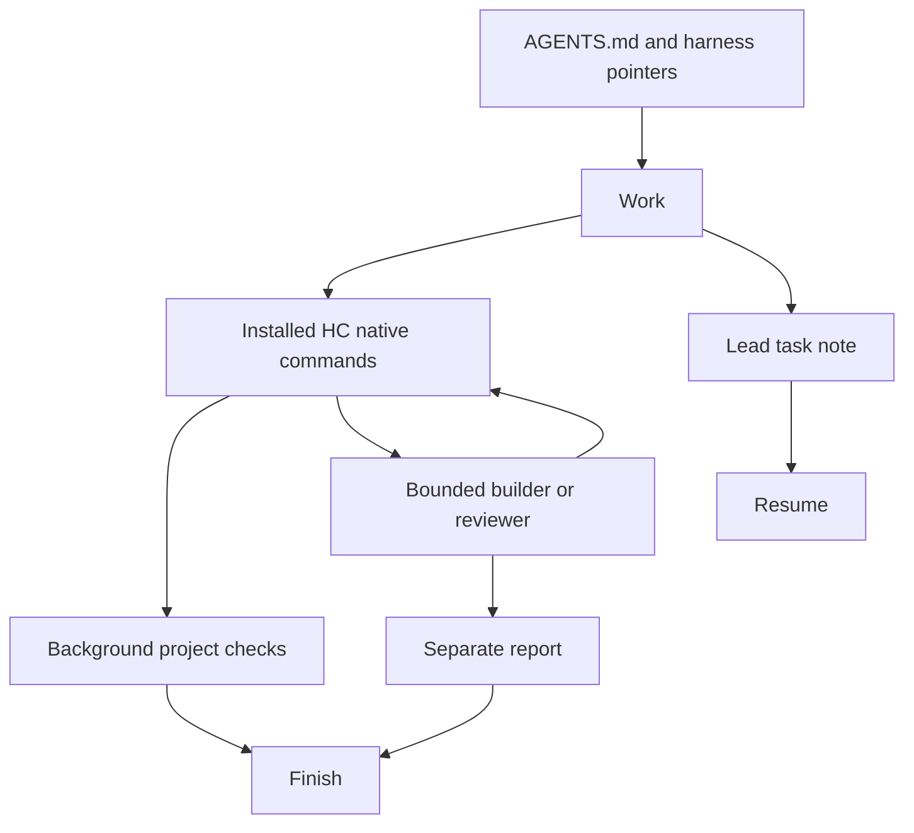
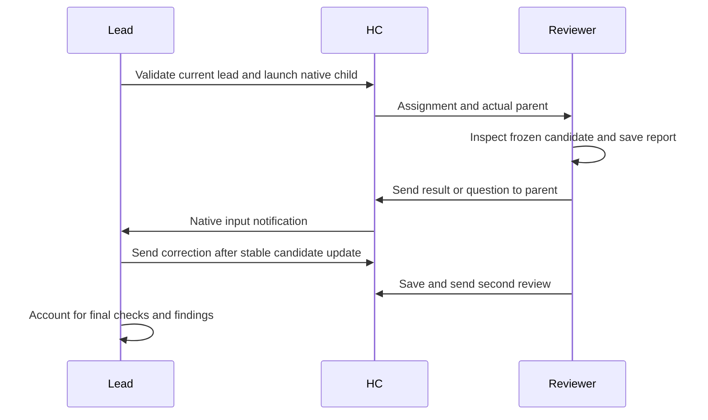

# Native HC instructions - Plan

## Goal Capsule

- Objective: An agent in the user's current Herdr terminal can complete approved software work, receive helpers' results, steer follow-up, and report checked outcomes in that conversation.
- Means: The instruction distribution and native HC contract in R1-R5.
- Authority: Issue [#348](https://github.com/douglasjarquin/sum/issues/348), the invoking user's instructions, target repository requirements, and preserved user merge authority.
- Execution profile: One coherent branch and open PR, with logical commits; no installation activation or merge.
- Stop conditions: A required source or protected contract cannot be preserved, unsafe implementation, or unresolved product conflict.
- Completion owner: This development conversation implements and publishes; the user merges and chooses adoption.

---

## Product Contract

### Summary

Replace Sum's application runtime with four discoverable working procedures, a short entry contract, and ordinary Markdown records.
Use native HC for launch, parentage, messaging, waiting, and lifecycle.

### Problem Frame

The audited runtime requires registration, dispatch, collection, receipts, and installation machinery between the user and an already capable HC terminal.
Issue #348 identifies those responsibilities as the mismatch and supplies the replacement behavior and acceptance scenarios.

### Requirements

**Core package**

- R1. Ordinary use requires no Sum executable, build, initialization, generated installation, operational state machine, or background service.
- R2. Provide Work, Review, Finish, and Resume procedures with shared harness pointers and a small task-note template.
- R3. A lead may implement directly or delegate bounded work; helpers retain their assigned roles and obey target repository instructions.
- R4. Concurrent source writers use separate worktrees, while tests and reviewers inspect an identified stable candidate including dirty and untracked inputs.

**Native communication**

- R5. Validate a nonempty actual lead HC address and installed contract before delegation; launch native children with parent-linked lifetime and notifications.
- R6. Each interactive helper receives a bounded brief, absolute procedure/work/report paths, actual immediate parent, explicit saved-report plus native-send obligation, and follow-up availability.
- R7. Ordinary test commands use native exit notification and inspected output; messages, waits, idle/done states, and successful sends alone do not establish completion.
- R8. Resolve uncertain launches/sends by inspection before any duplicate action; preserve busy, blocked, permission, timeout, interrupted-agent, and shell-recovery distinctions.
- R9. Preserve user-selected harnesses, accounts, models, permissions, capacity, source work, and publication authority.

**Records and support boundaries**

- R10. Keep a lead-owned task note and separate helper reports outside disposable checkouts, with decisions open/answered/applied and next resume action.
- R11. Remove obsolete runtime source, packaging, setup/update scripts, aliases, tests, dependencies, and active claims while keeping independent website and verification tools useful.
- R12. Preserve GROK_SUM.md, GROK_SQUARE.md, grok-bots/**, and skills/sum-factory/factories/{copy,software}.md unchanged; preserve the existing software lane through explicitly legacy pinned procedure references.
- R13. Adopt using an independent checkout between sessions; never mutate serving legacy installations, callbacks, records, worktrees, cores, or sessions.
- R14. Record actual native versions and evidence for every issue acceptance scenario, marking unrun scenarios honestly rather than substituting static/model-free proof.

### Key Decisions

- **Instructions replace runtime ownership.** Governs R1-R2, R5-R8, R10-R11 (session-settled: user-directed — chosen over retaining the Sum application control plane: the native HC communication loop is the product).
- **Independent adoption preserves legacy work.** Governs R12-R13 (session-settled: user-directed — chosen over live self-update or migration: running workers retain their installed callback helper).

### Scope Boundaries

No replacement collector, transport wrapper, registry, plugin framework, importer, automatic repair, compatibility bridge, cross-machine supervision, guaranteed unattended completion, or automatic session restoration.
Legacy updater maintenance and changes to predecessor issues are outside this task.
Authenticated native acceptance may remain unrun when the supported environment is absent, as issue Phase 1 explicitly permits.

---

## Planning Contract

### Key Technical Decisions

- KTD1. Keep canonical procedures at skills/sum-{work,review,finish,resume}/SKILL.md with relative .agents/skills and .claude/skills discovery symlinks; harness pointer files share AGENTS.md.
- KTD2. Preserve optional portable verification/evidence tools and relocate their existing behavior tests into tests/portable, a standalone Go test module without the runtime.
- KTD3. Delete runtime responsibilities from this development branch using recoverable trash, after inventorying callers; Git history retains historical source without shipping another runtime.
- KTD4. Replace public website copy in its existing layouts and routes, including install/update routes as native prerequisites and independent adoption guidance.
- KTD5. Keep the two Bot software-factory reference paths as short legacy guides linked to the immutable baseline, and label the unchanged Bot product as a separate legacy consumer.

### Assumptions

The locally inspected HC manual and upstream baseline define a candidate supported path, not authenticated qualification of all installed harnesses.
This API conversation lacks HC_TERMINAL_ID, so native message arrival and same-terminal authenticated lead acceptance are unavailable here.
The issue explicitly permits implementation and an honest acceptance gap in this environment.

### High-Level Technical Design

### Risks and System-Wide Impact

The largest risk is stale runtime dependency in retained tools, website claims, Bot references, and CI.
Inventory callers before deletion, retain independent behavior tests, audit local links, and independently review verification policy changes.
Native behavior varies by actual HC/app/harness artifact; no minimum version or live acceptance is inferred from a version string.
No independent installation or existing core is changed to manufacture acceptance.

---

## Implementation Units

### U1. Native working package

**Goal:** Deliver the ordinary entry and bounded helper procedures.
**Requirements:** R1-R10, R14.
**Dependencies:** None.
**Files:** AGENTS.md, skills/sum-work/SKILL.md, skills/sum-review/SKILL.md, skills/sum-finish/SKILL.md, skills/sum-resume/SKILL.md, .agents/skills/, .claude/skills/, templates/task.md, tests/test_instruction_package.py, docs/native-hc.md, docs/ACCEPTANCE.md.
**Approach:** Implement KTD1 with one owner per rule, absolute helper brief paths, native contract references, and a concise acceptance matrix.
**Patterns:** Existing canonical skill files and relative harness discovery links.
**Test scenarios:**
1. A fresh archive contains discoverable procedure links and no Sum startup command.
2. Missing HC identity gives supported-launch guidance without target-picker calls or invented identities.
3. Review and Finish require candidate stability and explicit results; Resume inspects shell/agent identity before reuse.
4. Native acceptance covers the complete issue matrix when possible and records exact unavailable prerequisites otherwise.
**Verification:** Offline packaging and local-link checks; human-independent instruction review; authenticated scenarios only where actually available.

### U2. Remove runtime and preserve independent tools

**Goal:** Ship no obsolete application core while preserving independent product tools and Bot contracts.
**Requirements:** R11-R13.
**Dependencies:** U1.
**Files:** go/, bin/, config/, lib/, scripts/, tests/, tests/portable/, mise-tasks/, mise.toml, .codex/hooks.json, .cursor/hooks.json, .grok/hooks/, skills/, docs/, skills/sum-dispatch/references/factory.md, skills/sum-work/references/factory.md.
**Approach:** Apply KTD2-KTD3 and KTD5 after concrete dependency inventory; keep fixture_git_env and evidence-publication behavior coverage.
**Patterns:** Existing portable skill tests and fixture isolation.
**Test scenarios:**
1. Portable scaffold, verification, audit, and evidence behavior tests still run without sumctl or runtime modules.
2. Bot files/shared settings compare byte-for-byte with baseline and legacy reference links remain readable.
3. Surviving active docs and hooks do not call removed runtime commands.
4. A fresh source archive needs no .local/.deps setup for ordinary entry.
**Verification:** Retained behavioral suites, packaging test, link audit, protected-file comparison, and source/runtime dependency search.

### U3. Public documentation and website

**Goal:** Present the same small native workflow across documentation and existing site routes.
**Requirements:** R1-R14.
**Dependencies:** U1-U2.
**Files:** README.md, CONTRIBUTING.md, docs/architecture.md, docs/update.md, docs/native-hc.md, docs/ACCEPTANCE.md, web/src/pages/, web/src/components/Side.astro, web/DESIGN.md, web/tests/e2e/.
**Approach:** Apply KTD4, keeping existing route/base-path and static-rendering contracts; retire stale historical runtime docs rather than publish contradictory instructions.
**Patterns:** SiteLayout, DocsLayout, sitePath, existing unit and Playwright tests.
**Test scenarios:**
1. All existing routes build under /sum/ and links resolve to retained source.
2. Desktop/mobile navigation, theme behavior, static content, and instructions match native prerequisites.
3. Install/update copy explains independent checkout adoption and the separate legacy Bot boundary.
**Verification:** Astro checks/unit/build, route assertions, Playwright and visual browser inspection where available.

### U4. Verification and acceptance handoff

**Goal:** Make the surviving package verifiable and limitations reviewable.
**Requirements:** R11-R14.
**Dependencies:** U1-U3.
**Files:** VERIFY.md, docs/features/, mise-tasks/verify, mise-tasks/lint, .github/workflows/verify.yml, docs/verification/issue-348.md.
**Approach:** Keep the portable runner and its policy-change detection, align the aggregate to retained suites, and record all unrun native scenarios explicitly.
**Patterns:** Existing canonical runner, feature maps, and GitHub Actions artifact upload.
**Test scenarios:**
1. The aggregate runs retained offline suites and website checks once without building Sum.
2. Policy changes require independent root review and do not self-certify.
3. Missing live evidence remains unrun in acceptance and the PR instead of appearing passed.
**Verification:** Canonical runner against merge base, audit, independent review of policy files, hosted CI after push.

---

## Verification Contract

Run targeted meaningful checks during iteration, then the canonical runner once on the final committed candidate with --base equal to the merge base of origin/main.
The adapted aggregate runs tests/portable behavioral tests, retained Python discovery, website check/unit/build, and all route assertions.
Use the repository's lint task, local-link/package checks, protected baseline comparisons, and browser E2E for the website.
Static checks do not qualify native parentage, authenticated conversations, real message delivery, interruption, or lifecycle recovery.
Record each issue acceptance row in docs/verification/issue-348.md with observed evidence or a specific not-run reason.
The PR states local proof, independent policy review, hosted CI, and native acceptance separately.

---

## Definition of Done

All four units are implemented with no abandoned runtime or replacement machinery in the shipped default.
Excluded contracts are unchanged and legacy software-factory references identify the pinned separate installation.
The fresh package, retained portable tools, and website pass their applicable checks; independent review findings are resolved or recorded durably.
An open pushed PR contains the changed product contract, removal/retention map, verification evidence, and honest remaining native acceptance limits.
No merge, legacy migration, installed update, or live terminal takeover occurs.
