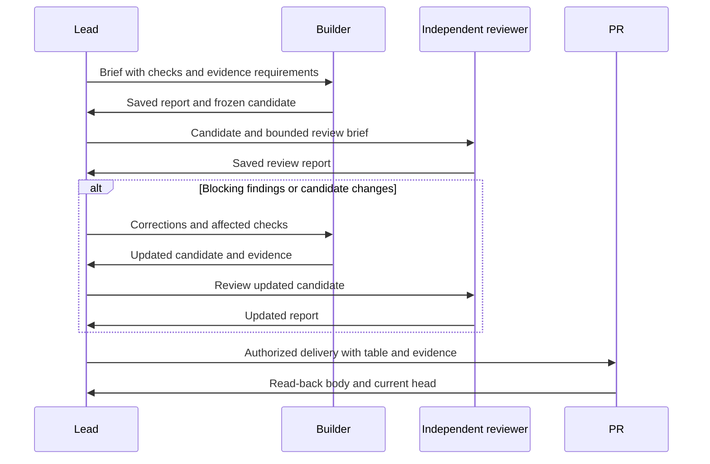
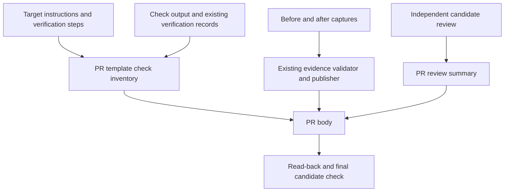

# Standardize Review and PR Evidence - Plan

## Goal Capsule

**Objective:** Doug can inspect any Sum-delivered PR and find independent review, the outcome of every prescribed verification step, and evidence of changed behavior regardless of the coding harness used.

**Means:** Strengthen existing Sum procedures and reuse portable evidence tooling with one shared PR template (KTD1–KTD3).

**Authority:** The confirmed user scope governs product behavior; repository instructions govern execution and preservation.
This plan authorizes no implementation, merge, deployment, or production adoption by itself.

**Execution profile:** One focused PR containing U1–U4.
The implementing session owns delivery and evidence accounting; a separate reviewer inspects the stable candidate.
Preserve pre-existing edits to `AGENTS.md`, `README.md`, `docs/architecture.md`, and `skills/sum-work/SKILL.md`.

**Stop conditions:** Required missing, failed, or stale review/evidence prevents a completion claim.
A clearly incomplete draft PR remains useful and permitted.

---

## Product Contract

### Summary

Restore independent review and standardized PR artifacts as ordinary Sum delivery requirements while retaining the native HC workflow.

### Problem Frame

The native-HC refactor retained the reviewer and evidence capabilities but weakened their connection to delivery.
`skills/sum-finish/SKILL.md` makes independent review conditional and asks only for a general verification description on PRs.
The evidence publisher also rejects comparisons containing only CLI/API text.
Doug must currently infer which checks happened and cannot consistently inspect before/after behavior from the PR.

### Requirements

**Review**

- R1. Every implementation candidate receives independent inspection by a separate reviewer after the builder reports completion, before Sum claims the task complete.
- R2. Blocking findings return to the builder, and the corrected frozen candidate receives affected verification and review again.
- R3. The PR identifies the reviewed candidate, review outcome, resolved or outstanding findings, and limitations without treating CI or a builder summary as independent review.

**Verification and behavior evidence**

- R4. Every delivered PR contains a consistent verification table accounting for every prescribed step from the target repository's instructions and verification contract, including referenced scenario maps where present.
- R5. Each row names its source, check or scenario, status, evidence, and limitations; distinguish passed, failed, blocked, not run, and not applicable with readable labels and status icons.
- R6. Changed visual behavior has comparable before/after screenshots; CLI and API behavior has comparable transcripts or HTTP request/response evidence.
- R7. Missing baselines and inapplicable visual evidence are labeled honestly, with a reason and available after evidence; neither becomes an invented before result or an implied pass.
- R8. Published evidence corresponds to the final candidate, remains accessible from the PR, and excludes secrets or unnecessary personal data.

**Delivery**

- R9. Missing required review, checks, or publication leaves delivery incomplete; an incomplete draft can still show the actual results and blockers.
- R10. The standard works across harnesses and target repositories through readable Sum instructions and shared templates, without a Sum runtime, mandatory startup installation, or replacement for native HC communication.
- R11. Local proof, hosted CI, authenticated native acceptance, and production acceptance remain distinguishable.

### Key Decisions

**Completion requires review and artifacts; draft sharing remains allowed** (session-settled: user-approved — chosen over treating a partial draft as completed delivery: missing proof must stay visible).
Governs R1, R9.

### Acceptance Examples

- AE1. Covers R1–R3: a builder reports done; the lead reads its report, launches a separate reviewer against that candidate, and routes a blocking finding back for correction instead of declaring completion.
- AE2. Covers R4–R5, R11: automated checks pass but a prescribed native scenario was never exercised; its table row says not run while the automated rows remain passed.
- AE3. Covers R6–R8: an API response changes; the PR shows redacted before/after request and response text without requiring a fabricated screenshot.
- AE4. Covers R7, R9: the base cannot run or attachment publication fails; the draft preserves available evidence and explains the gap without claiming complete delivery.
- AE5. Covers R2, R8: code changes after review or capture; old evidence stays identifiable as superseded and cannot satisfy the new candidate's completion requirements.

### Scope Boundaries

Keep excluded Grok Bot packs and historical plans untouched.
Do not backfill old PRs, modify HC, add a scheduler, or reintroduce persistent Sum lifecycle state.
Considered and not built: a new verification-record schema or mandatory table renderer, because the requested presentation can be provided by a canonical template and checked against existing records.
Reconsider only if behavioral acceptance shows that instruction-based table accounting is unreliable.

---

## Planning Contract

### Key Technical Decisions

- KTD1. **Put the review transition in Work and the completion rule in Finish.** `sum-review` already defines independent frozen-candidate inspection; reuse that role and the existing native send/report contract for R1–R3.
- KTD2. **Use one portable PR template.** Add `templates/pull-request.md`, referenced by Finish with an absolute resolved Sum path in downstream briefs, to implement R3–R5 without requiring target repositories to install a new skill stack.
- KTD3. **Extend the existing evidence publisher for text captures.** Its validation, candidate checks, redaction, body preservation, and receipts already address R6–R8; add text rendering to that boundary rather than a second publishing tool.
- KTD4. **Retain repository verification authority.** Derive table rows from the actual target instructions before running checks, and populate results from records or command output; the portable verifier remains optional tooling, not a prerequisite to using Sum.
- KTD5. **Publish through the already-authorized delivery role.** Builders capture evidence and reviewers inspect it; the role authorized to create/update the PR publishes and reads back the resulting body.

### High-Level Technical Design

### Existing Patterns and Constraints

`skills/sum-work/SKILL.md`, `skills/sum-review/SKILL.md`, and `skills/sum-finish/SKILL.md` own the native interaction and delivery flow.
`templates/task.md` already retains helper/check results; add only references needed for review and PR evidence, not a duplicate ledger.
`.agents/skills/verify/scripts/verify_run.py` produces candidate-bound `run.json` records and explicit unrun scenarios.
Automated scenario statuses are derived from the aggregate exit, so table evidence must label aggregate coverage and must not imply independently observed step execution.
`.agents/skills/evidence/scripts/evidence_publish.py` currently selects screenshot/video media and reports `no publishable after media` for text-only comparisons.
`tests/test_evidence_publish.py` and `tests/fixtures/gh_attach.py` provide publication tests with fake GitHub behavior.
`CONTRIBUTING.md` explicitly rejects restoring removed runtime machinery or mandatory prose bookkeeping.

### Risks and Dependencies

Public evidence can expose captured text; use the existing redaction and validation boundary before rendering text, and preserve originals separately.
The publisher's media path depends on installed GitHub attachment support; capability failures remain explicit publication blockers, not reasons to omit evidence.
Native HC acceptance requires a supported authenticated terminal at execution time; static tests cannot establish that an actual lead launches and receives a reviewer.
Current local edits overlap workflow files, so implementation must reconcile their intended behavior without overwriting unrelated changes.

---

## Implementation Units

### U1. Define the review handoff and uniform PR contract

**Goal:** Make review and artifact requirements discoverable from the ordinary workflow.
**Requirements:** R1–R5, R9–R11.
**Dependencies:** None.
**Files:** `skills/sum-work/SKILL.md`, `skills/sum-review/SKILL.md`, `skills/sum-finish/SKILL.md`, `templates/task.md`, new `templates/pull-request.md`, `tests/test_instruction_package.py`.

**Approach:**

1. Add the explicit builder-completion to reviewer-launch transition and correction loop under KTD1.
2. Give the template sections for behavior, independent review, verification, before/after evidence, and remaining limitations.
3. Define table columns as source/check, status, evidence, and limitations, with a compact shared status legend.
4. Resolve target check inventory before execution, including setup/readiness/teardown requirements when prescribed; grouped rows may reference complete scenario tables but must not hide omitted cases.
5. Keep one durable task note pointing to the reports and PR artifacts rather than reproducing the table everywhere.

**Patterns:** Existing frozen-candidate and native report requirements.
**Test seam:** Package tests catch missing procedure/template links and contradictory completion instructions; they do not prove agent behavior.

**Test scenarios:**

- Covers AE1: a documented builder-done path leads to independent review rather than directly to completion.
- Covers AE2: the template distinguishes all five statuses and requires a source/evidence explanation for non-pass outcomes.
- A target without the portable verification skill can follow its own instructions and populate the same PR sections.

**Verification:** All four procedure entry points remain discoverable; the shared template is readable through a Sum checkout from a different target repository.

### U2. Publish real CLI and API before/after evidence

**Goal:** Make text comparisons publishable using existing capture output.
**Requirements:** R6–R8.
**Dependencies:** U1 defines the presentation contract.
**Files:** `.agents/skills/evidence/scripts/evidence_publish.py`, `.agents/skills/evidence/SKILL.md`, `tests/test_evidence_publish.py`, `tests/fixtures/gh_attach.py` where needed.

**Approach:**

1. Reproduce the current text-only rejection using real CLI/API capture manifests before changing publisher behavior.
2. Accept validated textual evidence from those manifests and render escaped, labeled before/after fenced text with provenance in the existing managed block.
3. Keep screenshot/video presentation intact, allow mixed scenarios, and preserve existing hash/path/candidate/redaction checks.
4. Keep text-only publishing independent of media-attachment capability; media still uses the existing attachment path.
5. Bound PR inline content to the destination's supported size, using an explicit blocked publication result when complete text cannot be represented; never silently truncate proof.

**Patterns:** Existing `plan_scenario`, `render_block`, managed block splicing, and publisher read-back/reconciliation.
**Test seam:** Publisher tests prove content and failure behavior against the strict GitHub fake; live rendering still requires hosted acceptance.

**Test scenarios:**

- Covers AE3: real CLI and HTTP capture comparisons publish before/after text with command or request context and observed outcomes.
- Mixed media and text renders both, while a text-only plan uploads no image attachment.
- Covers AE4: unavailable baseline renders the explicit label and reason with after evidence.
- Altered hashes, wrong candidates, escaping paths, and secret-shaped content remain rejected or safely redacted under the existing contract.
- Repeat publication replaces the same managed block and preserves user prose.
- Oversized content produces a visible failure while retaining local proof and the prior PR body.

**Verification:** End-to-end capture-to-publication fixtures cover CLI and HTTP evidence without invented visual artifacts.

### U3. Wire evidence preparation and delivery into the procedures

**Goal:** Ensure evidence is captured early enough and published before completion.
**Requirements:** R2–R11.
**Dependencies:** U1, U2.
**Files:** `skills/sum-work/SKILL.md`, `skills/sum-review/SKILL.md`, `skills/sum-finish/SKILL.md`, `skills/sum-resume/SKILL.md`, `README.md`, `docs/architecture.md`, `docs/features/evidence.md`, `tests/test_instruction_package.py`.

**Approach:**

1. Add baseline/scenario selection to the initial worker brief so a before capture is not deferred until the base is lost.
2. Reference optional capture/publish tools by the available Sum checkout path while requiring equivalent artifacts even when another tool performs capture.
3. Have independent review inspect candidate/evidence correspondence and completeness of prescribed-check accounting.
4. Have Finish assemble the shared template, publish evidence under existing authority, read back the PR, and confirm the current head matches the reported candidate.
5. On resume, reconcile the current candidate with saved review and publication evidence before continuing; retain existing uncertain-send/write handling.
6. Reconcile optional-tool wording with mandatory delivery outcomes without introducing startup requirements.

**Test scenarios:**

- Covers AE5: candidate changes invalidate the previous review/evidence coverage and require refresh.
- Covers AE4: failed publication leaves an explicitly incomplete draft and retained evidence.
- A new feature with no runnable before state is represented honestly under R7.
- An implementation with no changed user-visible behavior gives a reasoned not-applicable evidence entry rather than fabricated captures.

**Verification:** A cold reader can follow entry instructions through capture, review, publication, and completion without relying on a particular coding skill stack.

### U4. Prove the workflow across harnesses and document its limits

**Goal:** Establish behavioral evidence for the delivery contract.
**Requirements:** R1–R11.
**Dependencies:** U1–U3.
**Files:** `docs/features/native.md`, `docs/features/verification.md`, `docs/features/evidence.md`, `docs/ACCEPTANCE.md`, new `docs/verification/review-pr-evidence.md`, `tests/test_instruction_package.py`, `tests/test_evidence_publish.py`.

**Approach:** Add mapped acceptance scenarios and record observed results from isolated native conversations and authorized disposable PRs.
Use at least two available harness/skill-stack combinations for the same delivery contract, recording exactly which combinations ran.
Exercise visual and API/CLI changes across the acceptance set.

**Test scenarios:**

- Covers AE1: an authenticated builder report causes a distinct reviewer launch and a substantive report reaches the lead.
- A reviewer finding causes correction and review of the updated candidate.
- Covers AE2–AE3: hosted PRs contain the same sections and status semantics across harnesses, including text and visual evidence.
- Covers AE4–AE5: unavailable baseline, unavailable publication, and changed candidate remain visible without a false completion claim.

**Test seam:** Native transcripts and hosted PR inspection prove behavior; package tests and fake GitHub tests cover only their respective structural and publication seams.
**Verification:** Record actual native addresses, candidate identities, report paths, published PR URLs, and any unrun combinations.

---

## Verification Contract

Begin implementation by reproducing the missing review/artifact behavior in a supported native task and the transcript-only publisher failure through its capture-to-publication path.
Do not change shared HC lifecycle or production settings for testing.

| Check | Command or evidence | Scope |
| --- | --- | --- |
| Package contracts | `python3 scripts/fixture_git_env.py -- python3 -m unittest discover -s tests -p 'test_instruction_package.py'` | Procedure and template discovery |
| Publication | `python3 scripts/fixture_git_env.py -- python3 -m unittest discover -s tests -p 'test_evidence_publish.py'` | Text/media validation and body preservation |
| Portable tools | `cd tests/portable && python3 ../../scripts/fixture_git_env.py -- go test ./...` | Existing capture and verifier behavior |
| Canonical verification | `MISE_ENABLE_TOOLS=go,python,node,aube python3 .agents/skills/verify/scripts/verify_run.py --base <merge-base>` | Final committed candidate and policy comparison |
| Independent policy review | Separate candidate-bound report | Instructions, feature maps, and evidence policy cannot certify themselves |
| Native and hosted acceptance | U4 evidence record and inspected PRs | Actual review handoff and cross-harness artifacts |

Follow `VERIFY.md` for setup, isolation, teardown, and hosted CI.
Run targeted checks during iteration and the canonical aggregate once for the final committed candidate; do not duplicate a full run solely because a different role reads it.
Native or hosted paths unavailable at execution time remain not run or blocked, with the task's acceptance incomplete unless the user changes that requirement.

---

## Definition of Done

- U1–U4 satisfy their verification outcomes and the PR accounts for all R1–R11 requirements.
- A separate reviewer has inspected the final candidate and resolved blocking findings.
- The PR uses the shared format and contains accessible, candidate-bound verification and before/after evidence.
- Actual CI, native acceptance, and any production limitations are reported separately.
- Existing local work, excluded Bot contracts, generated files, and changelogs remain preserved.
- Abandoned experimental code is removed from the delivered diff; evidence and unfinished work are retained conservatively.
- Merge and production adoption remain with the user.
