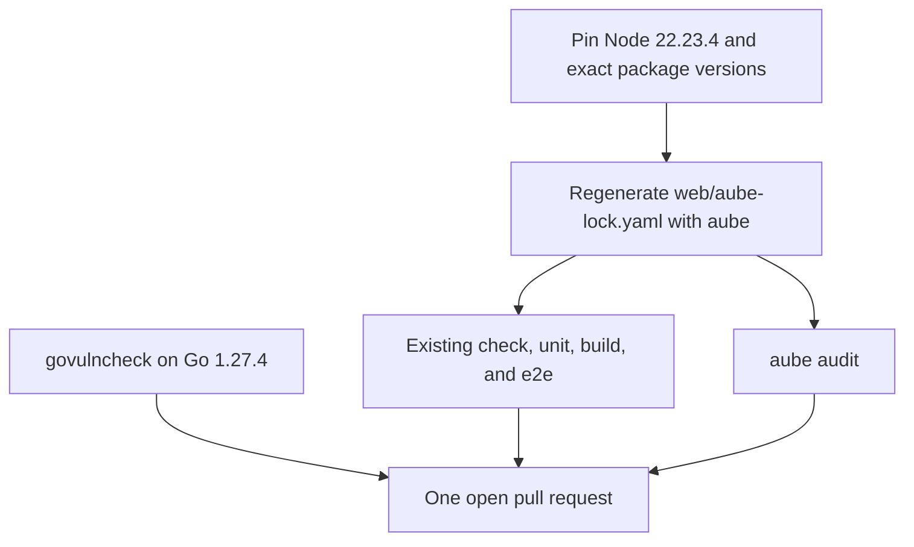

# Astro 7.4.12 Upgrade - Plan

## Goal Capsule

- **Objective:** The published Sum site is built with a current Astro release that includes the October 2026 XSS fixes, and dependency vulnerabilities that can be cleared without raising Go are cleared.
- **Means:** Pin Astro 7.4.12 and the current compatible Astro integrations, and raise the Node pin to the version that release requires (KTD1, KTD2).
- **Authority:** The requested release, the Go pin, the content freeze, and the single unmerged pull request win. Where a house rule says to leave the Node pin untouched, KTD1 wins because Astro 7.4.12 will not start on Node 22.20.0.
- **Execution profile:** Dependency and toolchain pin change. Existing checks are the proof. No new test suite and no new scanner in CI.
- **Stop conditions:** Stop if the only way forward edits published page copy, `web/public`, factory contracts, or `grok-bots/`. Stop if a fix would raise Go above 1.27.4. Stop if aube cannot install on Node 22.23.4. Stop if the work needs a second pull request, a merge, or a force-push. Stop before checking out or editing pull request #371's branch.
- **Finishes and ships:** The implementer opens one pull request against `main`. The user merges it. A `needs-root-review` verification result is expected and is not a merge.

---

## Product Contract

### Summary

The website moves to Astro 7.4.12 with compatible `@astrojs` packages and a lockfile regenerated by aube.
The same change fixes package-audit and govulncheck findings that can move without raising Go or editing published content.

### Problem Frame

The site pins `astro` at 7.3.1.
That release is older than the October 2026 fixes for GHSA-98hj-9722-w3j8 and GHSA-mpr7-6m5w-76rw.
The first advisory is patched in 7.3.2.
The second still covers 7.3.2 and is patched in 7.3.3.
The Node pin in `mise.toml` is 22.20.0.
Astro 7.4.12's package metadata and CLI both require Node `>=22.23.4`, so the current pin cannot run the requested release.

### Requirements

**Website release**

- R1. The website depends on astro 7.4.12.
- R2. Each direct `@astrojs` package is on a version compatible with astro 7.4.12.
- R3. `web/aube-lock.yaml` is regenerated by aube for those pins.
- R4. The existing typecheck, unit tests, production build, and end-to-end checks pass.

**Vulnerabilities**

- R5. Findings from `aube audit` are fixed in this change when an exact pin can fix them.
- R6. Findings from govulncheck are fixed when the fixed module still builds on Go 1.27.4.
- R7. A finding that cannot be fixed without raising Go, adding an override, or editing published content is recorded and left in place.
- R8. Go stays 1.27.4 in `mise.toml` and in both `go.mod` files.

**Protected work and delivery**

- R9. Published page copy, `web/public`, factory contracts, and `grok-bots/` stay byte-for-byte unchanged.
- R10. Pull request #371's branch and files stay unchanged.
- R11. The work is one open pull request against `main` and is not merged.

### Success Criteria

- A reader of the built pages still gets the same nine routes, the 404 page, and the same words.
- The pull request's required checks are green.
- The pull request body names the Astro version before and after, the `@astrojs` versions that changed, and each vulnerability that was fixed or left.

### Scope Boundaries

- In scope: `mise.toml`'s Node pin, `web/package.json`, `web/aube-lock.yaml`, site code only as KTD6 allows, and `tools/verify` module files only as KTD5 allows.
- Out of scope: published content and the byte-frozen trees in R9, the branch in R10, the Go and aube pins, and a merge or force-push.
- Out of scope: adding `aube audit` or govulncheck to `VERIFY.md`, `mise-tasks/`, or a workflow.
- Out of scope: editing `docs/features/site.md` when the routes and `sitePath()` stay as they are.
- Out of scope: a hand-edited lockfile, an npm or pnpm install, dropping `node-linker=hoisted`, new client JavaScript, a compatibility package, and `@astrojs/markdown-remark`.

#### Deferred to Follow-Up Work

- Adding `aube audit` and govulncheck to the verification inventory.
- Upgrading aube past 2.2.4.
- Moving Node past 22.23.4.
- Bumping Playwright, TypeScript, or `@types/node` when no audit finding requires it.

### Acceptance Examples

- AE1. Covers R1, R4, R9. Given the pins from KTD1 and KTD2 are installed, when the existing build and end-to-end checks run, the sitemap files are still `sitemap-index.xml` and `sitemap-0.xml` and the page words are unchanged.
- AE2. Covers R5. Given `aube audit` reports a direct dependency advisory with a fixed exact version that still satisfies R1 and R2, when that pin is updated, the next audit no longer reports it.
- AE3. Covers R6, R7, R8. Given govulncheck reports only a Go standard-library finding, the `go` directive stays 1.27.4 and the finding is named as remaining.

### Sources

- npm registry: `astro@7.4.12` engines `node >=22.23.4`, optional peer `@astrojs/markdown-remark`.
- GitHub Advisory Database: GHSA-98hj-9722-w3j8 / CVE-2026-114128, astro `< 7.3.2`, patched in 7.3.2. GHSA-mpr7-6m5w-76rw / CVE-2026-114127, astro `>= 7.1.0, <= 7.3.2`, patched in 7.3.3.
- Current `@astrojs` releases checked on the registry: `@astrojs/sitemap@3.7.5` and `@astrojs/check@0.9.12`.
- Sitemap guide: default output names `sitemap-index.xml` and `sitemap-0.xml`. https://docs.astro.build/en/guides/integrations-guide/sitemap/
- aube 2.2.4 documents an `audit` subcommand for its lockfile. `npm audit` and `pnpm audit` read different lockfile names.
- Repo: `web/package.json`, `web/astro.config.mjs`, `web/.npmrc`, `mise.toml`, `.github/workflows/verify.yml`, `.github/workflows/deploy.yml`.
- House rule for the website and the mise toolchain: (pack: house-rules, development.md).

---

## Planning Contract

### Key Technical Decisions

- KTD1. **Node 22.23.4.** Set `mise.toml` `node` from `22.20.0` to `22.23.4`, and set `web/package.json` `engines.node` to `>=22.23.4`. Leave `go` at `1.27.4` and `aube` at `2.2.4`. Astro 7.4.12 exits on Node 22.20.0 before check or build. Staying on that pin would keep the site off the requested release, and 7.3.2 is still inside GHSA-mpr7-6m5w-76rw. The workflows install Node from `mise.toml`, so they are not edited. `mise.toml` is a protected policy path, so `sum-verify` reports `needs-root-review` and exits 0.
- KTD2. **Integration pins.** Set `@astrojs/sitemap` to exact `3.7.5` and `@astrojs/check` to exact `0.9.12`. The current `3.7.4` and `0.9.10` declare no `astro` peer, so they already install beside 7.4.12. `3.7.5` is the current sitemap release and was built with astro 7.4.12. Its changelog does not change the default sitemap filenames for `trailingSlash: "always"`. `0.9.12` accepts TypeScript `^5.0.0 || ^6.0.0`, which the pinned `5.9.3` already meets. Keep astro itself at exact `7.4.12`.
- KTD3. **Lockfile owner.** Regenerate `web/aube-lock.yaml` with aube 2.2.4 only. Keep `web/.npmrc` as `node-linker=hoisted`. Do not hand-edit the lockfile. (pack: house-rules, development.md)
- KTD4. **Audit command.** `aube audit` is the package-manager audit for `web/aube-lock.yaml`. Do not use an autofix flag, an override, a second lockfile, or an ignore file. Do not add the command to CI. If the pinned aube binary has no `audit` subcommand, record that gap under R7 and do not switch auditors.
- KTD5. **Go scan.** Run govulncheck with `GOTOOLCHAIN=local` and the mise Go 1.27.4 in `tools/verify` and `tests/portable`, including tests. Install the scanner outside either module. Update a module only when its fixed version's go line is 1.27.4 or older. Do not add a `toolchain` line, do not raise either `go` directive, and do not give `tests/portable` a `go.sum`. Do not add the scanner to CI. A `tools/verify` module edit is a policy-path change, same outcome as KTD1.
- KTD6. **Content freeze.** The October advisories are fixed inside Astro, so page copy, `web/public`, JSON-LD text, and inline script bodies stay as they are. Edit a layout, config, or type reference only after check, build, or an existing test fails, and keep the rendered words and the sitemap filenames. Leave `sitemap()` with no options. Do not add `@astrojs/markdown-remark`, another integration, or client JavaScript. (pack: house-rules, development.md)
- KTD7. **Pull request #371.** Do not check out `sum-template-sync-20261115` and do not edit the `grok-bots/sum` files that pull request changed. The pull request is merged and does not touch `web/`.

### High-Level Technical Design

The Node pin is the gate. Package install, the site checks, and the two vulnerability scans follow it. Content files are not on the path unless a check fails under KTD6.

### Assumptions

- The compatible `@astrojs` versions in KTD2 are the newest registry releases that install with astro 7.4.12. Older pins would also install.
- Node `22.23.4` is the exact mise pin, not a later Node 22 release. If mise cannot install that version, the work stops.
- A Verify job that exits 0 and logs `needs-root-review` is the expected result of KTD1. It is not a failed check and it is not a merge.
- `docs/features/site.md` stays unchanged when the nine routes, the 404 page, and `sitePath()` stay.
- `@playwright/test` `1.62.1`, `typescript` `5.9.3`, and `@types/node` `25.2.3` stay unless KTD4 names a fixed exact version.

### Sequencing

U1 lands before U2 and U3.
U4 has no file dependency on U1 and still ships in the same pull request.
U2 does not edit site source until the existing checks have run once on the new pins.

### Risks & Dependencies

- Risk: `mise.toml` changes the Node version for every job that installs tools from that file, including verify and deploy. Mitigation: pin the Astro engine floor exactly, and leave the workflow files alone.
- Risk: `sum-verify` will not report `certified` after KTD1. Mitigation: treat exit 0 plus `needs-root-review` as the planned result and leave the pull request open for a human root review.
- Risk: `aube audit` or govulncheck may report a finding with no safe pin. Mitigation: follow R7. Do not add an override before the live command.
- Risk: a sitemap or `dist/` path change fails the route loop or `web/tests/e2e/home.spec.mjs`. Mitigation: keep `sitemap()` with no options, and do not edit `web/public/llms.txt` to follow a renamed file.
- Dependency: aube 2.2.4 and Node 22.23.4 must both be installed before the lockfile is regenerated.

---

## Implementation Units

### U1. Pin Node, Astro, and the integrations

- **Goal:** Node 22.23.4 can install astro 7.4.12, `@astrojs/sitemap` 3.7.5, and `@astrojs/check` 0.9.12 from an aube lockfile.
- **Requirements:** R1, R2, R3, R8
- **Dependencies:** none
- **Files:** `mise.toml`, `web/package.json`, `web/aube-lock.yaml`, `web/.npmrc`
- **Approach:**
  1. Apply KTD1 to the Node pin and `engines.node`. Do not change the `go` or `aube` pins.
  2. Install that Node and confirm it is v22.23.4 before any `astro` command.
  3. Apply KTD2 as exact specifiers.
  4. Regenerate the lockfile per KTD3.
- **Execution note:** This is packaging. The proof is a frozen install on Node 22.23.4, not a new unit test.
- **Patterns to follow:** Exact pins already in `web/package.json`. The earlier sitemap pin landed in the same commit as `web/aube-lock.yaml`.
- **Test scenarios:**
  - Happy path: the frozen install resolves astro 7.4.12, `@astrojs/sitemap` 3.7.5, and `@astrojs/check` 0.9.12, and `node` is v22.23.4.
  - Edge: `web/.npmrc` is still `node-linker=hoisted`, and the lockfile name is still `web/aube-lock.yaml`.
  - Error: if the Astro CLI says this Node is unsupported, correct the pin. Do not bypass the engine check.
  - Error: if npm or pnpm wrote the lockfile, delete that result and regenerate it with aube.
- **Verification:** The frozen aube install exits 0 on Node 22.23.4, and the three direct versions match KTD2.

### U2. Keep the existing site checks passing

- **Goal:** Typecheck, unit tests, the production build, and the existing browser checks pass without a content edit.
- **Requirements:** R4, R9
- **Dependencies:** U1
- **Files:** `web/astro.config.mjs`, `web/tsconfig.json`, `web/src/env.d.ts`, `web/src/layouts/SiteLayout.astro`, `web/src/layouts/DocsLayout.astro`, `web/src/components/Side.astro`, `web/src/lib/site-path.mjs`, `web/test/site-path.test.mjs`, `web/tests/e2e/home.spec.mjs`, `web/tests/e2e/docs.spec.mjs`, `web/tests/e2e/smoke.spec.mjs`, `web/tests/e2e/nav.spec.mjs`, `web/tests/e2e/assets.spec.mjs`, `web/tests/e2e/theme.spec.mjs`
- **Approach:** Run the existing checks on the U1 pins before editing. Apply KTD6 only to a file that a failure names. Keep `base: "/sum"`, `output: "static"`, `trailingSlash: "always"`, and `sitemap()` with no options. The build must still emit `web/dist/index.html`, `web/dist/404.html`, and `index.html` under `docs`, `install`, `architecture`, `verification`, `skills`, `configuration`, `herdr`, and `update`.
- **Execution note:** The existing suite is the characterization. Do not add a test file for an upgrade that does not change route behavior.
- **Patterns to follow:** `sitePath()` in `web/src/lib/site-path.mjs` for internal routes. `web/AGENTS.md` for the no-JavaScript page rule and the hoisted linker.
- **Test scenarios:**
  - Happy path: `astro check` passes, `web/test/site-path.test.mjs` passes, and the build emits the ten HTML files named above.
  - Happy path: `web/tests/e2e/home.spec.mjs` still finds `sitemap-index.xml` pointing at `sitemap-0.xml`, with nine locations under `https://douglasjarquin.github.io/sum/`. Covers AE1.
  - Edge: pages render with JavaScript disabled, and the theme toggle remains the only client script.
  - Error: a failure in `astro/client` or `astro/tsconfigs/strict` is fixed in the type reference, and no page under `web/src/pages/` changes.
  - Integration: the preview started the way `web/playwright.config.mjs` starts it still serves the `/sum/` routes.
- **Verification:** Check, unit, build, and the e2e suite pass. The diff does not touch `web/src/pages/`, `web/public/`, `grok-bots/`, or `skills/sum-factory/factories/`.

### U3. Clear aube audit findings

- **Goal:** `aube audit` for `web/` reports no remaining finding that an exact pin can fix.
- **Requirements:** R5, R7
- **Dependencies:** U1
- **Files:** `web/package.json`, `web/aube-lock.yaml`
- **Approach:** Run `aube audit` after U1. Move a named direct dependency to an exact fixed version when that version still satisfies R1, R2, and KTD2. Follow KTD4. Record anything left under R7 in the pull request body.
- **Execution note:** The advisory list is unknown until the command runs. Do not pre-build an override.
- **Patterns to follow:** KTD3 for any later lockfile rewrite.
- **Test scenarios:**
  - Happy path: `aube audit` reports no vulnerabilities.
  - Error: a finding whose only fix is an override, an ignore entry, or a package the site does not use stays unpatched and is named in the pull request. Covers R7.
  - Edge: Playwright, TypeScript, or `@types/node` moves only when the audit names that package and the new exact version still satisfies its peers.
- **Verification:** A second `aube audit` matches the fixed and remaining set recorded for the pull request.

### U4. Clear govulncheck findings on Go 1.27.4

- **Goal:** Both Go modules are scanned, and every module finding with a fix that stays on Go 1.27.4 is applied.
- **Requirements:** R6, R7, R8
- **Dependencies:** none
- **Files:** `tools/verify/go.mod`, `tools/verify/go.sum`, `tests/portable/go.mod`
- **Approach:** Follow KTD5. Scan before editing. A clean scan finishes the unit with no file changes. If `tools/verify` needs a qualifying module bump, update that module only and re-run its tests. `tests/portable` stays free of third-party requirements.
- **Execution note:** Scan first. A standard-library finding is a recorded remainder, not a Go upgrade.
- **Patterns to follow:** The current `go 1.27.4` lines and the single requirement `github.com/BurntSushi/toml` in `tools/verify/go.mod`.
- **Test scenarios:**
  - Happy path: both govulncheck runs report no vulnerabilities.
  - Error: a standard-library finding stays, both `go` directives stay 1.27.4, and the finding is named in the pull request. Covers AE3.
  - Edge: `tests/portable` does not gain a `go.sum` or a third-party requirement.
  - Integration: if `tools/verify` changes, `go test ./...` in that module still passes. The verification outcome may be `needs-root-review`.
- **Verification:** Repeat both scans. Both `go` directives are still 1.27.4. `mise.toml` `go` is still `1.27.4`.

---

## Verification Contract

Run these from the repository root after U1, and again on the committed candidate. `mise run verify` is the aggregate. The deploy workflow's browser job is separate because verify does not run Playwright.

| Check | Command | Proves |
| --- | --- | --- |
| Node pin | `mise install` then `node -v` | The runtime is v22.23.4 before Astro runs |
| Frozen install | `aube -C web install --frozen-lockfile` | `web/aube-lock.yaml` matches the pins |
| Typecheck | `aube -C web run check` | `astro check` accepts the site |
| Unit | `aube -C web run test:unit` | `web/test/site-path.test.mjs` |
| Build | `aube -C web run build` | The ten route HTML files exist under `web/dist/` |
| Lint | `mise run lint` | Go formatting and vet for both modules |
| Aggregate | `mise run verify` | Go tests, Python tests, frozen install, check, unit, build, and route files |
| Canonical | `.agents/skills/verify/scripts/sum-verify run --base <merge-base>` | Same aggregate, bound to the committed candidate. Expect `needs-root-review` and exit 0 after KTD1 |
| Deploy install | `aube -C web ci` | The lockfile also installs the way deploy.yml installs it |
| Browser | `aube -C web run test:e2e` | Existing Playwright specs, after Chromium is installed for that job |
| Package audit | `aube audit` from `web/` | R5 and R7 |
| Go audit | `govulncheck ./...` and `govulncheck -test ./...` in `tools/verify` and in `tests/portable`, with `GOTOOLCHAIN=local` | R6, R7, and R8 |

`mise run web:deps` is the one-time Chromium install the repo already documents. It is not a new gate.

---

## Definition of Done

- R1 through R11 hold. Remaining findings under R7 are written in the pull request body.
- The diff does not include `web/src/pages/`, `web/public/`, `grok-bots/`, `skills/sum-factory/factories/`, `VERIFY.md`, `docs/features/`, `.github/workflows/`, or pull request #371's branch.
- Generated trees `web/dist/`, `web/node_modules/`, `web/.astro/`, `web/test-results/`, and `web/playwright-report/` are not committed.
- Abandoned edits and experimental lockfiles are not in the diff.
- U1's frozen install, U2's check, unit, build, and e2e, U3's second audit, and U4's second scans have been run on the candidate that the pull request contains.
- One pull request is open against `main`. It is not merged and its branch was not force-pushed.
- Required CI on that pull request is green. `needs-root-review` in the verify log is acceptable.
